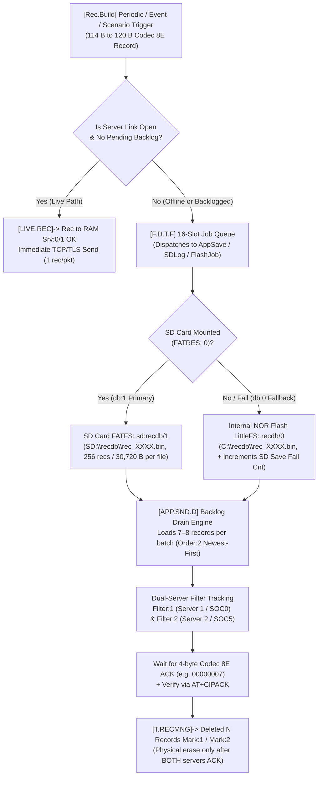
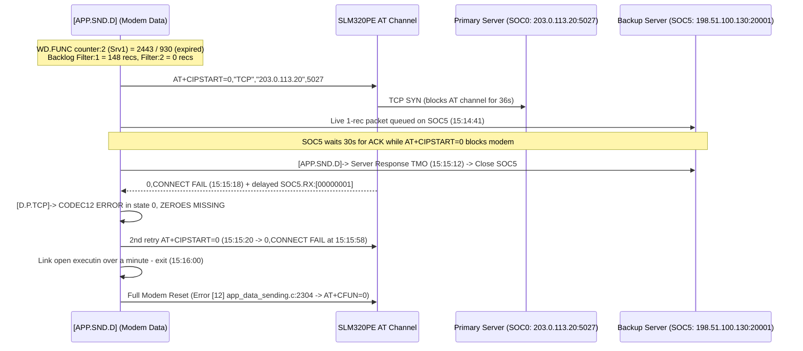

# Teltonika FMC650 — Core Functionalities, Runtime Architecture & Critical Errors Reference

This reference document synthesizes the internal runtime architecture, core subsystems, and critical failure modes of the **Teltonika FMC650** professional telematics unit, derived directly from UART/USB debug telemetry across 13 laboratory debugging sessions (`2026-10-27` to `2026-10-31`).

---

## Part 1 — Core Functionalities & Runtime Architecture

### 1.1 Hardware Platform & Boot Pipeline

| Subsystem | Hardware / Firmware Component | Firmware Log Tag | Key Specifications & Telemetry Signatures |
|---|---|---|---|
| **Main MCU** | ARM Cortex-M MCU (`CPU ID: EB:86:75:5D:D7:49:1E:35:00:00:00:00`) | `[HW.INIT]`, `[INIT]` | Bootloader `65.10`, Firmware `03.01.01.Rev.15`, Hardware Revision `HW:17` (`HW:170`). |
| **Internal NOR Flash** | XTX 16 MB SPI NOR Flash (`Device ID: 0B4018`) | `[Flash.Driver]`, `[LFS]` | 4,096 blocks × 4 KB = 16 MB. Mounted via LittleFS (`[LFS]-> Storage Size: 4096 blocks`). Stores configuration (`C:\@cfg\settings.set`), internal record DB (`recdb/0` at `C:\recdb\`), and crash dumps. |
| **External MicroSD** | FATFS-mounted removable SD card (`SD:` volume) | `[SD.API]` | Stores primary high-capacity AVL database (`sd:recdb/1` at `SD:\recdb\`), COM1 buffer (`sd:com1db`), and persistent odometer (`sd:odosd`). |
| **Cellular Modem** | MeiG Smart `SLM320PE` LTE Cat 1 / 2G Fallback | `[MODEM]`, `[M.INIT]`, `[OPER]` | FW `SLM320PE_TK_BE9863A_20230220_V51_U09` (`SLM320PE_TK_V51_U09`). Controlled over internal UART via AT commands + mbedTLS (`[MBED.PRNT]`). |
| **GNSS Receiver** | Airoha / MediaTek `AG3335M` Multi-GNSS | `[GPS]`, `[GPS.INIT]` | FW `AG3335M_V1.7.1_20220328`, HW `AG3335M_V1.0`. Controlled via proprietary `$PAIR` NMEA sentences (`$PAIR002`, `$PAIR513`, `$PAIR023`). |
| **BLE Co-Processor** | ST BlueNRG (`BlueNRG_APP_v0.1.1`) | `[NRF]` | BLE MAC `38:8a:21:9c:42:d0`. Polled periodically via `[NRF]-> Echo test` -> `[NRF]-> Echo rsp received`. |
| **3-Axis Accelerometer** | Internal MEMS Accelerometer (`AXL:3`) | `[AXL.CLBR]`, `[Movement]` | Auto-gravity calibration (`[AXL.CLBR]G Vector Count:0 Calibrated:YES`), drives movement detection, EcoDriving, Crash, and Towing scenarios. |
| **Vehicle Buses** | Dual CAN (`CAN1`, `CAN2`), FMS/J1939, J1708, K-Line, LVCAN | `[CAN]`, `[FMS]`, `[J1708]`, `[TACHO]` | Supports silent/active CAN监听, tachograph `.ddd` downloads (`[TACHO.MNG]`), and J1708 bus scanning. |
| **Battery-Backed RAM** | Persistent diagnostic & crash counters | `[BATRAM.INFO]`, `[BAT.RAM]` | Retains reset cause counters (`PowerOn`, `BrownOut`, `Watchdog`, `Soft`, `HardFault`, `MemFault`, `BusFault`, `UsageFault`), `SD Save Fail Cnt`, and last crash site (`file:line`, `arg`, `tid`). |

#### Boot Sequence (`[INIT]` & `[HW.INIT]`)
1. **Early Hardware Bring-up (`[HW.INIT]`)**: Initializes GPIO pins, UARTs, SPI NOR flash (`Device ID: 0B4018`), LittleFS (`[LFS]` 4,096 blocks), and battery-backed RAM (`[BATRAM.INFO]`).
2. **Database Recovery (`[T.RECMNG]`)**:
   - Scans `recdb/0` on internal flash (`C:\recdb\`) and `sd:recdb/1` on SD (`SD:\recdb\`).
   - Reconstructs read/write file indices (`First File`, `Last File`, `Write Offset`, `Read Offset`, `TotalRecCnt`).
   - If an unclosed `.bin` record file is found after an ungraceful reset, logs `m2m_recmng_internal_api.c:rec_file_read:1012` (`File not finished don't erase`) and preserves its records.
3. **Configuration Load (`[CFG]`)**: Reads `C:\@cfg\settings.set` and verifies backup integrity (`settings backup success: 104a3c02`).
4. **Peripheral & RTOS Task Start**: Starts all 33 RTOS task slots, powers on GNSS (`$PAIR002*38`), mounts SD card (`FATRES: 0` when present, `FATRES: 3` when absent), and initiates the cellular modem state machine (`[M.INIT]`).

---

### 1.2 RTOS Task Architecture (33 Task Slots)

Every 60 seconds during periodic diagnostics, the firmware dumps all active FreeRTOS/CMSIS-RTOS tasks, their stack pointers (`SP`), watermarks (`Max`/`Total`), and task watchdog timers (`[WDG.TASK]`).

| Task ID | Task Name | Stack Size | Watchdog Timeout (`tmo`) | Core Responsibility |
|---:|---|---:|---:|---|
| `0` | `[AppSave]` | `4608 B` | `180 s` | Primary application loop: processes queued jobs from `[F.D.T.F]`, manages ignition/movement state transitions, builds periodic/event AVL records, and dispatches storage writes (`[T.RECMNG]`). |
| `1` | `[CAN1]` | `1280 B` | `180 s` | CAN1 bus controller and frame filter management. |
| `2` | `[CAN2]` | `1280 B` | `180 s` | CAN2 bus controller and frame filter management. |
| `3` | `[Dsleep]` | `1280 B` | `180 s` | Sleep / Deep Sleep / Online Deep Sleep power-saving state machine (`PID 102`). |
| `4` | `[EventQ]` | `2560 B` | `180 s` | Asynchronous system event dispatcher. |
| `5` | `[WDG]` | `1280 B` | `180 s` | Hardware & software watchdog supervisor (`m2m_task_watchdog.c`, `[MTX.WDG]`, `[WD.FUNC]`). |
| `6` | `[Uart]` | `2560 B` | `180 s` | External RS232/RS485/USB UART router and command parser. |
| `7` | `[Modem.Rx]` | `3072 B` | `180 s` | Cellular modem UART receive parser (processes unsolicited result codes `+CIPRXGET`, `+CPIN`, `CONNECT OK`, etc.). |
| `8` | `[AxlDProc]` | `1664 B` | `180 s` | Accelerometer digital signal processing, gravity calibration (`[AXL.CLBR]`), and green driving/crash evaluation. |
| `9` | `[AxlReader]` | `1280 B` | `180 s` | High-rate MEMS accelerometer FIFO reader. |
| `10` | `[Scheduler]` | `2560 B` | `180 s` | 1-second system scheduler: drives `[Per.T]` periodic checks, ignition voltage evaluation, `Settings` checks, and timers. |
| `11` | `[HBeat]` | `768 B` | `180 s` | System heartbeat LED and liveness monitor. |
| `12` | `[Oper]` | `3072 B` | `180 s` | Cellular operator selection, roaming profile evaluation, CREG/CGREG registration, and RSSI/CSQ polling. |
| `13` | `[TcpCmd]` | `2560 B` | `180 s` | Codec 12 / GPRS command receiver and parser (`[D.P.TCP]`). |
| `14` | `[SmsE]` | `2560 B` | `180 s` | SMS command & event processor. |
| `15` | `[TachoSend]` | `2048 B` | `180 s` | Tachograph `.ddd` file upload session handler (`[TACHO.MNG]`). |
| `16` | `[TachoMain]` | `2048 B` | `180 s` | Tachograph CAN/K-Line bus state machine (`[TACHO]`). |
| `17` | `[SDLog]` | `2560 B` | `300 s` | SD card FATFS worker thread (`[SD.API]` jobs: `db:sd:recdb`, `db:sd:com1db`, `db:sd:odosd`, `eSD_JobRemoveBattery`). |
| `18` | `[FlashJob]` | `2048 B` | `1800 s` | Internal SPI NOR flash LittleFS worker thread (`flash_api.c`, `recdb/0`, `C:\@cfg\settings.set`). |
| `19` | `[Modem Data]` | `3072 B` | `180 s` | Dual-server TCP/UDP/TLS socket manager and AVL packet transmitter (`[APP.SND.D]`, `[DATA]`, `[SOCKET]`). |
| `20` | `[Trace Task]` | `1536 B` | `180 s` | Debug log formatting and USB/COM trace output multiplexer. |
| `22` | `[UPD task]` | `2560 B` | `1800 s` | FOTA (Firmware Over-The-Air) update manager. |
| `23` | `[SiD Gen]` | `1792 B` | `180 s` | FMS / J1939 / OBD Parameter ID generator. |
| `24` | `[Sid Tim]` | `1792 B` | `180 s` | FMS / J1939 timing and request scheduler. |
| `25` | `[BTLE.API]` | `2048 B` | `180 s` | Bluetooth Low Energy (`[NRF]`) manager and beacon/sensor scanner. |
| `27` | `[LVCAN.API]` | `2048 B` | `180 s` | Teltonika LV-CAN200 / ALL-CAN300 UART protocol handler. |
| `28` | `[TDM.APP]` | `2560 B` | `180 s` | Telematics Data Manager application orchestrator. |
| `29` | `[OneWire]` | `1536 B` | `180 s` | 1-Wire bus reader (iButton, Dallas temperature sensors; logs `[1WIRE]-> Check Health`). |
| `30` | `[MCAN]` | `2048 B` | `180 s` | Manual CAN reader and CAN frame aggregation. |
| `31` | `[GPS.T]` | `2048 B` | `180 s` | NMEA parser, `$PAIR` command controller, PDOP/HDOP filter, and Static Navigation filter. |
| `999` | `Main Stack` | `2048 B` | N/A | Bare-metal ISR and kernel startup stack (`0x2002f800`). |

---

### 1.3 Synchronization & Mutex Watchdog (`[MTX.WDG]`)

The firmware tracks **17 named kernel mutexes** under a **1,800-second (30-minute)** ceiling (`[MTX.WDG]`). Every periodic dump reports for each mutex:
- `<elapsed>/1800`: seconds since the mutex was last taken or released.
- `W:<line>`: source code line number of the task currently **Waiting** for the mutex (`W:0` if no waiter).
- `T:<line>`: source code line number that last **Took** the mutex.
- `R:<line>`: source code line number that last **Released** the mutex.
- `Tcnt` / `Rcnt`: cumulative take/release counters (mod 65536). When `Tcnt == Rcnt + 1`, the mutex is currently held (`F:N`).
- `F:Y` / `F:N`: whether the mutex is currently **Free** (`Y`) or **Held/Locked** (`N`).

| Mutex Name | Subsystem Protected | Typical Take/Release Lines (`T` / `R`) | Contention Risk Observed in Logs |
|---|---|---|---|
| `process` | Core event/process state transitions | `T:62 R:80` | Held during brownout/config writes (`F:N`, up to 168 s in Session 02). |
| `modem` | AT command channel to SLM320PE | `T:167 R:196` | Contended during slow `AT+CIPSTART` (36 s timeout) or `AT+CIPACK`. |
| `config` | In-memory configuration parameter table | `T:1403 R:1430` | Taken on every parameter read/write. |
| `AVLBUF` | Shared AVL record creation & serialization buffer | `T:985 R:1049` (`T:759 R:1049`) | **High Risk**: Held (`F:N`) during ignition-flapping storms while `AppSave` and `Modem Data` contend for record packing (`Session 01`, `Session 13`). |
| `REC.WRT` | Record database write serialization (`recdb/0`, `sd:recdb/1`) | `T:1491 R:1544` (`T:1126 R:1174`) | **High Risk**: Serializes every record write and `attr:7006` update. |
| `dtask` | Dynamic task / job dispatcher queue (`[F.D.T.F]`) | `T:169 R:205` | Contended when `[F.D.T.F]` 16-slot queue overflows. |
| `FLock` | LittleFS / SPI NOR Flash driver lock | `T:68 R:93` | Blocks callers during flash sector erases (`flash_api.c`). |
| `Spec` | Special functions / scenario state lock | `T:733 R:789` | Low contention. |
| `CAN.UPD` | CAN bus state & IO table lock | `T:1619 R:1632` | Taken several times per second during CAN polling. |
| `TLS.RB` | mbedTLS ring buffer lock | `T:0 R:0` | Used when TLS encryption is active on sockets. |
| `dmem` | Dynamic heap allocator lock | `T:119 R:136` | High frequency (`Tcnt` > 30,000), very short hold duration. |
| `LVCAN` | LV-CAN peripheral lock | `T:102 R:117` | Low contention. |
| `BLEnRF` | BlueNRG SPI/UART communication lock | `T:639 R:645` | Taken every 30 s for `[NRF]-> Echo test`. |
| `SPEC.TSK` | Scenario worker task lock | `T:213 R:219` | Low contention. |
| `Tacho` | Tachograph state & K-Line/CAN lock | `T:2513 R:2547` | Taken every second for tacho timer checks. |
| `USB` | USB CDC trace & configurator lock | `T:122 R:135` | Taken on every USB log write or Configurator packet. |
| `Settings` | Persistent settings file (`C:\@cfg\settings.set`) lock | `T:527 R:571` | **Critical Deadlock Risk**: In `Session 02`, locked at `T:527` while waiter blocked at `W:571` (`Tcnt:37 Rcnt:36 F:N`) for 221 s, starving Task 10 (`[Scheduler]`) and crashing the CPU (`arg=21`). |

---

### 1.4 Three-Tier Watchdog Architecture

The FMC650 enforces liveness at three distinct layers:

1. **Tier 1 — RTOS Task Watchdog (`[WDG.TASK]`, `m2m_task_watchdog.c:93`)**:
   - Evaluated by Task 5 (`[WDG]`) in **45-second increments** (`tmo: 0/180 -> 45/180 -> 90/180 -> 135/180 -> 180/180`).
   - If a monitored task fails to check in before its `tmo` reaches its limit (`180 s` for standard tasks, `300 s` for `SDLog`, `1800 s` for `FlashJob`/`UPD task`), Task 5 writes a crash record to battery RAM and triggers an immediate software reset:
     - `arg=46`: Task 0 (`[AppSave]`) stalled for 180 s (observed in [01_2026-10-28_0833_ignition_flapping_appsave_watchdog_crash_arg46.txt](./01_2026-10-28_0833_ignition_flapping_appsave_watchdog_crash_arg46.txt) and [13_2026-10-27_1916_battery_brownout_ignition_flapping_appsave_watchdog_crash.txt](./13_2026-10-27_1916_battery_brownout_ignition_flapping_appsave_watchdog_crash.txt)).
     - `arg=21`: Task 10 (`[Scheduler]`) stalled for 180 s waiting on `Settings` mutex (observed in [02_2026-10-28_0843_settings_mutex_scheduler_watchdog_crash_arg21_and_recovery.txt](./02_2026-10-28_0843_settings_mutex_scheduler_watchdog_crash_arg21_and_recovery.txt)).
     - `arg=53`: Task watchdog reset signature recorded in `[Per.T]-> Periodic info: Up:0h :93 Arg:53 U:5` prior to [03_2026-10-28_1224_dual_server_flash_backlog_drain_arg53.txt](./03_2026-10-28_1224_dual_server_flash_backlog_drain_arg53.txt).
2. **Tier 2 — Mutex Watchdog (`[MTX.WDG]`)**:
   - Supervises all 17 mutexes with an `1800 s` ceiling. Note that because Tier 1 (`[WDG.TASK]`) has a `180 s` limit on `AppSave` and `Scheduler`, a mutex deadlock on `AVLBUF`, `REC.WRT`, or `Settings` triggers a Tier 1 Task Watchdog reset at `180 s` long before Tier 2 reaches `1800 s`.
3. **Tier 3 — Function Watchdog (`[WD.FUNC]`)**:
   - Tracks high-level subsystem progress using 4 counters (`counter:0` through `counter:3`):
     - `counter:0` (`Limit:900` s): Modem / SIM / Operator initialization watchdog (`State:1` when SIM is missing or registration fails; resets to `State:0 Val:0` once operator connects).
     - `counter:1` (`Limit:21600` s = 6 h): Long-term periodic supervision timer (`State:0`).
     - `counter:2` (`Limit:930` s = 15.5 min): **Server 1 (Primary) Data Sending Watchdog** (`State:1`). Resets to `1` every time a packet is acknowledged by Server 1 (`SOC0`). When Server 1 is unreachable (as in [04_2026-10-31_1502_primary_server_tcp_tls_timeout_and_full_modem_reset.txt](./04_2026-10-31_1502_primary_server_tcp_tls_timeout_and_full_modem_reset.txt)), `counter:2` climbs past `930` (`2443 / 930`), and upon the next failed connection cycle triggers `[APP.SND.D]-> Can't Establish communication with GPRS on - Full Modem reset` (`Error [12] M:app_data_sending.c L:2304`).
     - `counter:3` (`Limit:930` s = 15.5 min): **Server 2 (Backup/Duplicate) Data Sending Watchdog** (`State:1`). Resets to `1` on every ACK from Server 2 (`SOC5`).

---

### 1.5 Data Acquisition, Dual-Database Storage & Backfill Pipeline



1. **Record Generation (`[Rec.Build]`)**:
   - Periodic timers (`MinPeriod`, `SendPeriod`) or I/O events (`New Igniton state`, `Movement`, `EcoDriving`, `OverSpeeding`) trigger `[Rec.Build]-> Start building record by event X` and output a **Codec 8 Extended** record (`record size: 114 bytes` or `120 bytes`).
2. **RAM Fast-Path (`[LIVE.REC]`) vs Persistent Storage (`[T.RECMNG]`)**:
   - When a server's TCP socket is already open and its backlog count is `0`, the firmware bypasses flash/SD wear for that server via `[LIVE.REC]-> Rec to RAM Srv:0 OK` / `Rec to RAM Srv:1 OK` and transmits a 1-record packet (`135 bytes` total Codec 8E frame) immediately.
   - Simultaneously, or whenever a server is disconnected/backlogged, the record is written to persistent storage:
     - **With MicroSD Mounted (`FATRES: 0`)**: Saved to `sd:recdb/1` (`[T.RECMNG]-> Save to db:1 rec size: 120`).
     - **Without MicroSD (`FATRES: 3`) or during SD Failure**: Saved to internal NOR flash `recdb/0` (`[T.RECMNG]-> Save to db:0 rec size: 120`). If SD is expected/configured, each fallback increments `[BATRAM.INFO]` `SD Save Fail Cnt`.
3. **256-Record File Segmentation**:
   - Both `recdb/0` and `sd:recdb/1` store records in sequential binary files (`rec_0001.bin`, `rec_0002.bin`, ...) capped at **256 records per file** (`256 × 120 B = 30,720 B` or `256 × 114 B = 29,184 B`).
   - When the 256th record is written (`Write Offset: 30600 -> 30720`), `[T.RECMNG]` closes the current file (`Closed file handle: 0`) and opens `Last File + 1`.
4. **Dual-Server Filter & Mark Bitmask (`Filter:1` / `Filter:2`, `Mark:1` / `Mark:2`)**:
   - Every stored record carries a delivery bitmask for each configured server:
     - **Bit 0 (`Filter:1` / `Mark:1`)**: Server 1 (Primary Server on `SOC0`).
     - **Bit 1 (`Filter:2` / `Mark:2`)**: Server 2 (Backup/Duplicate Server on `SOC5`).
   - When Server 1 acknowledges 7 records (`SOC0.RX:[00000007]`), `[T.RECMNG]-> Deleted 7 Records Mark:1` clears Bit 0. The records remain physically on disk for Server 2 (`Filter:2`) until Server 2 also acknowledges them (`Deleted 7 Records Mark:2`).
5. **Dual-Database Interleaved Draining (`Order:2` Newest-First)**:
   - When records exist in **both** `sd:recdb/1` and `recdb/0` (e.g., after an SD card was temporarily unavailable or during startup before SD mounted), `[T.RECMNG]` drains `db:1` (SD) and `db:0` (Flash) concurrently, packing 7 to 8 records per TCP packet (`855` to `975` bytes) in `Order:2` (**Newest-First**, configured via `PID 100` = `1`).

---

### 1.6 Cellular Modem & Dual-Socket Transport (`MeiG SLM320PE`)

- **Socket Allocation Table (`[SOCKET]`)**:
  - The modem driver exposes 7 socket handles (`0..6`).
  - **Handle `0` (`SOC0`)**: Dedicated to **Primary Server (Server 1)** (`203.0.113.10:20332` in Oct 27–28 sessions; `203.0.113.20:5027` in Oct 31 TLS test).
  - **Handle `5` (`SOC5`)**: Dedicated to **Backup/Duplicate Server (Server 2)** (`ch0000000.flespi.gw:20001` -> `198.51.100.30:20001` / `198.51.100.130:20001`).
- **Connection & TLS Handshake**:
  - Uses `AT+CIPSTART=<id>,"TCP","<host>",<port>` (or mbedTLS wrapper when TLS is enabled, attempting to load `z:\cert\root.pem` via `[MBED.PRNT]`).
  - **Important Shared-UART Constraint**: All sockets share a single AT command parser (`modem` mutex). While `AT+CIPSTART=0` is blocking waiting for a TCP SYN-ACK (up to 36–40 seconds per attempt), incoming data or ACKs on `SOC5` (`+CIPRXGET`) cannot be serviced until the blocking command finishes.
- **Delivery Verification**:
  - After `AT+CIPSEND=<id>,<len>`, the firmware polls `AT+CIPACK=<id>` (`+CIPACK: <sent>,<acked>,<unacked>`) to confirm TCP-layer acknowledgment before reading the 4-byte application-layer Codec 8E response via `AT+CIPRXGET=2,<id>,4`.

---

### 1.7 Power, Ignition & Battery Management (`[BAT.POWER.MAN]`, `[Ignition]`)

- **Ignition Detection State Machine (`[Ignition]`)**:
  - Supports bitmask sources:
    - `src:2` (`DIN1` digital input physical line)
    - `src:128` (`Power Voltage` comparator against configured Low/High thresholds, e.g., `12000 mV` / `20000 mV` or `13200 mV` / `30000 mV`)
    - `src:130` (`DIN1 | Power Voltage` combined)
  - Every transition logs `[Ignition]-> New Igniton state: <0|1>, src:<mask> [D:<din> V:<volt> C:<can> M:<mov> R:<rpm>]` and triggers:
    1. `[Odometer]-> FSM Reset`
    2. `[T.RECMNG]` write of attribute `7006` (persistent ignition state/counter) to Flash/SD
    3. High-priority eventual AVL record build (`[Rec.Build]`)
- **Battery Charger & Brownout Hibernate (`[BAT.POWER.MAN]`)**:
  - Monitors external supply (`Ext:<mV>`) and internal 2-cell Li-ion backup battery (`UBat:<mV>`, nominal `7.4 V – 8.4 V`, temperature `Temp:<0.1°C>`).
  - States: `FastCharge`, `ChargeDone`, `Discharging`, `Bad Power:5`, and `Hibernate State 2` (`pwr_manager_cng_states.c:60`).
  - When external voltage collapses below ~8.5 V (`Ext:7669 mV` to `8577 mV`), the power manager attempts to unmount/protect the SD card via `eSD_JobRemoveBattery` and transition to `Hibernate State Waiting for PowerGood`.

---

## Part 2 — Critical Errors, Failure Signatures & Root Causes

### 2.1 Master Catalog of Critical Errors Observed Across Debugging Sessions

| # | Critical Error Signature in Logs | Source File & Line | Severity | Root Cause & Mechanism | Sessions Affected |
|---:|---|---|---|---|---|
| **E1** | `[CPU RESET]->CPU reset has been initiated: 46, m2m_task_watchdog.c:93` (`[WDG.TASK]-> Task: 0, timeout: 180 s`) | `m2m_task_watchdog.c:93` (`arg=46`, Task `0 [AppSave]`) | **CRITICAL (Crash / Reboot)** | **Ignition Flapping + Flash/SD I/O Starvation**: Rapid voltage oscillation around the 12.0 V threshold (`Ext:8.5V–12.0V`) triggers >300 ignition transitions/min. Each transition forces `[Odometer]->FSM Reset`, `attr:7006` Flash/SD writes, and record generation, locking `AVLBUF` and `REC.WRT` mutexes, overflowing the 16-slot `[F.D.T.F]` queue, driving CPU load to 87%, and starving Task 0 (`[AppSave]`) for 180 s. | [Session 01](./01_2026-10-28_0833_ignition_flapping_appsave_watchdog_crash_arg46.txt), [Session 13](./13_2026-10-27_1916_battery_brownout_ignition_flapping_appsave_watchdog_crash.txt) |
| **E2** | `[CPU RESET]->CPU reset has been initiated: 21, m2m_task_watchdog.c:93` (`[WDG.TASK]-> Task: 10, timeout: 180 s`) | `m2m_task_watchdog.c:93` (`arg=21`, Task `10 [Scheduler]`) | **CRITICAL (Crash / Reboot)** | **`Settings` Mutex Deadlock during Concurrent Config Save & Brownout**: While writing `C:\@cfg\settings.tmp` -> `settings.set` during brownout/ignition flapping, the `Settings` mutex (`T:527 R:571`) remains locked (`Tcnt:37 Rcnt:36 F:N`) for 221 s. Task 10 (`[Scheduler]`) blocks at `W:571` for 180 s and trips the task watchdog (`arg=21`). | [Session 02](./02_2026-10-28_0843_settings_mutex_scheduler_watchdog_crash_arg21_and_recovery.txt) |
| **E3** | `[Per.T]-> Periodic info: Up:0h :93 Arg:53 U:5` | `m2m_task_watchdog.c:93` (`arg=53`, Task `5 [WDG]`) | **CRITICAL (Crash / Reboot)** | **Task Watchdog Reset (`arg=53`)**: Recorded in persistent `BATRAM` periodic info prior to `Session 03`, indicating another RTOS task exceeded its watchdog timeout under heavy dual-server flash I/O + SD failure fallback. | [Session 03](./03_2026-10-28_1224_dual_server_flash_backlog_drain_arg53.txt) |
| **E4** | `[Per.T]-> Periodic info: Up:1h flash_api.c:590 Arg:27 U:18` | `flash_api.c:590` (`arg=27`, Task `18 [FlashJob]`) | **HIGH (Flash Subsystem Reset)** | **Internal SPI NOR Flash API Timeout / Error**: Task 18 (`[FlashJob]`) encountered a flash operation failure or timeout at `flash_api.c:590` (`Arg:27`) while fallback-writing records to `recdb/0` with no SD card mounted (`SD Save Fail Cnt: 1898+`). | [Session 04](./04_2026-10-31_1502_primary_server_tcp_tls_timeout_and_full_modem_reset.txt) |
| **E5** | `[F.D.T.F]-> Full can't process 16 job` | Dynamic Task / Job Queue (`[F.D.T.F]`) | **HIGH (Dropped Internal Jobs)** | **16-Slot Asynchronous Job Queue Saturation**: When Flash (`recdb/0`) or SD (`sd:recdb/1`) writes take longer than the incoming rate of ignition/odometer/record events, the 16-entry ring buffer fills completely and drops subsequent jobs (255 times in Session 01; 212 times in Session 02). | [Session 01](./01_2026-10-28_0833_ignition_flapping_appsave_watchdog_crash_arg46.txt), [Session 02](./02_2026-10-28_0843_settings_mutex_scheduler_watchdog_crash_arg21_and_recovery.txt), [Session 05](./05_2026-10-27_1206_post_softreset_boot_and_ignition_flapping_com.txt), [Session 06](./06_2026-10-27_1256_ignition_flapping_and_job_queue_overflow.txt), [Session 13](./13_2026-10-27_1916_battery_brownout_ignition_flapping_appsave_watchdog_crash.txt) |
| **E6** | `[APP.SND.D]-> Can't Establish communication with GPRS on - Full Modem reset` / `Error [12] M:app_data_sending.c L:2304` | `app_data_sending.c:2304` & `L:1275` | **HIGH (Full Modem Power Cycle)** | **Primary Server Unreachable + Function Watchdog Escalation (`WD.FUNC counter:2 > 930`)**: Primary server (`203.0.113.20:5027`) fails TCP connect (`0,CONNECT FAIL` twice over >60 s). Because `WD.FUNC counter:2` is at `2443/930`, the firmware tears down GPRS (`AT+CGACT=0`, `AT+CIPSHUT`) and power-cycles the entire modem (`AT+CFUN=0`), interrupting the working Backup Server (`SOC5`) as collateral damage. | [Session 04](./04_2026-10-31_1502_primary_server_tcp_tls_timeout_and_full_modem_reset.txt) |
| **E7** | `[D.P.TCP]-> CODEC12 ERROR in state 0, ZEROES MISSING` & `Server Response TMO` on `SOC5` | `app_data_sending.c` / `[D.P.TCP]` | **MEDIUM-HIGH (Backup Socket Collateral Drop)** | **Shared AT Channel Head-of-Line Blocking**: While `AT+CIPSTART=0` blocks the modem UART for 36 s trying to reach dead Server 1, Server 2 (`SOC5`) sends a live packet at `15:14:41` and cannot read its `00000001` ACK before its 30 s `Server Response TMO` expires at `15:15:12`. When `00000001` finally arrives during socket teardown at `15:15:18`, the Codec 12 parser misinterprets the 4-byte ACK as a malformed Codec 12 command frame. | [Session 04](./04_2026-10-31_1502_primary_server_tcp_tls_timeout_and_full_modem_reset.txt) |
| **E8** | `[MBED.PRNT] Trying to parse z:\cert\root.pem` -> `[MBED.PRNT] Get file size error` | mbedTLS Certificate Loader (`[MBED.PRNT]`) | **MEDIUM (TLS Certificate Missing)** | **Missing or Empty Root CA File in `z:\cert\root.pem`**: When TLS/SSL is enabled or probed during socket initialization, mbedTLS attempts to read `z:\cert\root.pem` from the certificate partition and fails because no Root CA bundle has been uploaded to the device via Configurator/FOTA. | [Session 02](./02_2026-10-28_0843_settings_mutex_scheduler_watchdog_crash_arg21_and_recovery.txt) |
| **E9** | `[T.RECMNG]-> ERROR: m2m_recmng_internal_api.c:rec_file_read:1012` / `File not finished don't erase` | `m2m_recmng_internal_api.c:1012` | **MEDIUM (Unclean Reboot Recovery)** | **Unclosed Record File After Watchdog or Brownout Reset**: When a reset occurs while a `.bin` record file in `recdb/0` or `sd:recdb/1` has fewer than 256 records and has not been finalized, the boot scanner flags line 1012 and refuses to erase the file so unacknowledged records are preserved. | [Session 02](./02_2026-10-28_0843_settings_mutex_scheduler_watchdog_crash_arg21_and_recovery.txt), [Session 05](./05_2026-10-27_1206_post_softreset_boot_and_ignition_flapping_com.txt), [Session 11](./11_2026-10-27_1628_power_loss_rtc_2022_recovery_and_flash_backlog_drain.txt) |
| **E10** | `[BAT.PWR.M]-> Busy, can't execute:eSD_JobRemoveBattery job` & `Error [2] M:pwr_manager_cng_states.c L:60` | `pwr_manager_cng_states.c:60` | **MEDIUM-HIGH (Brownout SD Contention)** | **Brownout Hibernate While SD Worker is Busy**: External supply drops below ~8.5 V (`Ext:7669–8577 mV`), causing the power manager to request `eSD_JobRemoveBattery` to safely park the SD card before entering `Hibernate State 2`. Because `SDLog` is already saturated with ignition-flapping writes, the request is rejected (`Busy`). | [Session 02](./02_2026-10-28_0843_settings_mutex_scheduler_watchdog_crash_arg21_and_recovery.txt), [Session 13](./13_2026-10-27_1916_battery_brownout_ignition_flapping_appsave_watchdog_crash.txt) |
| **E11** | `SD card mount not OK. FATRES: 3` & climbing `SD Save Fail Cnt: 190 -> 1963` | `[SD.API]` / `[BATRAM.INFO]` | **MEDIUM (SD Card Missing / Contact Fault)** | **FATFS `FR_NOT_READY (3)`**: MicroSD card is either physically absent, unseated in its tray, or unresponsive. Every record save falls back to `recdb/0` (internal 16 MB NOR flash) and increments `SD Save Fail Cnt` in `BATRAM`. | [Session 03](./03_2026-10-28_1224_dual_server_flash_backlog_drain_arg53.txt), [Session 04](./04_2026-10-31_1502_primary_server_tcp_tls_timeout_and_full_modem_reset.txt), [Session 09](./09_2026-10-27_1449_stable_dual_server_baseline_flash_only.txt), [Session 10](./10_2026-10-27_1451_network_outage_sim_removal_flash_buffering.txt) |
| **E12** | `Error [4] M:modem_status.c L:68` -> `Error [4] M:modem_init.c L:328` (`SIM init failure!`) | `modem_status.c:68`, `modem_init.c:328` | **MEDIUM (SIM Absent / Dual-SIM Switch Loop)** | **SIM Card Not Detected (`+CPIN: NO SIM`)**: After 5 retries over ~15 s, the modem init state machine aborts, triggers `Switch SIM -> 1` (attempting to switch to SIM slot 2), powers off the modem (`MODEM OFF, caller 805`), and restarts the loop until a valid SIM responds. | [Session 02](./02_2026-10-28_0843_settings_mutex_scheduler_watchdog_crash_arg21_and_recovery.txt), [Session 10](./10_2027-10-27_1451_network_outage_sim_removal_flash_buffering.txt) |
| **E13** | `[GPS.INIT] Warning check failed -> GNSS stays on` | `[GPS.INIT]` | **LOW-MEDIUM (GNSS Power Override)** | When ignition turns OFF or brownout occurs while GNSS warning conditions exist (or sleep mode is disallowed), the GNSS receiver stays powered on, increasing current draw on the internal battery. | [Session 01](./01_2026-10-28_0833_ignition_flapping_appsave_watchdog_crash_arg46.txt), [Session 02](./02_2026-10-28_0843_settings_mutex_scheduler_watchdog_crash_arg21_and_recovery.txt) |

---

### 2.2 Detailed Failure Cascade Diagrams

#### Cascade A: Brownout / Unstable Bench Supply -> Ignition Flapping -> Watchdog Crash (`arg=46` or `arg=21`)

```mermaid
sequenceDiagram
    participant PSU as External Supply (Ext)
    participant Ign as [Ignition] & [Odometer]
    participant Queue as [F.D.T.F] (16-Slot Queue)
    participant DB as [T.RECMNG] & Mutexes (AVLBUF / REC.WRT / Settings)
    participant WDG as Task 5 [WDG] (m2m_task_watchdog.c:93)

    PSU->>Ign: Voltage sags to 8.4V–8.6V (below 12.0V Power Voltage threshold)
    loop 300+ times per minute
        Ign->>Ign: Flip state 1 <-> 0 (src:128 Power Voltage vs src:2 DIN1)
        Ign->>Ign: [Odometer]-> FSM Reset
        Ign->>Queue: Enqueue attr:7006 write + Eventual Record build
    end
    Queue->>DB: Continuous Flash/SD writes lock REC.WRT, AVLBUF, or Settings mutex
    Queue-->>Ign: [F.D.T.F]-> Full can't process 16 job (250+ drops)
    Note over DB,WDG: CPU 5m load hits 87%; Task 0 [AppSave] or Task 10 [Scheduler] blocked >180s
    WDG->>WDG: [WDG.TASK]-> Task 0 (or 10), timeout: 180 s
    WDG->>PSU: [BAT.RAM]-> Save crash site + [CPU RESET] (arg=46 or arg=21)
```

#### Cascade B: Unreachable Primary Server -> Shared Modem Blocking -> Backup Server Drop -> Full Modem Reset



---

### 2.3 Actionable Remediation Checklist

1. **Eliminate Ignition Flapping (`src:128` vs `src:2`)**:
   - Configure **Ignition Source** exclusively to **Digital Input 1 (`DIN1`, value `2`)** if hardwired ignition is used, or widen the **Power Voltage Ignition** hysteresis window (`Low < 11,500 mV`, `High > 13,200 mV`) and keep bench power supplies strictly at **`13.8 V – 14.4 V` (current limit >= 2 A)**.
2. **Prevent Primary Server Outages from Resetting the Modem When Backup Server is Healthy**:
   - In `Session 04`, Primary Server `203.0.113.20:5027` was unreachable from the m2m.sim2 APN (`internet.m2m.sim2.dz`), causing `WD.FUNC counter:2` to trigger a full modem reset every ~15.5 minutes and severing the healthy Flespi backup connection (`198.51.100.130:20001`).
   - Verify firewall/NAT rules and public reachability on `203.0.113.20:5027`, or set Flespi (`198.51.100.130:20001`) as **Primary Server** when testing on public APNs that cannot route to `203.0.113.20`.
3. **Provision `z:\cert\root.pem` Before Enabling TLS**:
   - Upload the required Root CA certificate (`root.pem`) via Teltonika Configurator (`Security -> Certificates`) so `[MBED.PRNT]` does not fail with `Get file size error`.
4. **Lock SIM Slot to SIM 1 When Single SIM is Installed**:
   - Disable automatic SIM switching when only SIM 1 is populated so transient `+CPIN: NO SIM` events during brownouts do not trigger `Switch SIM -> 1` and unnecessary modem power-down cycles.
5. **Inspect MicroSD Slot Mechanical Seating**:
   - Whenever `SD Save Fail Cnt` increments (`190` in Session 03; `1963` in Session 04) alongside `FATRES: 3`, reseat or format the industrial FAT32 MicroSD card so high-rate logging does not wear out the 16 MB internal NOR flash (`recdb/0`) or trigger `flash_api.c:590` resets.
