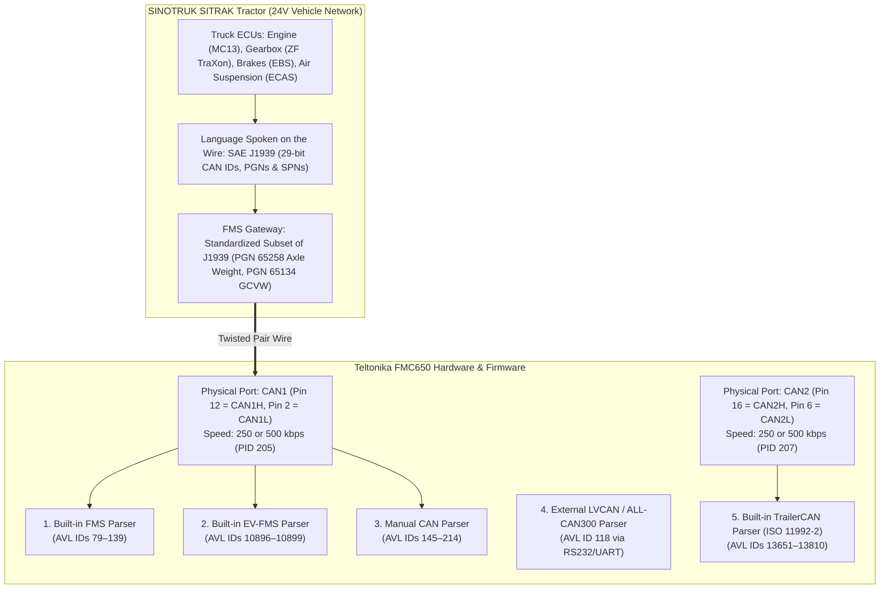

# 01 — CAN1, SAE J1939, FMS, LVCAN & EV-FMS Architecture + The 15 FMS Axle Slots

This document explains the physical and protocol layers of the **Teltonika FMC650** CAN architecture (`CAN1` vs `CAN2`, `SAE J1939`, `FMS`, `LVCAN`, `EV-FMS`, and `Manual CAN`), lists the **16 official FMS Weight parameters**, and explains why J1939 provides **15 Axle Weight slots (`AVL ID 89–103`)**.

---

## 1. The 5-Layer Truck CAN Architecture

---

### Layer 1: `CAN1` & `CAN2` (The Physical Hardware Ports on the FMC650)
* **What they are:** The physical electrical pins on the 20-pin black connector of the FMC650.
* **Why the FMC650 has two (`CAN1` and `CAN2`):**
  * **`CAN1` (Pin 12 = `CAN1 High`, Pin 2 = `CAN1 Low`):** Dedicated to the **Truck Tractor's primary network** (Engine, ZF TraXon Gearbox, Dashboard, Tractor Suspension).
  * **`CAN2` (Pin 16 = `CAN2 High`, Pin 6 = `CAN2 Low`):** Dedicated to the **Trailer's ISO 11992-2 network** (WABCO TEBS E modulator via the 7-pin ISO 7638 cable) or the Digital Tachograph.
* **Key Configurator Settings (`CAN \ Tachograph` tab):**
  * **`CAN1 Bus Speed` (`PID 205`):** Set to **`250 kbps`** (classic J1939/FMS) or **`500 kbps`** (modern SINOTRUK SITRAK C7H / Euro 6).
  * **`CAN1 Bus Mode` (`PID 206`):**
    * `0 = Silent` (Listen-only; safe, zero electrical disturbance to the truck).
    * `1 = Normal` (Two-way; required only if you enable **Locked FMS Request** or **Tachograph DDD download**).
  * **`CAN1 Termination Resistance` (`PID 216`):** `120 Ω` internal resistor (`0 = OFF` when tapping into an existing truck bus that already has two `120 Ω` terminators).

---

### Layer 2: `SAE J1939` (The Language Spoken by Heavy Trucks)
* **What it is:** The global communication standard created by the Society of Automotive Engineers (SAE) for heavy trucks (SINOTRUK SITRAK, Volvo, Scania, MAN, DAF, Mercedes).
* **How it works:** Instead of wiring a separate analog cable for every gauge, all ECUs on the truck (`0x00` Engine, `0x03` Gearbox, `0x0B` Brakes, `0x2F` Air Suspension ECAS) share two twisted wires (`CAN High` and `CAN Low`) and broadcast 8-byte digital packets identified by a **29-bit CAN ID**.
* **The two core J1939 terms:**
  1. **`PGN` (Parameter Group Number):** The **"Envelope / Topic ID"** of the 8-byte message.
     * Example 1: **`PGN 65258` (`0x00FEEA`)** = *"Vehicle Weight (Individual Axle, Trailer & Cargo Weights)"*.
     * Example 2: **`PGN 65134` (`0x00FE6E`)** = *"Combination Vehicle Weight (Powered Vehicle & Gross Combination Weight)"*.
  2. **`SPN` (Suspect Parameter Number):** The **"Specific Variable"** inside those 8 bytes.
     * Inside `PGN 65258` (`0x00FEEA`):
       * **Byte 1 (`SPN 928`):** `Axle Location` (Which axle number `1..15` this message is reporting).
       * **Bytes 2–3 (`SPN 582`):** `Axle Weight` (`0.5 kg/bit` resolution).
       * **Bytes 4–5 (`SPN 583`):** `Trailer Weight` (`2 kg/bit` resolution).
       * **Bytes 6–7 (`SPN 584`):** `Cargo Weight` (`2 kg/bit` resolution).
     * Inside `PGN 65134` (`0x00FE6E`):
       * **Bytes 1–2 (`SPN 1585`):** `Powered Vehicle Weight` (`10 kg/bit`).
       * **Bytes 3–4 (`SPN 1760`):** `Gross Combination Vehicle Weight` (`10 kg/bit`).

---

### Layer 3: `FMS` (Fleet Management System Standard — `AVL IDs 79–139`)
* **What it is:** In 2002, the 6 major European truck makers (Volvo, Scania, MAN, DAF, Mercedes, Iveco) created the **FMS Standard**—an official, standardized subset of SAE J1939 so GPS trackers like the FMC650 wouldn't have to reverse-engineer every truck model.
* **How it works on the FMC650:**
  * When you enable **`FMS`** on `CAN1` (`PID 210 = 0`), the FMC650 firmware automatically listens for standard FMS PGNs (`PGN 65258`, `PGN 65134`, `PGN 61444`, `PGN 65265`, etc.), applies the J1939 scaling math (`× 0.5 kg` or `× 10 kg`), and outputs ready-to-use **FMS Elements (`AVL ID 79–139`)**.

---

### Layer 4: `EV-FMS` (Electric & Extended Vehicle FMS — `AVL IDs 10896–10899`)
* **What it is:** A newer extension of the FMS standard (**FMS 4.0 / 5.0**) added to FMC650 firmware (`03.01.01.Rev.15`) to decode additional J1939 SPNs that the classic FMS parser previously ignored!
* **Why `EV-FMS` matters even on Diesel Sitrak Trucks:**
  * Even though Teltonika named the tab **"EV-FMS"**, the weight parameters inside it (`AVL ID 10896, 10897, 10898, 10899`) actually decode the remaining bytes of standard J1939 **`PGN 65258`** and **`PGN 65134`** that classic FMS (`AVL ID 89–103`) left out:
    * **`AVL ID 10896` (`IoId 90750`):** `Trailer Weight` (`SPN 583` — Bytes 4–5 of `PGN 65258`)
    * **`AVL ID 10897` (`IoId 90760`):** `Cargo Weight` (`SPN 584` — Bytes 6–7 of `PGN 65258`)
    * **`AVL ID 10898` (`IoId 90770`):** `Powered Vehicle Weight` (`SPN 1585` — Bytes 1–2 of `PGN 65134`, Tractor alone)
    * **`AVL ID 10899` (`IoId 90780` / `48940`):** `Gross Combination Vehicle Weight` (`SPN 1760` — Bytes 3–4 of `PGN 65134`)

---

### Layer 5: `LVCAN` (`LV-CAN200` / `ALL-CAN300` — `AVL ID 118`) vs `Manual CAN` (`AVL ID 145–214`)
* **`LVCAN` (`AVL ID 118`, `IoId 45860` — `CAN Adapter Axle Weight 1`):**
  * Used **only** when an external Teltonika `LV-CAN200` or `ALL-CAN300` adapter box is wired to the FMC650's serial port (mostly for light commercial vans like Renault Master, Iveco Daily, Mercedes Sprinter, or construction machinery that do not have heavy-truck J1939 FMS).
  * On a heavy truck wired directly to `CAN1`, **`AVL ID 118` stays empty** (disabled in `P2_PRODUCTION_v1.2`).
* **`Manual CAN` (`AVL ID 145–214`, `IoId 52000+`):**
  * Allows the FMC650 to read **any raw 29-bit or 11-bit CAN ID** directly off `CAN1` or `CAN2` if a Chinese truck ECU broadcasts axle weight or airbag pressure on a proprietary PGN outside standard FMS.

---

## 2. The 16 Official FMS Weight Parameters (`CAN1`)

When we talk about **"FMS Weight"** in the Teltonika FMC650, there are **exactly 16 parameters** in the `FMS Elements` group (`15` Individual Axle Weights + `1` Gross Combination Vehicle Weight):

| # | Configurator Name (`FMS IO` Tab) | `.cfg` Base `IoId` (`P2_v1.2`) | Wire `AVL ID` | Official Flespi Parameter | Wialon Key (`Path A`: Stream) | Wialon Key (`Path B`: Direct) | J1939 Source (`PGN` & `SPN`) |
| :-: | :--- | :---: | :---: | :--- | :--- | :--- | :--- |
| **1** | **`Axle weight 1`** (`Axle 1 load`) | `45290` / `46100` (`Low`) | **`89`** | `can.axle.weight.1` (`fms_axle_load_1`) | **`can_axle_weight_1`** | `io_89` | `PGN 65258` (`SPN 928=1`, `SPN 582`) |
| **2** | **`Axle weight 2`** (`Axle 2 load`) | `45300` / `46110` (`Low`) | **`90`** | `can.axle.weight.2` (`fms_axle_load_2`) | **`can_axle_weight_2`** | `io_90` | `PGN 65258` (`SPN 928=2`, `SPN 582`) |
| **3** | **`Axle weight 3`** (`Axle 3 load`) | `45310` / `46120` (`Low`) | **`91`** | `can.axle.weight.3` (`fms_axle_load_3`) | **`can_axle_weight_3`** | `io_91` | `PGN 65258` (`SPN 928=3`, `SPN 582`) |
| **4** | **`Axle weight 4`** (`Axle 4 load`) | `45320` / `46130` (`Low`) | **`92`** | `can.axle.weight.4` (`fms_axle_load_4`) | **`can_axle_weight_4`** | `io_92` | `PGN 65258` (`SPN 928=4`, `SPN 582`) |
| **5** | **`Axle weight 5`** (`Axle 5 load`) | `45330` (`Low`) / `46140` (`0`) | **`93`** | `can.axle.weight.5` (`fms_axle_load_5`) | **`can_axle_weight_5`** | `io_93` | `PGN 65258` (`SPN 928=5`, `SPN 582`) |
| **6** | **`Axle weight 6`** | `46150` (`Disabled`) | **`94`** | `can.axle.weight.6` | `can_axle_weight_6` | `io_94` | `PGN 65258` (`SPN 928=6`, `SPN 582`) |
| **7** | **`Axle weight 7`** | `46160` (`Disabled`) | **`95`** | `can.axle.weight.7` | `can_axle_weight_7` | `io_95` | `PGN 65258` (`SPN 928=7`, `SPN 582`) |
| **8** | **`Axle weight 8`** | `46170` (`Disabled`) | **`96`** | `can.axle.weight.8` | `can_axle_weight_8` | `io_96` | `PGN 65258` (`SPN 928=8`, `SPN 582`) |
| **9** | **`Axle weight 9`** | `46180` (`Disabled`) | **`97`** | `can.axle.weight.9` | `can_axle_weight_9` | `io_97` | `PGN 65258` (`SPN 928=9`, `SPN 582`) |
| **10** | **`Axle weight 10`** | `46190` (`Disabled`) | **`98`** | `can.axle.weight.10` | `can_axle_weight_10` | `io_98` | `PGN 65258` (`SPN 928=10`, `SPN 582`) |
| **11** | **`Axle weight 11`** | `46200` (`Disabled`) | **`99`** | `can.axle.weight.11` | `can_axle_weight_11` | `io_99` | `PGN 65258` (`SPN 928=11`, `SPN 582`) |
| **12** | **`Axle weight 12`** | `46210` (`Disabled`) | **`100`** | `can.axle.weight.12` | `can_axle_weight_12` | `io_100` | `PGN 65258` (`SPN 928=12`, `SPN 582`) |
| **13** | **`Axle weight 13`** | `46220` (`Disabled`) | **`101`** | `can.axle.weight.13` | `can_axle_weight_13` | `io_101` | `PGN 65258` (`SPN 928=13`, `SPN 582`) |
| **14** | **`Axle weight 14`** | `46230` (`Disabled`) | **`102`** | `can.axle.weight.14` | `can_axle_weight_14` | `io_102` | `PGN 65258` (`SPN 928=14`, `SPN 582`) |
| **15** | **`Axle weight 15`** | `46240` (`Disabled`) | **`103`** | `can.axle.weight.15` | `can_axle_weight_15` | `io_103` | `PGN 65258` (`SPN 928=15`, `SPN 582`) |
| **16** | **`Gross Combination Vehicle Weight`** | **`46530` (`High = 2`)** | **`139`** | **`total.vehicle.weight`** (`fms_total_weight`) | **`total_vhc_weight`** | **`io_139`** | **`PGN 65134` (`SPN 1760`)** |

---

## 3. Why Does FMS Have 15 Axle Weights (`AVL ID 89–103`)? Are They Drive Axles or Attached Trailer Axles?

### A. Why the Number `15` Exists (4-Bit Binary Math in `SPN 928`)
Inside SAE J1939 **`PGN 65258` (`0x00FEEA`)**, **Byte 1** is **`SPN 928` (Axle Location)**.
* The J1939 standard allocates **4 binary bits** for the **Axle Number** (`0000` to `1111`):
  * `0000` (`0`) to `1110` (`14`) = **Axles `1` through `15`**
  * `1111` (`15` / `0xF`) = Reserved for *"Not Available"*
* Because $2^4 - 1 = 15$, the J1939 FMS specification provides **exactly 15 Axle Weight slots (`AVL ID 89` through `AVL ID 103`)**!

### B. Are They Drive Axles or Attached Trailer Axles?
**They are BOTH — numbered sequentially from the front bumper of the truck to the rear bumper of the last attached trailer (`Axle 1` $\rightarrow$ `Axle N`)!**

J1939 does **not** reserve slots by axle type (steer vs. drive vs. trailer); it numbers every axle touching the road in order from front to back:

| Vehicle Type | Which `AVL ID`s Are Steer / Drive / Pusher Axles? | Which `AVL ID`s Are Attached Trailer Axles? |Unused Slots |
| :--- | :--- | :--- | :--- |
| **2-Axle Tractor (`4x2`) + 3-Axle Trailer** | • `AVL 89` (`Axle 1`): Front Steer • `AVL 90` (`Axle 2`): Rear Drive | *(If bridged onto CAN1 FMS):* • `AVL 91–93` (`Axle 3–5`): Trailer Axles 1–3 | `AVL 94–103` (`Axle 6–15`) |
| **3-Axle SITRAK C7H (`6x4`) + 3-Axle Trailer** | • `AVL 89` (`Axle 1`): Front Steer • `AVL 90` (`Axle 2`): Drive Tandem 1 • `AVL 91` (`Axle 3`): Drive Tandem 2 | *(If bridged onto CAN1 FMS):* • `AVL 92–94` (`Axle 4–6`): Trailer Axles 1–3 | `AVL 95–103` (`Axle 7–15`) |
| **4-Axle SITRAK Dump Truck (`8x4`)** | • `AVL 89` (`Axle 1`): Steer 1 • `AVL 90` (`Axle 2`): Steer 2 • `AVL 91` (`Axle 3`): Drive 1 • `AVL 92` (`Axle 4`): Drive 2 | *(None)* | `AVL 93–103` (`Axle 5–15`) |
| **Heavy Lowbed / Road Train (Up to 15 Axles)** | • `AVL 89–92` (`Axle 1–4`): 4-Axle Heavy Prime Mover (`8x4`/`8x6`) | • `AVL 93–103` (`Axle 5–15`): Up to **11 attached hydraulic modular / dolly / B-double trailer axles** | None |
