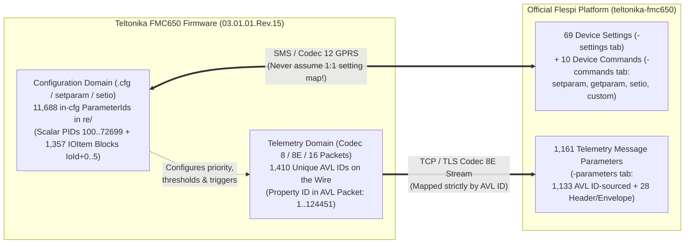

# Teltonika FMC650 — Official Flespi Parameters, Settings & Mappings (`flespi-parameters/`)

This directory contains the complete, authoritative reference of **all official Flespi Telemetry Parameters (`1,161`), Device Configuration Settings (`69`), and Device Commands (`10`)** for the **Teltonika FMC650** (sourced directly from [`https://flespi.com/devices/teltonika-fmc650`](https://flespi.com/devices/teltonika-fmc650) and [`https://flespi.com/protocols/teltonika`](https://flespi.com/protocols/teltonika)), together with their exact mappings to:
1. **FMC650 Configuration Parameters (`ParameterId` & `IoId`)** in [`fmc650-reverse-engineered/re/fmx65_03.01.01.Rev.15_schema.json`](./re/fmx65_03.01.01.Rev.15_schema.json) (`11,688` in-cfg parameters across `13,966` total schema IDs).
2. **FMC650 Telemetry Parameters (`AVL ID`)** in [`Data_Sending_Parameters_ID/`](./README.md) (`1,410` unique `AVL ID`s across 19 sections).

---

## Non-Negotiable Architectural Rules

1. **Never Confuse Telemetry Parameters with Configuration Parameters**:
   - **Configuration Parameters (`ParameterId` / `IoId` in `re/`)** live inside `.cfg` files and `setparam`/`getparam`/`setio` commands.
   - **Telemetry Parameters (`AVL ID` in `Data_Sending_Parameters_ID/`)** are the measured values transmitted in Codec 8 / Codec 8 Extended packets and decoded by Flespi into **Flespi Message Parameters**.
   - **82 exact integer IDs collide across both domains with completely different meanings** (documented in [`01_FMC650_Configuration_Parameters_re_to_Flespi_Settings_Mapping.md` §1.1](./01_FMC650_Configuration_Parameters_re_to_Flespi_Settings_Mapping.md)). For example:
     - `100` as a **Configuration `ParameterId`** (`re/`) is `Movement Source`, whereas `100` as a **Telemetry `AVL ID`** is `Axle weight 12` (`can.axle.weight.12`).
     - `102` as a **Configuration `ParameterId`** (`re/`) is `Sleep Settings`, whereas `102` as a **Telemetry `AVL ID`** is `Axle weight 14` (`can.axle.weight.14`).
     - `104` as a **Configuration `ParameterId`** (`re/`) is `High Voltage (mV)`, whereas `104` as a **Telemetry `AVL ID`** is `Engine Total Hours Of Operation` (`can.engine.motorhours`).
     - `169` as a **Configuration `ParameterId`** (`re/`) is `Accelerometer Auto Calibration`, whereas `169` as a **Telemetry `AVL ID`** is `Geofence zone 15` (`geofence.status.15`).
2. **Never Assume a Manufacturer Parameter Maps Directly to a Flespi Setting**:
   - Out of **11,688 `in_cfg` Configuration `ParameterId`s** in `re/fmx65_03.01.01.Rev.15_schema.json`, Flespi's 69 Device Settings only cover **~240 `in_cfg` `ParameterId`s** (mostly bundled into composite JSON settings or decomposed from bitmasks).
   - Furthermore, **16** of the 69 Flespi settings (`camera_*`) target `PID 1001000..1012045` (`in_cfg: false` in `FMC650:1 SpecId 1`), **1** (`battery_level_io`) targets an FMB-only I/O block (`in_cfg: false` on FMC650), and **14** (`cpureset`, `deleterecords`, `getgps`, `getimeiccid`, `getrecord`, `getver`, `mcan_cmd`, `mcan_stop`, `odoset`, `outputs`, `sdformat`, `setdigout_4`, `tachocheck`, `web_connect`) are runtime command pseudo-settings with **no `.cfg` `ParameterId` at all**.
   - The remaining **>11,400 `in_cfg` `ParameterId`s** in `re/` have **no dedicated Flespi setting** and must be accessed via Flespi's official `setparam`, `getparam`, or `setio` commands.

---

## Deliverables in This Directory

| File | Scope & Contents | Size / Lines |
|---|---|---:|
| **[Flespi_Official_Full_Parameters.md](./Flespi_Official_Full_Parameters.md)** | **Standalone Full Official Flespi Reference**: Contains all **1,161 Flespi Telemetry Message Parameters** (`28` header/envelope + `1,133` `AVL ID`-sourced), all **69 Flespi Device Configuration Settings**, and all **10 Flespi Device Commands** from `https://flespi.com/devices/teltonika-fmc650`. | `175 KB` (`1,281` lines) |
| **[01_FMC650_Configuration_Parameters_re_to_Flespi_Settings_Mapping.md](./01_FMC650_Configuration_Parameters_re_to_Flespi_Settings_Mapping.md)** | **Configuration Domain Mapping (`re/` <-> Flespi Settings & Commands)**: Full table of all **82 integer ID collisions**, property-by-property mapping of all **69 Flespi Device Settings** to `re/` `ParameterId`s, reverse mapping of core scalar `re/` `ParameterId`s (`100..12099`), and dual-domain bridge for `50000..50890` `IOItem` blocks. | `111 KB` (`671` lines) |
| **[02_FMC650_Telemetry_AVL_ID_to_Flespi_Parameters_Mapping.md](./02_FMC650_Telemetry_AVL_ID_to_Flespi_Parameters_Mapping.md)** | **Telemetry Domain Mapping (`AVL ID` <-> Flespi Message Parameters)**: Complete section-by-section mapping of all **19 FMC650 Telemetry Sections (`1,410` unique `AVL ID`s)** to the **1,734 expanded `AVL ID` mappings** in the official Flespi `teltonika` protocol documentation. | `244 KB` (`1,551` lines) |
| **[03_Complete_re_IOItem_Blocks_1357_Catalog.md](./03_Complete_re_IOItem_Blocks_1357_Catalog.md)** | **Complete `re/` `IOItem` Block Catalog (`1,357` Bases / `6,451` IDs)**: Lists every `in_cfg` `IOItem` base (`45100..181330`), its 6 configuration `ParameterId`s, default priority, and whether it maps to one of the 12 Flespi `*_io` settings or requires the `setio` command. | `194 KB` (`1,372` lines) |
