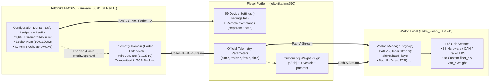

# FMC650 FLEET TELEMATICS `v1.2` (`P2_PRODUCTION`) — Complete Flespi & Wialon Mapping

- **Configuration File**: [`FMC650_FLEET_P2_PRODUCTION_v1.2_rev15.cfg`](./FMC650_FLEET_P2_PRODUCTION_v1.2_rev15.cfg)
- **Target Device & Firmware**: Teltonika `FMC650` (`03.01.01.Rev.15`, `ConfigurationVersion: 4.43.1.0`, `11,688` total parameters, SHA-256 `f8476bfd68ff6c4e26a848ca0454b178f3faaef5b48f9e34b1d73c6342654a6e`)
- **Target Vehicle Combination**: SINOTRUK SITRAK (MC13 Engine + ZF TraXon 12TX Gearbox on `CAN1`) + CIMC Semi-Trailer (WABCO TEBS E ISO 11992-2 on `CAN2`)
- **Telematics Pipeline**: `FMC650` (Codec 8 Extended) $\rightarrow$ **Flespi** (`ch0000000.flespi.gw:20001` + `tidj` Weight Plugin) $\rightarrow$ **Wialon Local** (`TR84_Flespi_Test.wlp`)

---

## 0. Architectural Rules: Configuration Domain vs. Telemetry Domain

1. **Configuration Parameters (`PID` / `IoId`)** live inside `.cfg` files and `setparam`/`setio` commands. Scalar `PID`s (`100..13002`) are **never** transmitted to Wialon as telemetry sensor values.
2. **Telemetry Parameters (`AVL ID`)** are measured values sent inside Codec 8 Extended packets, decoded by Flespi into dotted parameter names (`trailer.axle.load.sum`), and translated into Wialon keys:
   - **Path A (Flespi Wialon Stream)**: Dotted names are abbreviated (`trailer.axle.load.sum` $\rightarrow$ `trailer_axle_load_sum`, `can.fuel.level` $\rightarrow$ `fuel_lvl`).
   - **Path B (Direct FMC650 $\rightarrow$ Wialon TCP)**: Wialon names parameters `io_<AVL_ID>` (`io_13657`, `io_87`).

---

## 1. Network, Queue, Packet & Scalar Configuration Parameters (`PID 100..13002`)

### 1.1 Network, Timeout & Queue Optimization Settings

| Optimization Setting | Prompt Note (FMB1xx) | Actual FMC650 `Rev.15` `PID` | Value in `P2_PRODUCTION_v1.2` | Official Flespi Device Setting | Flespi Command (`setparam`) | Operational Purpose |
| :--- | :--- | :--- | :--- | :--- | :--- | :--- |
| **Open Link Timeout** | `PID 1000` | **`1000`** | **`120`** (`2 min`, was `600`) | `open_link_timeout` | `setparam 1000:120` | Drops stalled m2m.sim2 sockets after 120 s instead of holding a dead link for 10 min. |
| **Response Timeout** | `PID 1002` | **`1001`** *(on FMC650, `1002` is `Sort By`)* | **`5`** (`5 s`, was `30`) | `response_timeout` | `setparam 1001:5` | Waits max 5 s for server ACK so m2m.sim2/Wialon lag never freezes the queue for 30 s. |
| **Data Sending Sort (`Sort By`)** | `PID 1006` | **`1002`** (`SortBy`: `0=Newest`, `1=Oldest`) | **`1`** (`Oldest First`, was `0`) | `sort_by` | `setparam 1002:1` | Drains flash backlog chronologically (`Oldest First`) so Wialon maps and Flespi `tidj` filters have zero gaps or timestamp inversions. |
| **Save Records To** | — | **`1006`** (`0=Internal`, `1=SD card`) | **`0`** (`Internal memory`) | *(None)* | `setparam 1006:0` | Prevents `SD Save Fail Cnt` (`flash_api.c:590`) when no SD card is installed. |
| **Min Saved Records** | `PID 1004` / `1005` | **`10004, 10054, 10104, 10154, 10204, 10254`** | **`1`** | `*_data_acquisition` (`min_saved_records`) | `setparam 10004:1;10054:1;...` | Preserves live cadence while `[T.RECMNG]-> LoadRec` packs up to ~20 records per Codec 8E TCP frame during backlog drain. |
| **`Monitoring` CAN Priorities** | `IO 13155` $\rightarrow$ `Low` | All `Operand=3` CAN blocks *(except `46530`)* | **`1`** (`Low`) | `setio` command | `setio` | Prevents continuous CAN fluctuations from forcing immediate high-priority socket connections outside the periodic send timer. |

### 1.2 System, GNSS, GPRS, CAN Bus & Data Acquisition Scalar Settings

| `.cfg` `PID` | Value in `P2_PRODUCTION_v1.2` | Teltonika Configurator Parameter | Official Flespi Device Setting | Flespi Command (`setparam`) |
| :--- | :--- | :--- | :--- | :--- |
| **`100`** | **`1`** (`Movement` — Accelerometer) | Movement Source | `movement_source` | `setparam 100:1` |
| **`101`** | **`1`** (`DIN1` — Physical Contact) | Ignition Source | `ignition_source` | `setparam 101:1` |
| **`102`** | **`0`** (`Disable`) | Sleep Mode | `sleep_settings` (`mode`) | `setparam 102:0` |
| **`106` / `123`** | **`1`** (`Enable`) / **`0`** (`Movement OR Ignition`) | Static Navigation / Source | `static_navigation` | `setparam 106:1;123:0` |
| **`109`** | **`15`** (`GPS + GLONASS + GALILEO + BEIDOU`) | GNSS Source | `gnss_source` | `setparam 109:15` |
| **`113`** | **`1`** (`Codec 8 Extended`) | Data Protocol | `codec` | `setparam 113:1` |
| **`169`** | **`1`** (`Enable`) | Accelerometer Auto Calibration | `accelerometer_calibration` | `setparam 169:1` |
| **`221`** | **`0`** (`Don't Send`) | I/O Send Mode (when CAN I/O absent >30 s) | *(None)* | `setparam 221:0` |
| **`2004` / `2005` / `2006`** | **`ch0000000.flespi.gw`** / **`20001`** / **`0`** (`TCP`) | Server #1 Domain / Port / Protocol | `backend_server` | `setparam 2004:ch0000000.flespi.gw;2005:20001;2006:0` |
| **`2010` / `2007` / `2008`** | **`0`** (`Disabled`) / `203.0.113.10` / `20332` | Server #2 Mode / Domain / Port | `second_server` | `setparam 2010:0` |
| **`2020`** | **`0`** (`None`) | TLS Encryption Mode | *(None)* | `setparam 2020:0` |
| **`13002`** | **`720`** (`720 min` = 12 h) | FOTA WEB Period | `fota_web` (`period`) | `setparam 13002:720` |
| **`205` / `206` / `216`** | **`500`** (`kbps`) / **`0`** (`Silent`) / **`0`** (`OFF`) | CAN1 Bus Speed / Mode / Termination | *(None)* | `setparam 205:500;206:0;216:0` |
| **`207` / `208` / `217`** | **`500`** (`kbps`) / **`0`** (`Silent`) / **`0`** (`OFF`) | CAN2 Bus Speed / Mode / Termination | *(None)* | `setparam 207:500;208:0;217:0` |
| **`210`** | **`0`** (`CAN1`) | FMS Data Source | *(None)* | `setparam 210:0` |
| **`330`** | **`2`** (`CAN2`) | TrailerCAN Data Source (WABCO TEBS E) | *(None)* | `setparam 330:2` |
| **`200, 209, 215, 232`** | **`0, 3 (OFF), 0, 0`** | Tachograph / K-Line / DDD Download | `tachograph_*` | `setparam 200:0;209:3;215:0;232:0` |
| **`11003, 11103, 11204, 11304, 11700, 12000`** | **`1, 1, 1, 1, 0, 1`** (`None` / `Disabled`) | DOUT / Immobilizer / Scenario Output Control | `green_driving`, `overspeeding`, `immobilizer` | `setparam 11003:1;11103:1;11700:0;12000:1` |
| **`10000 / 10004 / 10005`** | **`60` s / `1` / `300` s** | Home On Stop: Min Period / Min Rec / Send Period | `home_stop_data_acquisition` | `setparam 10000:60;10004:1;10005:300` |
| **`10050..10055`** | **`20` s / `100` m / `10`° / `10` km/h / `1` / `60` s** | Home Moving: Period / Dist / Angle / Speed / MinRec / Send | `home_moving_data_acquisition` | `setparam 10050:20;10051:100;10052:10;10053:10;10054:1;10055:60` |
| **`10100 / 10104 / 10105`** | **`300` s / `1` / `900` s** | Roaming (& Unknown `10200..`) On Stop | `roaming_stop_data_acquisition` | `setparam 10100:300;10104:1;10105:900` |
| **`10150..10155`** | **`60` s / `250` m / `15`° / `15` km/h / `1` / `120` s** | Roaming (& Unknown `10250..`) Moving | `roaming_moving_data_acquisition` | `setparam 10150:60;10151:250;10152:15;10153:15;10154:1;10155:120` |

---

## 2. The 40 Weight & WABCO TEBS E Parameters (`message (2).txt`) — Flespi & Wialon Telemetry Mapping

Each I/O block uses 5 (or 6) consecutive configuration IDs: `+0 = Priority`, `+1 = Operand`, `+2 = High Level`, `+3 = Low Level`, `+4 = Event Only`, `+5 = Averaging Constant`.

| # | Module | `.cfg` Base `IoId` (`P2`: `Prio, Op, High, Low, Ev`) | Configurator Parameter Name | Wire `AVL ID` | Official Flespi Parameter | Wialon Key (`Path A`: Flespi Stream) | Wialon Key (`Path B`: Direct) | Wialon Sensor (`TR84_Flespi_Test.wlp`) & Flespi `tidj` Plugin Role |
| :--- | :--- | :--- | :--- | :--- | :--- | :--- | :--- | :--- |
| 1 | FMS | **`45290`** (`1, 3, 0, 0, 0` + `Avg=1`) *(+ `46100`: `1, 3, 0, 0, 0`)* | `Axle 1 load` (`kg`) | **`89`** | `can.axle.weight.1` (`can.axle.weight`) | **`can_axle_weight_1`** (`can_axle_weight`) | `io_89` | Tractor front steering axle weight (`kg`) |
| 2 | FMS | **`45300`** (`1, 3, 0, 0, 0` + `Avg=1`) *(+ `46110`: `1, 3, 0, 0, 0`)* | `Axle 2 load` (`kg`) | **`90`** | `can.axle.weight.2` (`can.axle.weight`) | **`can_axle_weight_2`** | `io_90` | Tractor drive axle 2 weight (`kg`) |
| 3 | FMS | **`45310`** (`1, 3, 0, 0, 0` + `Avg=1`) *(+ `46120`: `1, 3, 0, 0, 0`)* | `Axle 3 load` (`kg`) | **`91`** | `can.axle.weight.3` (`can.axle.weight`) | **`can_axle_weight_3`** | `io_91` | Tractor drive axle 3 weight (`kg`) |
| 4 | FMS | **`45320`** (`1, 3, 0, 0, 0` + `Avg=1`) *(+ `46130`: `1, 3, 0, 0, 0`)* | `Axle 4 load` (`kg`) | **`92`** | `can.axle.weight.4` (`can.axle.weight`) | **`can_axle_weight_4`** | `io_92` | Axle 4 weight (`kg`) |
| 5 | FMS | **`45330`** (`1, 3, 0, 0, 0` + `Avg=1`) | `Axle 5 load` (`kg`) | **`93`** | `can.axle.weight.5` (`can.axle.weight`) | **`can_axle_weight_5`** | `io_93` | Axle 5 weight (`kg`) |
| **6** | **FMS** | **`46530`** (**`2, 3, 0, 0, 0`** — **High Priority**) | **`Combined vehicle weight`** (`kg`) | **`139`** | **`total.vehicle.weight`** | **`total_vhc_weight`** | **`io_139`** | **Sensor `21`** (*Poids brut combiné du véhicule*, `kg`) + **Primary input to all 58 Flespi `fleet_*` & `vhc_*` weight/fraud sensors (`IDs 90..150`)** |
| 7 | FMS opt. | `45860` (`0, 3, 0, 0, 0` — Disabled) | `Load Weight` (`kg`) | `118` | `can.axle.weight` | `can_axle_weight` | `io_118` | Disabled in `P2` (LVCAN adapter parameter) |
| 8 | FMS opt. | `48940` (`0, 3, 0, 0, 0` — Disabled) | `Gross vehicle combination weight` (`kg`) | `10899` | `can.gross.combination.vehicle.weight` | `can_gross_combination_vhc_weight` | `io_10899` | Disabled in `P2` |
| 9 | FMS opt. | `90750` (`0, 3, 0, 0, 0` — Disabled) | `Trailer Weight` (`kg`, EV FMS) | `10896` | `can.ev.trailer.weight` | `can_ev_trailer_weight` | `io_10896` | Disabled in `P2` |
| 10 | FMS opt. | `90760` (`0, 3, 0, 0, 0` — Disabled) | `Cargo Weight` (`kg`, EV FMS) | `10897` | `can.ev.cargo.weight` | `can_ev_cargo_weight` | `io_10897` | Disabled in `P2` |
| 11 | FMS opt. | `90770` (`0, 3, 0, 0, 0` — Disabled) | `Powered Vehicle Weight` (`kg`, EV FMS) | `10898` | `can.ev.powered.vehicle.weight` | `can_ev_powered_vhc_weight` | `io_10898` | Disabled in `P2` |
| 12 | FMS opt. | `90780` (`0, 3, 0, 0, 0` — Disabled) | `Gross Combination Vehicle Weight` (EV FMS) | `10899` | `can.gross.combination.vehicle.weight` | `can_gross_combination_vhc_weight` | `io_10899` | Disabled in `P2` |
| 13 | TrailerCAN | **`103000`** (`1, 3, 0, 0, 0`) | `Detected Towed Vehicle` | **`13651`** *(or `10520`)* | `trailer.towing.state.enum` | **`trailer_towing_st_enum`** | `io_13651` | **Sensor `74`** (*Remorque détectée*) |
| + | TrailerCAN | **`103020`** (`1, 3, 0, 0, 0`) | `Vehicle ABS Status` | **`13653`** *(or `10508`)* | `trailer.abs.state.enum` | **`trailer_abs_st_enum`** | `io_13653` | **Sensor `72`** (*État ABS remorque*) |
| 14 | TrailerCAN | **`103060`** (`1, 3, 0, 0, 0`) | `Axle Load Sum` (`kg`) | **`13657`** *(or `10510`)* | **`trailer.axle.load.sum`** | **`trailer_axle_load_sum`** | `io_13657` | **Sensor `71`** (*Charge totale essieux remorque*, `/1000` t) + **Feeds Flespi `fleet_trailer_axle_raw` (`Sensor 99`), `fleet_trailer_axle_stable` (`98`), `fleet_trailer_loss_delta` (`93`)** |
| 15 | TrailerCAN | **`103110`** (`1, 3, 0, 0, 0`) | `Axle Load Measured By Towed Vehicle` (`kg`) | **`13662`** *(or `10521`)* | `trailer.towing.vehicle.axle.load` | **`trailer_towing_vhc_axle_load`** | `io_13662` | **Sensor `70`** (*Charge EBS remorque*, `/1000` t) |
| 16 | TrailerCAN | **`103120`** (`1, 3, 0, 0, 0`) | `Axle Load Measured By External Scale` (`kg`) | **`13663`** *(or `10518`)* | `trailer.scale.axle.load` | **`trailer_scale_axle_load`** | `io_13663` | **Sensor `69`** (*Charge balance externe*, `/1000` t) |
| 17 | TrailerCAN | **`103130`** (`1, 3, 0, 0, 0`) | `Axle Load Calibration Data Load Level` | **`13664`** *(or `10511`)* | `trailer.calibration.load.level.state.enum` | **`trailer_calibration_load_lvl_state_enum`** | `io_13664` | **Sensor `68`** (*État calibration charge*) |
| 18 | TrailerCAN | **`103200`** (`1, 3, 0, 0, 0`) | `VIN` (Trailer VIN) | **`13671`** | `can.trailer.vin` | **`can_trailer_vin`** | `io_13671` | Automatic semi-trailer VIN identification |
| 19 | TrailerCAN | **`103300`** (`1, 3, 0, 0, 0`) | `Lift Axle 1 Position Status` | **`13681`** | `trailer.lift.axle.1.position.state.enum` | **`trailer_lift_axle_1_pos_st_enum`** | `io_13681` | Lift Axle 1 position enum |
| 20 | TrailerCAN | **`103310`** (`1, 3, 0, 0, 0`) | `Lift Axle 2 Position Status` | **`13682`** | `trailer.lift.axle.2.position.state.enum` | **`trailer_lift_axle_2_pos_st_enum`** | `io_13682` | Lift Axle 2 position enum |
| 21 | TrailerCAN | **`103220`** (`1, 3, 0, 0, 0`) | `Lateral Acceleration` (`m/s²`) | **`13673`** | `trailer.lateral.acceleration` | **`trailer_lateral_accel`** | `io_13673` | Trailer lateral cornering acceleration (`m/s²`) |
| 22 | TrailerCAN | **`103080`** (`1, 3, 0, 0, 0`) | `Vehicle Service Brake Status` | **`13659`** *(or `10522`)* | `trailer.vehicle.service.brake.state.enum` | **`trailer_vhc_service_brake_st_enum`** | `io_13659` | **Sensor `65`** (*État frein de service remorque*) |
| 23 | TrailerCAN | **`103210`** (`1, 3, 0, 0, 0`) | `VDC Active` | **`13672`** | `trailer.vdc.active.state.enum` | **`trailer_vdc_active_st_enum`** | `io_13672` | Trailer Vehicle Dynamic Control status |
| 24 | TrailerCAN | **`103270`** (`1, 3, 0, 0, 0`) | `ROP System Status` | **`13678`** *(or `10517`)* | `trailer.rop.system.state.enum` | **`trailer_rop_system_st_enum`** | `io_13678` | **Sensor `60`** (*ROP anti-retournement*) |
| 25 | TrailerCAN | **`103280`** (`1, 3, 0, 0, 0`) | `YC System Status` | **`13679`** | `trailer.yc.system.state.enum` | **`trailer_yc_system_st_enum`** | `io_13679` | Trailer Yaw Control status |
| 26 | TrailerCAN | **`104570`** (`1, 3, 0, 0, 0`) | `Electrical Load Proportional Function Installation Status` | **`13808`** | `trailer.electric.load.proportional.function.installation.state.enum` | **`trailer_electric_load_proportional_function_installation_st_enum`** | `io_13808` | WABCO EBS load-sensing installation status |
| 27 | TrailerCAN | **`104230`** (`1, 3, 0, 0, 0`) | `Vehicle Pneumatic Supply Status` | **`13774`** *(or `10514`)* | `trailer.pneumatic.supply.state.enum` | **`trailer_pneumatic_supply_st_enum`** | `io_13774` | **Sensor `61`** (*État alimentation pneumatique*) |
| 28 | TrailerCAN | **`104590`** (`1, 3, 0, 0, 0`) | `Pneumatic Supply Pressure` (`kPa`) | **`13810`** *(or `10513`)* | `trailer.pneumatic.supply.pressure` | **`trailer_pneumatic_supply_press`** | `io_13810` | **Sensor `62`** (*Pression pneumatique remorque*, `/100` bar) |
| 29 | TrailerCAN | **`103140`** (`1, 3, 0, 0, 0`) | `Brake Cylinder Pressure First Axle Left Wheel` (`kPa`) | **`13665`** | `trailer.braking.cylinder.pressure.axle.1.left` | **`trailer_braking_cylinder_press_axle_1_left`** | `io_13665` | Trailer Axle 1 Left brake cylinder pressure (`kPa`) |
| 30 | TrailerCAN | **`103150`** (`1, 3, 0, 0, 0`) | `Brake Cylinder Pressure First Axle Right Wheel` (`kPa`) | **`13666`** | `trailer.braking.cylinder.pressure.axle.1.right` | **`trailer_braking_cylinder_press_axle_1_right`** | `io_13666` | Trailer Axle 1 Right brake cylinder pressure (`kPa`) |
| 31 | TrailerCAN | **`103160`** (`1, 3, 0, 0, 0`) | `Brake Cylinder Pressure Second Axle Left Wheel` (`kPa`) | **`13667`** | `trailer.braking.cylinder.pressure.axle.2.left` | **`trailer_braking_cylinder_press_axle_2_left`** | `io_13667` | Trailer Axle 2 Left brake cylinder pressure (`kPa`) |
| 32 | TrailerCAN | **`103170`** (`1, 3, 0, 0, 0`) | `Brake Cylinder Pressure Second Axle Right Wheel` (`kPa`) | **`13668`** | `trailer.braking.cylinder.pressure.axle.2.right` | **`trailer_braking_cylinder_press_axle_2_right`** | `io_13668` | Trailer Axle 2 Right brake cylinder pressure (`kPa`) |
| 33 | TrailerCAN | **`103180`** (`1, 3, 0, 0, 0`) | `Brake Cylinder Pressure Third Axle Left Wheel` (`kPa`) | **`13669`** | `trailer.braking.cylinder.pressure.axle.3.left` | **`trailer_braking_cylinder_press_axle_3_left`** | `io_13669` | Trailer Axle 3 Left brake cylinder pressure (`kPa`) |
| 34 | TrailerCAN | **`103190`** (`1, 3, 0, 0, 0`) | `Brake Cylinder Pressure Third Axle Right Wheel` (`kPa`) | **`13670`** | `trailer.braking.cylinder.pressure.axle.3.right` | **`trailer_braking_cylinder_press_axle_3_right`** | `io_13670` | Trailer Axle 3 Right brake cylinder pressure (`kPa`) |
| 35 | TrailerCAN | **`103090`** (`1, 3, 0, 0, 0`) | `Vehicle Electrical Supply Status` | **`13660`** *(or `10515`)* | `trailer.power.state.enum` | **`trailer_power_st_enum`** | `io_13660` | **Sensor `63`** (*État alimentation EBS*) |
| 36 | TrailerCAN | **`103040`** (`1, 3, 0, 0, 0`) | `Red Warning Signal Request` | **`13655`** *(or `10516`)* | `trailer.red.warning.request.state.enum` | **`trailer_red_warning_req_st_enum`** | `io_13655` | **Sensor `67`** (*Alerte rouge EBS*) |
| 37 | TrailerCAN | **`103050`** (`1, 3, 0, 0, 0`) | `Amber Warning Signal Request` | **`13656`** *(or `10509`)* | `trailer.amber.warning.request.state.enum` | **`trailer_amber_warning_req_st_enum`** | `io_13656` | **Sensor `66`** (*Alerte jaune EBS*) |
| 38 | TrailerCAN | **`104580`** (`1, 3, 0, 0, 0`) | `Spring Brake Status` | **`13809`** *(or `10519`)* | `trailer.spring.brake.state.enum` | **`trailer_spring_brake_st_enum`** | `io_13809` | **Sensor `59`** (*État frein à ressort*) |
| 39 | Apache opt. | `180510` (`0, 3, 0, 0, 0` — Disabled) | `EBS Weight Load` (RS232 Apache) | `10510` | `trailer.axle.load.sum` | `trailer_axle_load_sum` | `io_10510` | Disabled in `P2` (native CAN2 `103060` used instead) |
| 40 | Apache opt. | `180520` (`0, 3, 0, 0, 0` — Disabled) | `EBS Pneumatic Supply` (RS232 Apache) | `10513` | `trailer.pneumatic.supply.pressure` | `trailer_pneumatic_supply_press` | `io_10513` | Disabled in `P2` (native CAN2 `104590` used instead) |

---

## 3. Guide `v1.2` Powertrain, Fuel, AdBlue, ZF TraXon, Retarder & Permanent I/O Mapping

| `.cfg` Base `IoId` (`P2`: `Prio, Op, Ev`) | Configurator Parameter Name | Wire `AVL ID` | Official Flespi Parameter | Wialon Key (`Path A`: Flespi Stream) | Wialon Key (`Path B`: Direct) | Wialon Sensor in `TR84_Flespi_Test.wlp` |
| :--- | :--- | :--- | :--- | :--- | :--- | :--- |
| **`46000`** (`1, 5, 0`) | `Brake switch` | **`79`** | `can.pedal.brake.status` | **`can_pedal_brake_stat`** | `io_79` | **Sensor `33`** (*Interrupteur de frein*) |
| **`46010`** (`1, 3, 0`) | `Wheel based speed` (`km/h`) | **`80`** | `can.wheel.speed` | **`can_wheel_speed`** | `io_80` | **Sensor `28`** (*Vitesse Basée sur les Roues*) |
| **`46020`** (`1, 5, 0`) | `Cruise control active` | **`81`** | `can.cruise.status` | **`can_cruise_stat`** | `io_81` | **Sensor `29`** (*Régulateur de vitesse*) |
| **`46030`** (`1, 5, 0`) | `Clutch switch` | **`82`** | `can.pedal.clutch.status` | **`can_pedal_clutch_stat`** | `io_82` | **Sensor `10`** (*Interrupteur d'embrayage*) |
| **`46040` / `46510`** (`2, 5, 0`) | `PTO state` / `PTO Drive Engagement` | **`83` / `137`** | `can.powersource.takeoff.enum` / `pto.drive.engagement.enum` | **`pto_drive_engagement_enum`** | `io_83` / `io_137` | **Sensor `15`** (*PTO Drive Engagement*) |
| **`46050`** (`1, 3, 0`) | `Accelerator pedal position` (`%`) | **`84`** | `can.throttle.pedal.level` | **`can_thrt_pedal_lvl`** | `io_84` | **Sensor `36`** (*Position de la Pédale d'accélération*) |
| **`46060`** (`1, 3, 0`) | `Engine percent load` (`%`) | **`85`** | `can.engine.load.level` | **`can_eng_load_lvl`** | `io_85` | **Sensor `2`** (*Charge moteur*), **Sensor `44`** (*Puissance*), **Sensor `45`** (*Couple*) |
| **`46070` / `46520`** (`1, 3, 0`) | `Engine total fuel used` / `High res` (`L`) | **`86` / `138`** | `can.fuel.consumed` | **`can_fuel_consumed`** | `io_86` / `io_138` | **Sensor `35`** (*Moteur total carburant utilisé*), **Sensor `27`** (*L/100km*) |
| **`46080`** (`1, 3, 0`) | `Fuel level` (`%`) | **`87`** | `can.fuel.level` | **`fuel_lvl`** *(legacy override)* | `io_87` | **Sensor `3`** (*Fuel level in L*), **Sensor `4`** (*%*), **Sensor `39`** |
| **`46090`** (`1, 3, 0`) | `Engine speed` (`RPM`) | **`88`** | `can.engine.rpm` | **`can_eng_rpm`** | `io_88` | **Sensor `34`** (*RPM La vitesse du moteur*), **Sensor `44`** (*Puissance*) |
| **`46250`** (`1, 3, 0`) | `Engine total hours of operation` (`h`) | **`104`** | `can.engine.motorhours` | **`eng_mth`** *(legacy override)* | `io_104` | **Sensor `30`** (*Engine Hours*) & **Sensor `58`** (*TOTAL HEUR MOTEUR*) |
| **`46310`** (`1, 3, 0`) | `Service distance` (`km`) | **`113`** | `can.service.mileage` | **`can_service_mileage`** | `io_113` | **Sensor `23`** (*Distance de service*) |
| **`46450`** (`1, 3, 0`) | `Engine coolant temperature` (`°C`) | **`127`** | `can.engine.coolant.temperature` | **`can_eng_coolant_temp`** | `io_127` | **Sensor `31`** (*Température du liquide de refroidissement*) |
| **`46460`** (`1, 3, 0`) | `Ambient air temperature` (`°C`) | **`128`** | `can.ambient.air.temperature` | **`can_ambient_air_temp`** | `io_128` | **Sensor `25`** (*Température ambiante*) |
| **`46490`** (`1, 3, 0`) | `Fuel rate` (`L/h`) | **`135`** | `can.fuel.consumption` / `can.engine.fuel.rate` | **`can_fuel_cons`** | `io_135` | **Sensor `5`** (*Tarif carburant*) |
| **`46500`** (`1, 3, 0`) | `Instantaneous fuel economy` (`km/L`) | **`136`** | `can.fuel.economy` | **`can_fuel_eco`** | `io_136` | **Sensor `26`** (*Économie de carburant instantanée*) |
| **`46540`** (`1, 3, 0`) | `Brake pedal position` (`%`) | **`357`** | `can.brake.pedal.level` | **`can_brake_pedal_lvl`** | `io_357` | **Sensor `8`** (*Position de la pédale de frein*) |
| **`46550` / `46810`** (`1, 3, 0`) | `AdBlue Status` / `AdBlue Level` (`%`) | **`229` / `10455`** | `fms.adblue.state.enum` / `can.adblue.level` | **`fms_adblue_state_enum`** / **`can_adblue_lvl`** | `io_229` / `io_10455` | **Sensor `85`** (*État AdBlue*) & **Sensor `86`** (*Niveau AdBlue*) |
| **`46570`** (`2, 5, 0`) | `Engine MIL Indicator` | **`10427`** *(or `123`)* | `can.mil.status` / `can.engine.mil.indicator.state` | **`can_mil_stat`** | `io_10427` | **Sensor `84`** (*Voyant défaut moteur MIL*) |
| **`46580..46610, 46860`** (`2, 5, 0`) | `Tell Tale ID0..ID4` | **`10428..10431, 13259`** | `fms.tell.tale` *(+ 45 decoded indicator states)* | **`fms_tell_tale`** *(+ `can_*_indicator_st`)* | `io_10428..10431`, `io_13259` | Dashboard warning lamps (Oil, Temp, EBS, Trans, Retarder) |
| **`46790` / `46890`** (`1, 3, 0`) | `Actual retarder % torque` / `Retarder Selection` | **`188` / `13155`** | `can.retarder.torque.load` | **`can_retarder_torque_load`** | `io_188` / `io_13155` | Retarder load & selection (`IO 13155` priority set to `Low = 1`) |
| **`46880`** (`1, 3, 0`) | `Engine Oil Temperature` (`°C`) | **`13154` / `1191`** | `can.engine.oil.temperature` | **`can_eng_oil_temp`** | `io_13154` | Engine oil thermal monitoring (`°C`) |
| **`46900`** (`1, 3, 0`) | `Transmission Oil Temperature` (ZF TraXon, `°C`) | **`13156` / `1199`** | `can.transmission.oil.temperature` | **`can_transmission_oil_temp`** | `io_13156` / `io_1199` | **ZF TraXon 12TX gearbox oil temperature (`°C`)** |
| **`46800`** (`1, 5, 0`) | `Parking brake switch` | **`10426`** | `can.handbrake.status` / `can.parking.brake.indicator.state` | **`can_handbrake_stat`** | `io_10426` | Parking brake switch state |
| **`50000`** (`2, 5, 0`) | `Ignition` | **`239`** | `engine.ignition.status` | **`eng_ign_stat`** | `io_239` | **Sensor `13`** (*Capteur démarrage moteur*) & **Sensor `57`** (*Engine ignition*) |
| **`50010`** (`2, 5, 0`) | `Movement` | **`240`** | `movement.status` | **`mvm_stat`** | `io_240` | **Sensor `19`** (*MOVEMENT*) + **Flespi `tidj` Plugin motion input** |
| **`50020`** (`1, 3, 0`) | `Data Mode` | **`22`** | `gsm.network.roaming.status` / `data.mode` | **`gsm_network_roaming_stat`** | `io_22` | Home vs. Roaming SIM network state |
| **`50030`** (`1, 3, 0`) | `GSM Signal` | **`21`** | `gsm.signal.level` | **`gsm_signal_lvl`** | `io_21` | Cellular signal level (`1..5` / `%`) |
| **`50040`** (`1, 5, 0`) | `Sleep Mode` | **`200`** | `sleep.mode.enum` | **`sleep_mode_enum`** | `io_200` | Tracker sleep state |
| **`50050`** (`2, 5, 0`) | `GNSS Status` | **`71`** | `gnss.state.enum` / `gnss.status` | **`gnss_st_enum`** | `io_71` | GNSS receiver status (`On Change`) |
| **`50060` / `50070`** (`1, 3, 0`) | `GNSS PDOP` / `GNSS HDOP` | **`181` / `182`** | `position.pdop` / `position.hdop` | **`pos_pdop` / `pos_hdop`** (`hdop`) | `io_181` / `io_182` | GNSS dilution of precision |
| **`50080`** (`1, 3, 0`) | `External Voltage` (`mV` $\rightarrow$ `V`) | **`66`** | `external.powersource.voltage` | **`ext_pwrs_vlt`** | `io_66` | **Sensor `14`** (*Voltage batterie*, `V`) |
| **`50090`** (`1, 3, 0`) | `Speed` (`km/h`) | **`24`** | `position.speed` / `can.vehicle.speed` | **`speed`** | `io_24` | GNSS / tracker vehicle speed (`km/h`) |
| **`50120` / `50130`** (`1, 3, 0`) | `Battery Voltage` / `Battery Current` | **`67` / `68`** | `battery.voltage` / `battery.current` | **`battery_vlt`** / **`battery_current`** | `io_67` / `io_68` | **Sensor `20`** (*Ampérage Batterie*, `A`) |
| **`50140`** (`1, 3, 0`) | `Active GSM Operator` | **`241`** | `gsm.mcc` + `gsm.mnc` (`gsm.operator.code`) | **`gsm_operator_code`** | `io_241` | m2m.sim2 / Djezzy / m2m.sim1 PLMN operator code |
| **`50160`** (`1, 3, 0`) | `Total Odometer` (`m`) | **`216`** | `vehicle.mileage` | **`vhc_mileage`** | `io_216` | Total GPS odometer (`km`) |
| **`50170`** (`1, 5, 0`) | `Digital Input 1` (Physical Contact) | **`1`** | `din.1` (`din`) | **`din_1`** | `io_1` | Physical `DIN1` ignition wire verification |
