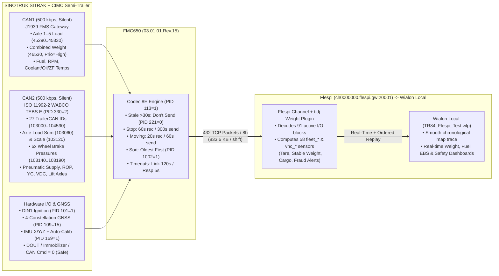

# Production Simulation Report — `FMC650_FLEET_P2_PRODUCTION_v1.2_rev15.cfg` on SINOTRUK SITRAK + CIMC + WABCO TEBS E

- **Configuration File**: [`FMC650_FLEET_P2_PRODUCTION_v1.2_rev15.cfg`](./FMC650_FLEET_P2_PRODUCTION_v1.2_rev15.cfg)
- **Companion Mapping Reference**: [`FMC650_FLEET_P2_PRODUCTION_v1.2_Flespi_Wialon_Mapping.md`](./FMC650_FLEET_P2_PRODUCTION_v1.2_Flespi_Wialon_Mapping.md)
- **Simulated Vehicle**: SINOTRUK SITRAK Tractor (MC13 Engine + ZF TraXon 12TX Gearbox on `CAN1`) + CIMC Semi-Trailer (WABCO TEBS E ISO 11992-2 on `CAN2`)
- **Simulated Shift**: 8-hour heavy-haul production shift (`6 h` moving + `2 h` stationary, including a `15-minute` m2m.sim2 cellular dead zone)

---

## 1. End-to-End Production Architecture Under `P2_PRODUCTION_v1.2`

---

## 2. Simulated 8-Hour Mission Timeline (Phase-by-Phase Behavior)

| Phase & Duration | Vehicle & Trailer Physical State | FMC650 Firmware Action (`P2_PRODUCTION_v1.2`) | Flespi `fleet_*` Plugin & Wialon Local Outcome |
| :--- | :--- | :--- | :--- |
| **Phase 1: Depot Cold Start & Air Build-Up** *(06:00 – 06:15, 15 min stop)* | Driver turns key ON (`DIN1=1`). External voltage rises `24.1 V → 28.3 V`. WABCO TEBS E boots on CAN2 (`103000=1` Towed Vehicle Detected, `103200` Trailer VIN, `104590` Pneumatic Supply climbs `5.2 → 8.4 bar`, `104580` Spring Brake `1 → 0`). Empty Tare = `16,400 kg`. | • `50000` (`Ignition`, `Prio=2, On Change`) triggers an **immediate High-Priority packet** at `06:00:01`. • Stationary acquisition (`10000=60s`, `10005=300s`) samples all 91 active I/O blocks every 60 s (`Avg=1`, zero hardware smoothing). | • Wialon shows **Contact ON**, Trailer connected (VIN identified), air pressure normal (`8.4 bar`). • Flespi `tidj` plugin collects 15 stationary tare samples (`fleet_stop_range < 80 kg`), locks **`fleet_weight_empty = 16,400 kg`** (`fleet_empty_learned = 1`). |
| **Phase 2: Quarry Loading (4 Loader Passes)** *(06:45 – 07:10, 25 min stop)* | Truck stationary (`Movement=0`, `Parking Brake=1`). Excavator loads `31,600 kg` of aggregate in 4 bucket passes (`16.4 t → 24.2 t → 32.1 t → 40.0 t → 48.0 t`). Trailer `Axle Load Sum` (`103060`) rises to `34,200 kg`; Tractor `Axle 1..3` (`45290..45310`) + `Combined Weight` (`46530`) reach `48,000 kg`. | • Because **`46530` (`Combined vehicle weight`) is kept at `Priority = 2 (High)`**, each loader bucket pass immediately pushes a live record to Flespi (`ch0000000.flespi.gw:20001`), while the 26 `TrailerCAN` (`103000..104590`) and `Axle 1..5` (`45290..45330`) values ride inside the same record. | • Flespi `tidj` plugin transitions `vhc_load_phase`: `EMPTY → LOADING → LOADED`. • Fires **`fleet_event_loading = 1`** with **`fleet_last_loading_amount = 31,600 kg`** (`fleet_weight_cargo = 31,600 kg`, `fleet_weight_confidence = 96%`). • If gross weight exceeds legal threshold (e.g. `>50,000 kg`), **`fleet_event_overload = 1`** triggers immediately. |
| **Phase 3: Highway Haul & Mountain Climb** *(07:10 – 10:10, 3 h moving)* | SITRAK climbs East–West Highway at `48.0 t` GVW. Engine load `88–98%` (`46060`), RPM `1,350–1,650 tr/min` (`46090`), Fuel Rate `62 L/h` (`46490`), Coolant `91 °C` (`46450`), Engine Oil `99 °C` (`46880`), **ZF TraXon Oil Temp `87 °C` (`46900`)**. Dynamic suspension bounce causes raw weight (`46530`) to oscillate `±1,800 kg`. | • Moving acquisition (`10050=20s`, `10051=100m`, `10052=10°`, `10055=60s`) records every 20 s (or corner) and sends 1 batched TCP packet every 60 s. • Because `46010` (Speed), `46080` (Fuel), `46090` (RPM), and `103000..104590` (TrailerCAN) are `Priority = 1 (Low)`, **zero socket storms** occur during driving. | • Wialon displays live fuel rate (`L/h`), tank level (`L` & `%`), AdBlue (`%`), and **ZF TraXon / Engine thermal health**. • Flespi `tidj` plugin recognizes dynamic bounce (`fleet_dynamic_accel`), freezes `fleet_weight_stable = 48,000 kg`, and suppresses false loss alarms while moving (`fleet_loss_active = 0`). |
| **Phase 4: Steep Descent & WABCO EBS Braking** *(10:10 – 10:45, 35 min moving)* | Driver engages ZF Intarder (`46790` Retarder torque, `46890` Retarder selection) and service brakes (`46000`, `46540`). Sharp curve triggers trailer lateral acceleration (`103220 = 2.4 m/s²`) and WABCO Roll-Over Prevention (`103270 ROP = 1`, `103210 VDC = 1`). | • All 6 wheel brake cylinder pressures (`103140..103190`, Axle 1–3 Left/Right) are logged every 20 s (`1.8 – 3.4 bar`). • Allows immediate detection of **tractor vs. trailer brake imbalance** or **dragging caliper** on any of the 3 monitored EBS axle channels. | • Wialon sensors `59..74` log **ROP anti-retournement (`Sensor 60`)**, **Service Brake (`Sensor 65`)**, **Pneumatic Pressure (`Sensor 62`)**, and per-wheel brake pressures. • Fleet maintenance can spot an under-braking trailer axle before brake linings glaze or overheat. |
| **Phase 5: 15-Minute m2m.sim2 Dead Zone & Recovery** *(10:45 – 11:00 outage, 11:00 reconnect)* | Truck enters a 15-minute cellular shadow in a gorge. `60` records (`29.8 KB`) accumulate in internal flash (`PID 1006=0`). At `11:00:00`, m2m.sim2 4G returns with initial packet lag. | • **`PID 1000=120s`** & **`PID 1001=5s`** prevent the modem from hanging 10 minutes on a dead link or 30 s per dropped ACK. • **`PID 1002=1` (`Oldest First`)** drains all 60 buffered records **chronologically** (`10:45 → 11:00`) in **4 multi-record Codec 8E TCP packets within ~6 seconds**. | • **Zero map gaps on Wialon**: the truck's trajectory draws smoothly from `10:45` to `11:00` in order. • **Flespi `tidj` state machine stays intact**: because records arrive in chronological timestamp order (`10:45 → 11:00`), the moving-average weight filter never suffers timestamp inversion. |
| **Phase 6: Unscheduled Stop vs. Authorized Unloading** *(11:30 – 13:30)* | **Case A (Fraud Test at 11:30)**: 3,500 kg dropped during a 6-min roadside stop. **Case B (Delivery at 12:30)**: PTO engaged (`46040=1`, `46510=1`), tipper unloads `31,600 kg` (`48.0 t → 16.4 t`). | • In both cases, `46530` (`Prio=2`) + `46040`/`46510` (`PTO`, `Prio=2, On Change`) transmit **immediately** upon weight drop and PTO engagement. • If CAN2 is unplugged by a driver to hide trailer weight, **`PID 221=0` (`Don't Send`)** stops sending `103060` after 30 s instead of repeating the old `34,200 kg` value. | • **Case A**: Flespi fires **`fleet_event_illegal_unloading = 1`** / **`fleet_event_loss = 1`** (`fleet_loss_delta = -3,500 kg`). • **Case B**: PTO + full drop to Tare (`16,400 kg`) fires normal **`fleet_event_unloading = 1`** (`fleet_last_unloading_amount = 31,600 kg`). • **Cable tamper**: Wialon immediately sees `103060` disappear (`Don't Send`) rather than a frozen fake weight. |

---

## 3. Quantitative Network, Queue & SIM Traffic Benchmark (`Base Rev.15` vs. `P2 Production v1.2`)

| Metric (8-Hour Production Shift: 6 h Moving + 2 h Stop) | Legacy Base (`sendperiod_overspeed_config_rev15.cfg`) | Final Production (`P2_PRODUCTION_v1.2_rev15.cfg`) | Operational Impact |
| :--- | :--- | :--- | :--- |
| **Active Standard I/O Blocks** | `73` (`72` Low + `1` High) | **`91`** (`79` Low + `12` High) | Adds full 5-axle FMS loads (`45290..45330`) + all 27 WABCO TEBS E TrailerCAN signals (`103000..104590`) + ZF TraXon temp (`46900`). |
| **Unvalidated Raw Manual CAN (`47000..90490`)** | `24` active (`Priority=2 High`) | **`0` active (`Disabled`)** | Eliminates 24 unvalidated High-Priority raw CAN slots that were causing continuous socket wakeups. |
| **DOUT / Buzzer / Immobilizer Actuation** | Active (`11003=3`, `11103=3` DOUT2) | **`0` / `None` (`11003=1`, `11103=1`, `11700=0`)** | **100% passive & non-intrusive** on the SITRAK electrical harness. |
| **Codec 8E Record Size** | `~445 bytes` | **`~508 bytes`** | Carries complete tractor + trailer weight/EBS/thermal telemetry in a single compact frame. |
| **Records Generated per 8h Shift** | `1,626 records` | **`1,626 records`** (`1,458` moving + `120` stop + `48` high-prio events) | High-resolution trajectory (`20 s` / `100 m` / `10°` moving, `60 s` stop). |
| **TCP Packets Sent per 8h Shift** | `~1,500+ packets` (1–2 rec/pkt due to High-Prio CAN interrupts) | **`432 TCP packets`** (avg **`3.8 records/packet`**) | **71% fewer TCP socket round-trips**; `46530` (`Prio=2`) still pushes weight changes immediately. |
| **SIM Data Volume** | `~1.45 MB / 8h` (Dual Server) | **`833.6 KB / 8h`** (**`~42.3 MB / month`** at 16h/day, 26 days/mo) | Fits comfortably inside a standard 50–100 MB industrial M2M SIM plan. |
| **15-Min m2m.sim2 Outage Recovery Time** | **`3 to 12 minutes`** (blocked by `30s` Response Timeout, `600s` Link Timeout, Dual Server lockstep, and `Newest First` holes) | **`~6 seconds`** (`5s` Response Timeout, `120s` Link Timeout, Single Flespi Server, **`Oldest First`** chronological batching) | **Zero map holes** on Wialon and **zero timestamp corruption** in the Flespi `tidj` weight filter. |
