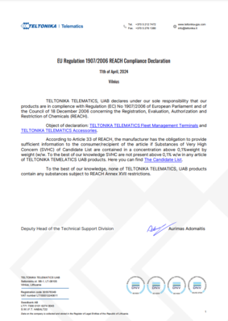

# FMC650 REACH

**TELTONIKA TELEMATICS** is committed to ensuring compliance with the requirements of **Regulation (EC) No 1907/2006 (REACH)**.

Material compliance is assessed based on available supplier information, external databases (e.g. Silicon Expert), and internal evaluation processes. Efforts are ongoing to further improve material traceability and data completeness across all products.

Information regarding the presence of Substances of Very High Concern (SVHC) and detailed compliance data is provided upon request, based on currently available information. Preparation and provision of such documentation is typically provided within 2–3 weeks.

# Attachments

| REACH Regulation Declaration certificate |
| --- |

You can the find PDF version of the REACH Regulation Declaration certificate **[here](https://web.archive.org/images/8/86/TELTONIKA_TELEMATICS_REACH_DoC_official_signed_2024-04-11.pdf)**.
