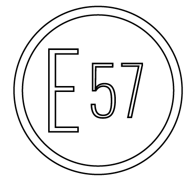
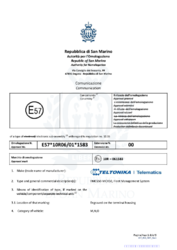
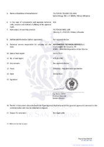
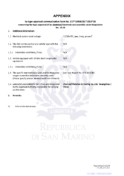
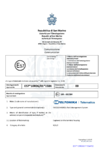
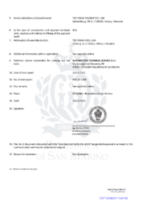
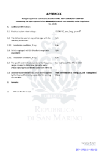

# FMC650 E-Mark

E-Mark is the regulations issued by the Economic Commission for Europe (referred to as ECE).

# Description

According to the UN European Economic Commission regulations and the provisions of EU directives, in order to enter the European market, cars, motorcycles and a variety of components and systems must be certified to meet the basic requirements of traffic safety and environmental protection. E-Mark and e-Mark are the European conformity marks issued by the transport sector, indicating that the products comply with relevant laws and regulations or directives. Vehicles and related products need to go through the E-Mark certification process to be legally sold in Europe.

There are currently 28 EU countries in ECE, in addition to EU member countries, including Eastern European, Southern European, and other non-European countries. ECE regulations apply to all members is recommended, not mandatory standards. Member States may apply the ECE regulations, or continue to use their own regulations. E-Mark logo is a circular frame, which means when the vehicle stop travel, the products must be used, for example, windshield, seat belts, headlights, and so on. Each EU member state has its own number of E-Mark certificate.

# Standards applied

This Approval shall apply to a type of electrical/electronic sub-assemblies (ESA) from serial production under the following conditions:

Individual products from serial production shall comply at least with all requirements set out in the **Regulation No. 10.06**.

Approval no.: **E57*10R06/01*1583** (for MCX50) / **E57*10R06/01*1584** (for MBX50)

Extension No.: **00**

The attached test report and drawings shall be a constituent part of this Approval.

Every product shall be marked with a readable and durable:

- approval marking.

# Attachments

**FMC650-MCX50**

| FMC650-MCX50 E-mark page 1 | FMC650-MCX50 E-mark page 2 | FMC650-MCX50 E-mark page 3 |
| --- | --- | --- |

You can find the PDF version of the certificate **[here](https://web.archive.org/images/4/4e/E57_10R-06_1583.pdf)**.

**FMC650-MBX50**

| FMC650-MBX50 E-mark page 1 | FMC650-MBX50 E-mark page 2 | FMC650-MBX50 E-mark page 3 |
| --- | --- | --- |

You can find the PDF version of the certificate **[here](https://web.archive.org/images/a/a4/E57_10R-06_1584.pdf)**.

***Disclaimer:***

*Test reports that are referenced in declarations and certificates can be provided upon request. For the request to be approved, the recipient of the test reports should be a certification authority or certified test house. The recipients will be asked to sign a non-disclosure agreement (NDA).*

[https://unece.org/fileadmin/DAM/trans/main/wp29/wp29regs/2019/E-ECE-324-Add.9-Rev.6.pdf](https://unece.org/fileadmin/DAM/trans/main/wp29/wp29regs/2019/E-ECE-324-Add.9-Rev.6.pdf)
