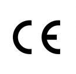
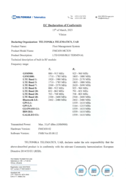
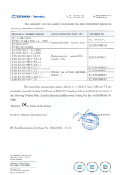
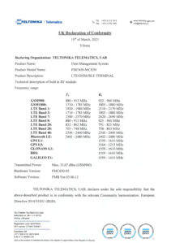
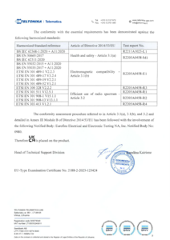
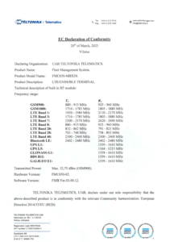
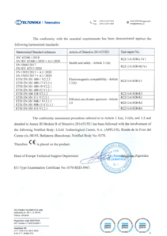
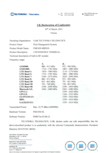
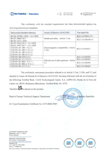

# FMC650 CE/RED

CE logoUKCA logoThe **Radio Equipment Directive** (2014/53/EU) ensures a Single Market for radio equipment by setting essential requirements for safety and health, electromagnetic compatibility, and the efficient use of the radio spectrum.

# Description

It applies to all products using the radio frequency spectrum. It has been applicable since 13 June 2016. As of 13 June 2017 the new set of requirements of RED are applicable to the equipment.

According to RED directive, the conformity against the following requirements needs to be demonstrated:

- 3.1(a): Radio equipment shall be constructed so as to ensure the protection of health and safety of persons and of domestic animals and the protection of property, including the objectives with respect to safety requirements set out in Directive 2014/35/EU (LVD), but with no voltage limit applying;
- 3.1(b): Radio equipment shall be constructed so as to ensure an adequate level of electromagnetic compatibility as set out in Directive 2014/30/EU (EMC).
- 3.2: Radio equipment shall be so constructed that it both effectively uses and supports the efficient use of radio spectrum in order to avoid harmful interference.

Starting with 20 December 2020 only the EN62368-1 will be accepted as a proof of conformity for LVD part of CE RED requirements.

# Standards applied

The conformity with the essential requirements has been demonstrated against the following harmonized standards:

| Standard | Article |
| --- | --- |
| IEC 62368-1:2018 EN IEC 62368–1:2020 + A11:2020 EN 50665:2017 EN IEC 62311:2020 | Health and safety - Article 3.1(a) |
| EN 55032:2015 + A11:2020 EN 55035:2017 + A11:2020 EN 301 489-1 V2.2.3 EN 301 489-17 V3.2.4 EN 301 489-19 V2.2.1 EN 301 489-52 V1.2.1 | Electromagnetic compatibility - Article 3.1(b) |
| EN 300 328 V2.2.2 EN 301 511 V12.5.1 EN 301 908-1 V15.1.1 EN 301 908-2 V13.1.1 EN 303 413 V1.2.1 | Efficient use of radio spectrum - Article 3.2 |

Therefore  and  are placed on the product.

***Disclaimer:***

*Test reports that are referenced in declarations and certificates can be provided upon request. For the request to be approved, the recipient of the test reports should be a certification authority or certified test house. The recipients will be asked to sign a non-disclosure agreement (NDA).*

# Attachments

**FMC650-MCX50**

| EC Declaration of Conformity FMC650-MCX50 (2023-03-15), First Page | EC Declaration of Conformity FMC650-MCX50 (2023-03-15), Second Page | UK Declaration of Conformity FMC650-MCX50 (2023-03-15), First Page | UK Declaration of Conformity FMC650-MCX50 (2023-03-15), Second Page |
| --- | --- | --- | --- |

You can the find PDF version of the EC declaration **[here](https://web.archive.org/images/6/64/EC_Declaration_of_Conformity%2C_FMC650-MCX50%2C_2023-03-15.pdf)**.

You can the find PDF version of the UK declaration **[here](https://web.archive.org/images/b/b3/UK_Declaration_of_Conformity%2C_FMC650-MCX50%2C_2023-03-15.pdf)**.

You can the find PDF version of the EC declaration regarding Cyber Security **[here](https://web.archive.org/images/8/88/EC_Declaration_of_Conformity%2C_ET25A0566%2C_2025-08-01.pdf)**.

**FMC650-MBX50**

| EC Declaration of Conformity FMC650-MBX50 (2023-03-20), First Page | EC Declaration of Conformity FMC650-MBX50 (2023-03-20), Second Page | UK Declaration of Conformity FMC650-MBX50 (2023-03-20), First Page | UK Declaration of Conformity FMC650-MbX50 (2023-03-20), Second Page |
| --- | --- | --- | --- |

You can the find PDF version of the EC declaration **[here](https://web.archive.org/images/b/b8/EC_Declaration_of_Conformity%2C_FMC650-MBX50%2C_2023-03-20.pdf)**.

You can the find PDF version of the UK declaration **[here](https://web.archive.org/images/a/a2/UK_Declaration_of_Conformity%2C_FMC650-MBX50%2C_2023-03-20.pdf)**.

You can the find PDF version of the EC declaration regarding Cyber Security **[here](https://web.archive.org/images/b/b9/EC_Declaration_of_Conformity%2C_ET25A0565%2C_2025-08-01.pdf)**.

# External links

[https://ec.europa.eu/growth/single-market/european-standards/harmonised-standards/red_en](https://ec.europa.eu/growth/single-market/european-standards/harmonised-standards/red_en)
