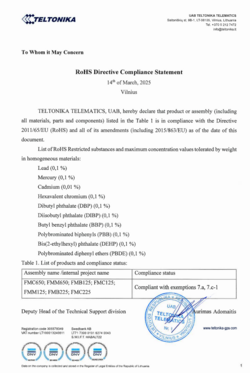

# FMC650 RoHS

RoHS compliance logo.The **Restriction of Hazardous Substances Directive 2002/95/EC**, (**RoHS 1**), short for Directive on the restriction of the use of certain hazardous substances in electrical and electronic equipment, was adopted in February 2003 by the European Union. The **RoHS 2** directive (2011/65/EU) is an evolution of the original directive and became law on 21 July 2011 and took effect 2 January 2013. **RoHS 3**, or Directive 2015/863, adds four additional restricted substances (phthalates) to the orginal list of six, as cited under REACH legislation. It also adds Category 11 products. The RoHS3 takes effect 22 Jul 2019.

# Description

The **RoHS 1** directive took effect on 1 July 2006, and is required to be enforced and became a law in each member state. This directive restricts (with exceptions) the use of six hazardous materials in the manufacture of various types of electronic and electrical equipment. It is closely linked with the Waste Electrical and Electronic Equipment Directive (WEEE) 2002/96/EC which sets collection, recycling and recovery targets for electrical goods and is part of a legislative initiative to solve the problem of huge amounts of toxic electronic waste.

Each European Union member state will adopt its own enforcement and implementation policies using the directive as a guide.

RoHS is often referred to as the "lead-free directive", but it restricts the use of the following six substances:

1. Lead (Pb)
2. Mercury (Hg)
3. Cadmium (Cd)
4. Hexavalent chromium (Cr6+)
5. Polybrominated biphenyls (PBB)
6. Polybrominated diphenyl ether (PBDE)

The **RoHS 2** directive (2011/65/EU) addresses the same substances as the original directive while improving regulatory conditions and legal clarity. It requires periodic reevaluations that facilitate gradual broadening of its requirements to cover additional electronic and electrical equipment, cables and spare parts. The CE logo now indicates compliance and RoHS 2 declaration of conformity is now detailed.

The **RoHS 3** (EU Directive 2015/863) adds Category 11 (catch-all) products and adds four new restricted substances - all phthalates. The four phthalates are mainly used as insulation plasticizers, and are on the REACH list of SVHC (Substances of Very High Concern). The expanded list for RoHS 3 is thus as follows:

- Lead (0.1 %)
- Mercury (0.1 %)
- Cadmium (0.01 %)
- Hexavalent chromium (0.1 %)
- Dibutyl phthalate (DBP) (0.1 %)
- Diisobutyl phthalate (DIBP) (0.1 %)
- Butyl benzyl phthalate (BBP) (0.1 %)
- Polybrominated biphenyls (PBB) (0.1 %)
- Bis(2-ethylhexyl) phthalate (DEHP) (0.1 %)
- Polybrominated diphenyl ethers (PBDE) (0.1 %)

# Attachments

| EU RoHS Declaration of Conformity |
| --- |

You can the find PDF version of the declaration **[here](https://web.archive.org/images/e/ec/RoHS_pro_2025-03-14.pdf)**.

# External links

[http://www.rohsguide.com/](http://www.rohsguide.com/)
