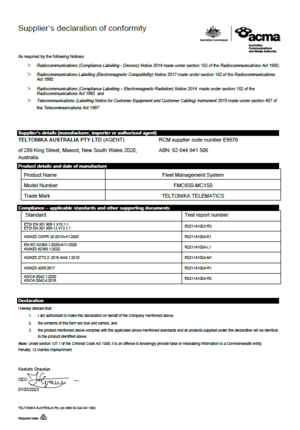

# FMC650 RCM

RCM compliance logo.The Regulatory Compliance Mark (RCM) is a trade mark owned by the electrical regulator (Regulatory Authorities (RAs)) and Australian Communications Media Authority (ACMA).

# Description

The Australian Standard AS/NZS 4417.1 and AS/NZS 4417.2 Marking of electrical products to indicate compliance with regulations – General rules for use of the mark provides general requirements for the use of the RCM including location of the marking on the equipment and its dimensional requirements.

The RCM is a symbol that represents compliance with two independent schemes:

- EESS; and
- ACMA’s labelling requirements.
-

**For electrical safety, in-scope electrical equipment must not be sold unless the item is marked with the RCM in compliance with AS/NZS 4417.1 & 2 and the EESS.**

The move to one single mark helps reduce red tape for industry and save costs. One mark to represent compliance to both schemes, and the removal of the need to track and mark equipment with unique approval/certificate numbers saves time and money. The symbol will also be easier to recognise by consumers.

# Compliace-applicable standards and other supporting documents

- Evidence of compliance with applicable standards may be demonstrated by test reports, endorsed/accredited test reports, certification/competent body statements.
- Having had regard to these documents, I am satisfied the above mentioned product complies with the requirements of the relevant ACMA Standards made under the Radiocommunications Act 1992 and the Telecommunications Act 1997.
- List the details of the documents the above statement was made, including the standard title, number and, if applicable, number of the test report/endorsed test report or certification/competent body statement

| Standard | Test Report Number |
| --- | --- |
| ETSI EN 301 908-1 V15.1.1 ETSI EN 301 908-13 V13.1.1 | R2211A1023-R2 |
| AS/NZS CISPR 32-2015+A1:2020 | R2211A1024-E1 |
| EN IEC 62368-1:2020+A11:2020 AS/NZS 62368.1:2022 | R2211A1024-L1 |
| AS/NZS 2772.2: 2016 Amd 1:2018 | R2211A1024-M1 |
| AS/NZS 4268:2017 | R2211A1024-R1 |
| AS/CA S042.1:2020 AS/CA S042.4:2018 | R2211A1024-R2 |

# Attachments

Suppliers declaration of conformity FMC650

You can the find PDF version of the RCM certificate [here](https://web.archive.org/images/4/41/Suppliers_Declaration_of_Conformity_FMC650-MCX50.pdf)

# External links

[https://infostore.saiglobal.com/en-au/Standards/Product-Details-116302_SAIG_AS_AS_267286/?ProductID=116302_SAIG_AS_AS_267286](https://infostore.saiglobal.com/en-au/Standards/Product-Details-116302_SAIG_AS_AS_267286/?ProductID=116302_SAIG_AS_AS_267286)

[https://www.acma.gov.au/](https://www.acma.gov.au/)
