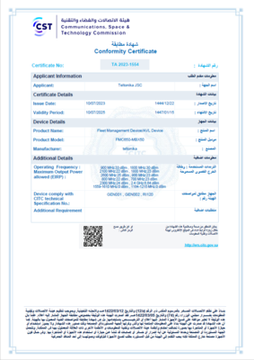

# FMC650 CITC

# About CITC

The [Communications and Information Technology Commission](https://www.citc.gov.sa/ar/Pages/default.aspx) (CITC or the Commission) is mandated, in accordance with the Telecommunications Act, Telecom Act Bylaw and CITC Ordinance; to license telecommunications and information technology equipment in the Kingdom of Saudi Arabia

CITC mandates that network-based devices must support 4G/LTE technology as a prerequisite for approval of such equipment in Saudi Arabia. Hence, 2G and 3G only devices can no longer be approved and certified in the Kingdom. This specification has come into force on January 2020 and has been communicated without a transitional period as a part of the country’s network infrastructure improvement.

# WHY THIS CERTIFICATION IS SIGNIFICANT

CITC approval allows to deliver one of the most advanced, credible, and competitive Teltonika GPS trackers to Saudi Arabia. No doubt, it will bring the indisputable value to our business partners and end-users, numerous market segments and local society by delivering high value features, durability, and quality in Telematics.

# Attachments

## FMC650 - MBX50

| Communications and Information Technology Commission (CITC) certificate for FMC650 |
| --- |

You can the find PDF version of the CITC certificate **[here](https://web.archive.org/images/7/77/ApprovalCertificateFront_FMC650_CITC.pdf)**.

# External links

[https://www.citc.gov.sa/ar/Pages/default.aspx](https://www.citc.gov.sa/ar/Pages/default.aspx)
