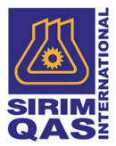
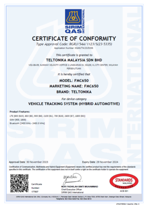
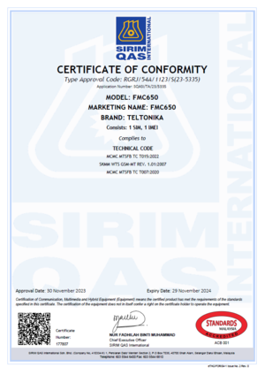

# FMC650 SIRIM QAS

SIRIM QAS International Sdn. Bhd. is Malaysia’s leading testing,inspection and certification body.

# Description

After three decades of providing testing, inspection and certification under SIRIM Berhad, the company established a wholly-owned subsidiary of SIRIM Group – SIRIM QAS International in March 1997. Today, local and international customers from various economies have made us the preferred choice for their testing, inspection and certification needs.

Companies wanting to comply with internationally recognised standards have found their ideal solution in SIRIM QAS International’s certification scheme. As a partner of the International Certification Network (IQNet), our management system certificates are globally recognised. Thus, adding value to your products and services and giving you access to world markets. Customers trust and rely on our one-stop solutions and quality services to safeguard their interests and the environment.

# Standards applied

The conformity with the essential requirements has been demonstrated against the following harmonized standards:

**Standards applied:**

1. **MCMC MTSFB TC T007:2020**
2. **MCMC MTSFB TC T015:2017**
3. **SKMM WTS GSM-MT REV. 1.01:2007**

The characteristics and technical specifications of this Certificate are as follows:

| BRAND | TELTONIKA |
| --- | --- |
| MODEL | FMC650 |
| DEVICE CATEGORY | VEHICLE TRACKING SYSTEM (HYBRID-VEHICLE) |
| OPERATING FREQUENCY BANDS | GSM 900/1800/3G(900/2100) / LTE (850/900/1800/2100/2600(B7/B38)) / ISM |

Sirim Approval No.: **RGMK/01A/0820/S(20-3059)**

# Attachments

## FMC650

|  FMC650-MCBI0 1 SIRIM QAS Sertificate |  FMC650-MCBI0 2 SIRIM QAS Sertificate |
| --- | --- |

To download a PDF version of the declaration, [here](https://web.archive.org/images/d/d1/FMC650-MCBI0_SIRIM_QAS_Sertificate_2024-01-25.pdf).

***Disclaimer:***

Test reports that are referenced in declarations and certificates can be provided upon request. For the request to be approved, the recipient of the test reports should be a certification authority or certified test house. The recipients will be asked to sign a non-disclosure agreement (NDA)

> **Note:** the latest available Wayback capture of this page is **2024-10-13** (CDX-verified: no captures after that date); the certificate itself is dated 2024-01-25, so the page content is consistent.
