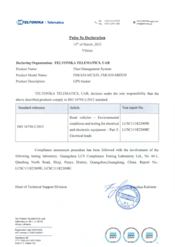

# FMC650 Pulse 5a declaration

# Description

ISO 16750-2:2012 applies to electric and electronic systems/components for road vehicles. It describes the potential environmental stresses and specifies tests and requirements recommended for the specific mounting location on/in the road vehicle.

FMC650 is a Pulse 5a compliant device.

# Attachments

| Pulse 5a declaration FMC650 |
| --- |

You can the find PDF version of Pulse 5a declaration **[here](https://web.archive.org/images/b/b6/Pulse_5a_Declaration%2C_FMC650%2C_2023-03-15.pdf)**.
