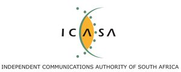
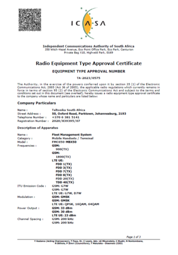
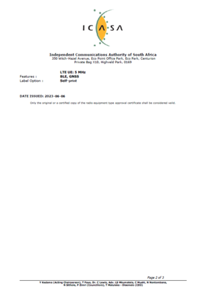
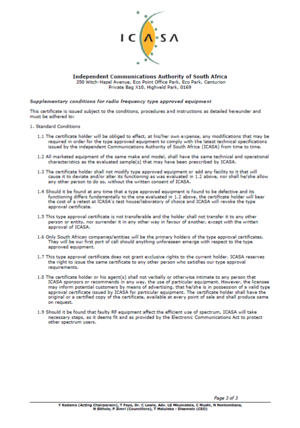

# FMC650 ICASA

ICASA logo

# Description

The Independent Communications Authority of South Africa (ICASA) is the regulatory body responsible for overseeing the communications and broadcasting sectors in South Africa. It plays a pivotal role in regulating and managing the use of radio frequency spectrum, ensuring fair competition, protecting consumers, and promoting the growth of the telecommunications industry.

Having a certificate from ICASA for telecommunication devices is essential for several reasons:

- Regulatory compliance: Obtaining ICASA certification ensures that telecommunication devices comply with the regulatory standards set by the authority. This includes technical specifications, safety requirements, and adherence to international standards.

- Spectrum management (interference prevention): ICASA manages the allocation and use of radio frequency spectrum, and certification helps ensure that devices operate within allocated frequency bands, minimizing the risk of interference with other services.

- Quality assurance (consumer protection): Certification ensures that devices meet safety standards, protecting consumers from potential hazards associated with poorly designed or manufactured devices. It also ensures that consumers receive quality products that perform as expected.

- Market access: Having ICASA certification facilitates market access in South Africa.

# Attachments

| FMC650-MBX50 ICASA Certificate 1 page | FMC650-MBX50 ICASA Certificate 2 page | FMC650-MBX50 ICASA Certificate 3 page |
| --- | --- | --- |
