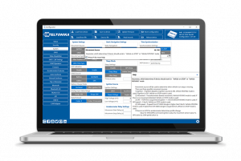

# Teltonika Configurator

Teltonika Configurator software is a sophisticated tracker management tool. With just one application you can manage several types of devices.

This tool lets you also make firmware updates, device diagnostics, status checks, and debug. Configurator supports connection over USB cable and Bluetooth®. Advanced tooltips integration allows you to use configurator without any user manuals.

- [Introduction](https://wiki.teltonika-gps.com/view/Teltonika_Configurator_Introduction)
- [Configurator versions](https://wiki.teltonika-gps.com/view/Teltonika_Configurator_versions)
- [FAQ](https://wiki.teltonika-gps.com/view/Teltonika_Configurator_FAQ)
