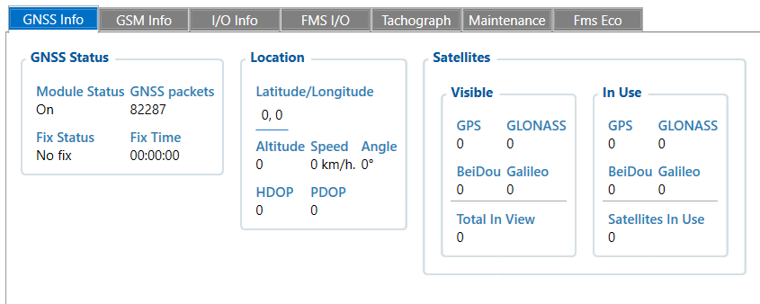
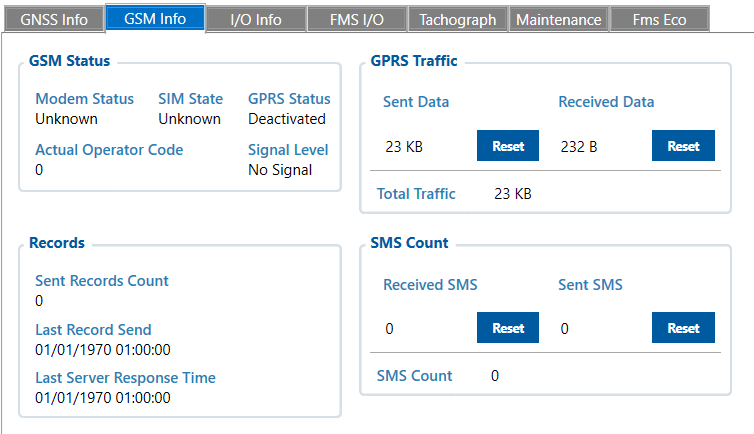
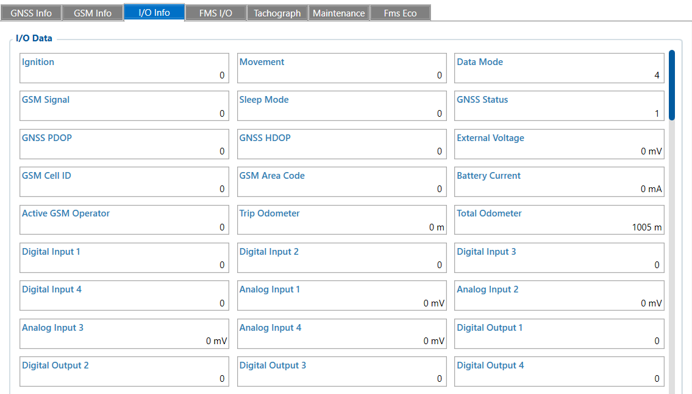
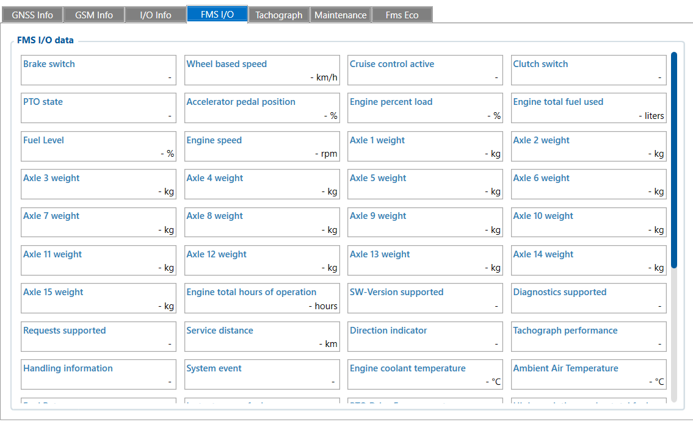
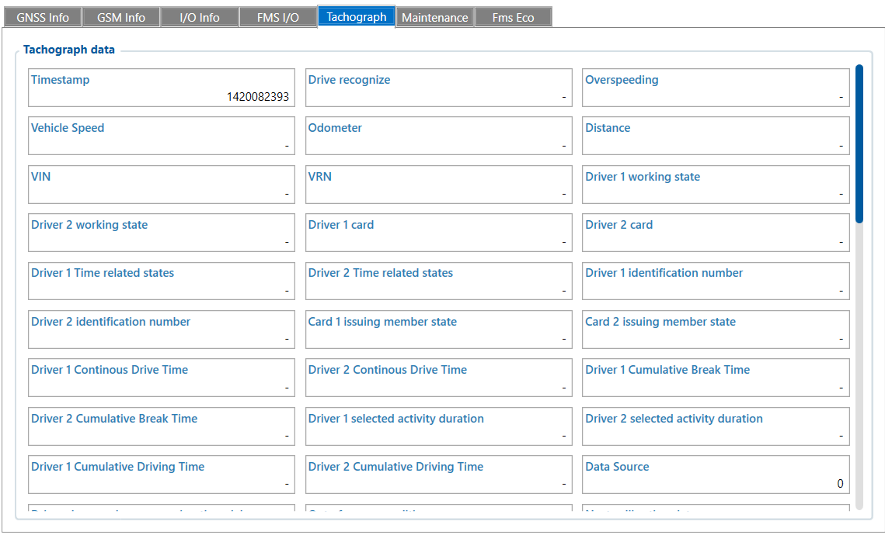
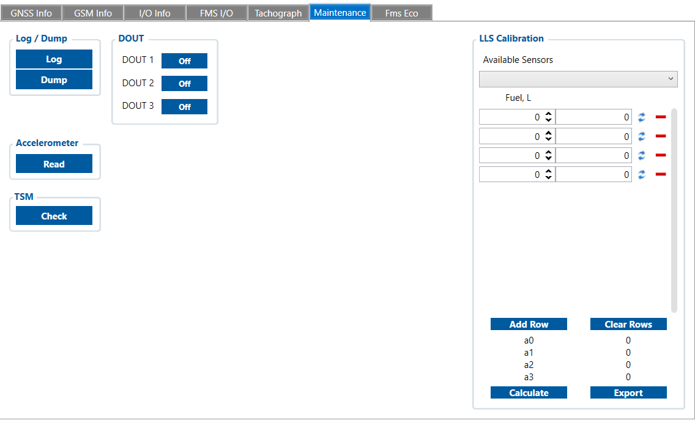
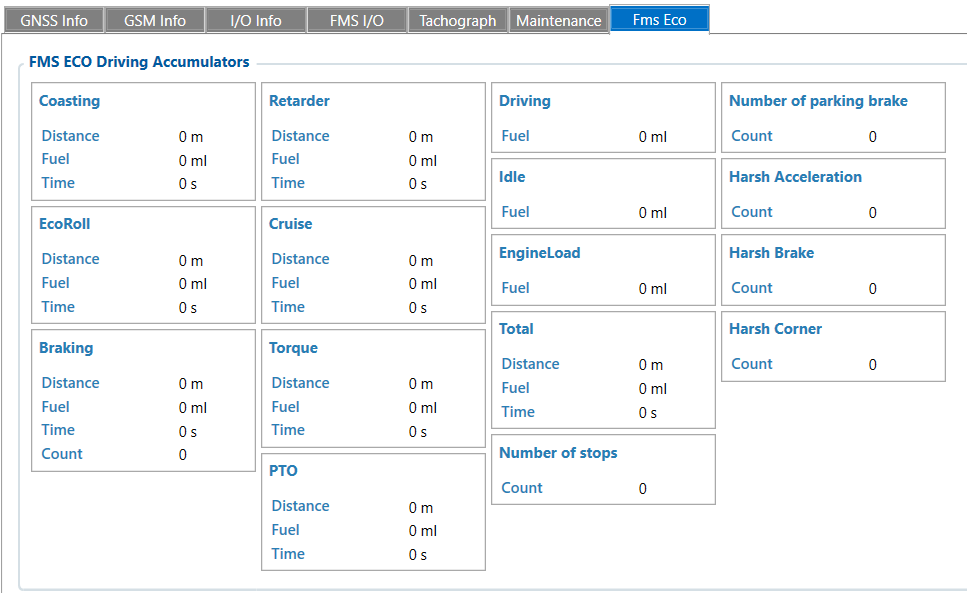

# Status — Configurator notes (EN)

> **Note:** Supplementary notes extracted from the French Configurator tab PDF
> `status-tab.pdf`, generated on **2026-11-05T08:37:58Z** — newer than the wiki
> snapshot kept in this folder. The text has been translated into English; it
> supplements the reference page [`status-info.md`](../status-info.md).
> PDF extraction quirks: section titles sometimes appear after the text they
> introduce, figures reuse page-1 filenames, and some wide tables are
> restituted row by row because the PDF text layer does not always preserve
> the columns. Unarchived `docs.tinolyx.com` image links were removed; unique
> figures are grouped under `## Figures`.

<!-- PDF p. 1 -->

## Contents

- GNSS info
- GSM Info
- I/O info
- FMS I/O
- Tachograph
- Maintenance
- Fms eco

<!-- PDF p. 2 -->

Meaning: Indicates whether the satellite hardware receiver is on ( On ) or off ( Off ).
The FMC650 has an Airoha AG3335MB GNSS module and supports:
GPS
GLONASS
Galileo
BeiDou
QZSS.
Meaning: Raw counter of the number of data packets processed by the GNSS module since startup. (This is not a satellite count).
Meaning: Indicates whether the device has managed to obtain a position fix.
Fix = valid position acquired.
No fix = no position calculated.

## GNSS info

The Status > GNSS Info menu lets you monitor in real time the device's ability to receive signals from the satellite constellations.

**Module Status**

**GNSS Packets**

**Fix Status**

**Fix Time**

<!-- PDF p. 3 -->

Meaning: Duration or timestamp of the last successful GPS fix.
Meaning: Current geographic coordinates of the tracker. 0,0 means no position has been determined.
Meaning: Vehicle height above sea level (in metres). Unavailable if No fix .
Meaning: Instantaneous vehicle speed calculated by GPS.
Meaning: Vehicle heading (orientation in degrees from 0° to 360° relative to north).
Meaning: Geometric precision indices of the satellite position. The lower the value, the more precise the position.
Meaning: Total number of satellites seen by the antenna in the sky, across all constellations (GPS, GLONASS, BeiDou, Galileo).
Meaning: Actual number of satellites used by the device to mathematically calculate its position (generally requires at least 4 satellites).

**Location (Latitude / Longitude)**

**Altitude**

**Speed**

**Angle**

**HDOP / PDOP**

**Satellites — Total In View**

**Satellites — Satellites In Use**

<!-- PDF p. 4 -->

Meaning: Internal operating state of the cellular modem (e.g. Unknown , Ready , etc.).
Meaning: Read state of the inserted SIM card (e.g. SIM absent, PIN code required, valid card, or Unknown ).
Meaning: State of the mobile data session. Deactivated means the device is not connected to the Internet via the mobile network.

## GSM Info

This page covers mobile network + modem + GPRS + data traffic + SMS.

**Modem Status**

**SIM State**

**GPRS Status**

**Actual Operator Code**

<!-- PDF p. 5 -->

Meaning: Numeric code (MCC/MNC) of the mobile network operator to which the device is currently registered ( 0 = no network).
Meaning: Strength of the cellular signal received by the antenna ( No Signal = no coverage or GSM antenna disconnected).
Meaning: Total volume of data (in kilobytes or bytes) sent and received by the modem since power-on.
Meaning: Number of records (AVL messages containing coordinates and tags) sent and acknowledged by the remote server.
Meaning: Date and time of the last successful sending of an AVL message to the server .
Meaning: Timestamp of the last response received from the remote server (acknowledgement).
Meaning: Counter of text messages received and sent by the tracker.

**Signal Level**

**GPRS Traffic (Sent / Received)**

**Sent Records Count**

**Last Record Send**

**Last Server Response Time**

**SMS Count (Received / Sent)**

<!-- PDF p. 6 -->

Ignition : Indicates the vehicle ignition state ( 0 = OFF, 1 = ON).
Movement : Detects physical movement via the accelerometer ( 0 = stationary, 1 = moving).
Data Mode : Network mode and vehicle logic state (e.g. 4 = Unknown On Stop).
GSM Signal : Mobile signal reception level (from 1 to 5, or 0 if no signal).

## I/O info

This page lists all the input/output (I/O) parameters of the Teltonika FMC650 as well as the meaning of each value measured by the device.

### System and general parameters

<!-- PDF p. 7 -->

Sleep Mode : Device power-saving mode ( 0 = No Sleep, 1 = Deep Sleep, etc.).
GNSS Status : Satellite positioning state ( 0 = OFF, 1 = ON without antenna, 2 = ON without fix, 3 = ON with fix).
GNSS PDOP / HDOP : Geometric and horizontal precision indicators of the GPS position.
External Voltage : External supply voltage measured at the device (in millivolts).
Battery Current : Electrical current associated with the internal backup battery.
Trip Odometer : Distance counter for the current trip.
Total Odometer : Overall internal mileage counter of the terminal (in metres).
Record Counter : Total number of AVL records generated since startup.
Ignition Work Time : Accumulated operating time with the ignition on.
GSM Cell ID : Identifier of the mobile telephony cell in use.
GSM Area Code : Network location area code (LAC).
Active GSM Operator : Numeric code of the active mobile operator.
Network Type : Network technology used ( 0 = 3G, 1 = 2G, 2 = 4G, etc.).
LTE Cell ID : Identifier of the active LTE cell.
Connectivity Quality : Indicator of network link quality.
No SIM Err Counter : Counter of errors related to the absence or reading of the SIM card.
IMSI / ICCID : Unique identification numbers of the SIM card.

**Network and Identification (GSM / SIM)**

<!-- PDF p. 8 -->

IMEI : Unique hardware serial number of the terminal (essential for identification on Wialon).
Digital Inputs (DIN 1 to 4) : State of the logic inputs for detecting on/off type signals (ignition, button, alarm).
Analog Inputs (AIN 1 to 4) : Measurement of electrical voltages on the analog inputs (in millivolts or volts).
Digital Outputs (DOUT 1 to 4) : Control commands for external equipment (relays, buzzers, etc.).
Axis X, Y, Z : Acceleration values measured on the three axes by the accelerometer (expressed in mG).
Axl Calibration State : Calibration state of the device orientation.
Eco Score : Score or indicator related to driving behaviour (eco-driving).
SD Status : Detection state of the external storage card (Micro-SD).
PCB Temperature : Internal temperature of the device's electronic board.
1-Wire Temperature / Humidity : Values read by the 1-Wire probes (the value 3000 indicates a sensor that is not connected).
1-Wire Sensor Temperature ID : Unique hardware identifier of the 1-Wire sensor.
iButton / RFID / RFID2 : Identifiers of the keys or badges used for driver authentication.
Inputs and Outputs (I/O)
Integrated Sensors and Processing

### Fuel and External Sensors (1-Wire, RS232, BLE)

<!-- PDF p. 9 -->

Fuel Counter : Pulse or volume counter dedicated to fuel consumption.
Impulse Frequency / RPM : Frequency in Hz and engine speed measured from pulses.
LLS Fuel Level / Temperature : Fuel level and temperature measured via LLS sensors (analog, RS232, RS485).
UL202 / UL212 : Fuel level and volume parameters for connected ultrasonic probes.
BLE (Temperature, Battery, Humidity, Custom, LLS, Luminosity) : Data transmitted by wireless sensors connected via Bluetooth Low Energy.

<!-- PDF p. 10 -->

Brake switch : Brake pedal state ( 0 = released, 1 = pressed).
Wheel based speed : Actual vehicle speed provided by the CAN/FMS system.
Cruise control active : Cruise control state ( 0 = OFF, 1 = ON).
Clutch switch : Clutch pedal state ( 0 = released, 1 = pressed).
Accelerator pedal position : Accelerator pedal position or demand (in %).

## FMS I/O

FMS = Fleet Management System.
In the context of the FMC650, FMS is an interface that allows the tracker to retrieve information from the heavy vehicle, mainly via CAN/J1939/FMS.

### Driving and Vehicle Controls

<!-- PDF p. 11 -->

Brake pedal position : Report of the current brake pedal position (in %).
Direction indicator : Direction of travel ( 0 = forward, 1 = reverse).
PTO State / PTO Drive Engagement : Power take-off state (hydraulic equipment, tipper, crane).
Engine speed : Engine speed in revolutions per minute (RPM).
Engine percent load : Current engine load (in %).
Engine total hours of operation : Total number of engine operating hours.
Engine coolant temperature : Coolant temperature.
Engine Oil Temp / Transmission Oil Temp : Engine and transmission oil temperatures.
Engine Oil Pressure : Engine oil pressure.
Ambient Air Temperature : Outside air temperature.
Cab Interior Temp : Temperature inside the cab.
Engine MIL Indicator : Engine fault indicator (diagnostic lamp).
Fuel Level : Fuel level of the main tank (in %).
Fuel Level 2 : Fuel level of the secondary tank.
Engine total fuel used : Cumulative volume of fuel consumed.
High Resolution Engine Total Fuel Used : Fuel volume consumed in high resolution (increased precision in L or mL).
Fuel Rate : Instantaneous consumption rate (in L/h).
Instantaneous Fuel Economy : Instantaneous fuel economy (in km/L).
Engine and Performance

### Fuel and Consumption

<!-- PDF p. 12 -->

Fuel Type : Fuel type reported by the vehicle.
Water In Fuel : Alert for detection of water in the fuel.
AdBlue Status / AdBlue Level : Status and percentage of the AdBlue fluid level (SCR system).
Axle 1 weight to Axle 15 weight : Load transmitted individually by each axle via the truck system.
Combined vehicle weight : Total combined weight of the truck and its trailers (Gross Combination Vehicle Weight).
Service Distance : Remaining or associated distance to the vehicle's maintenance intervals.
Tachograph performance : Operating state of the tachograph.
Handling information / System event : Specific information and events from the tachograph.
Tire Location / Tire Pressure : Tire location and pressure via the monitoring system (TPMS).
SW-Version supported / Diagnostics supported / Requests supported : Compatibility and version indicators for the vehicle's FMS functions.

### Weights and Loads

Maintenance and Tachograph

<!-- PDF p. 13 -->

Before collecting data, the FMC650 device must be configured to know where and how to query the tachograph.
DDD Download Source (File download source) :
Meaning: Defines which physical line of the device the tachograph is connected to in order to retrieve the bulk files (DDD files).
Value options:
CAN1 (Generally reserved for the FMS/J1939 bus)

## Tachograph

The FMC650 works with digital tachograph information, in particular via its K-Line interface, and it can also manage remote downloading of tachograph files.

### 1. Device Configurations (Tachograph / WEB Tacho Settings)

<!-- PDF p. 14 -->

**CAN2 (Generally wired to the tachograph or TachoCAN)**

K-Line (Direct K-Line communication line of the tachograph)
Tachograph Ignition Source (Ignition source for the tacho) :
Meaning: Associates the tachograph ignition state with a physical source on the device (e.g. digital input DIN or system ignition source).
Value options: DIN1 , DIN2 , DIN3 , DIN4 , Ignition Virtuelle , etc.
WEB Tacho Settings (Remote download parameters) :
Status : 0 = Disabled / 1 = Enabled (activation of the automatic transfer service for DDD files to a remote server).
Domain / Port : IP address/domain name and port of the server centralising tachograph files (e.g. Wialon Web Tacho or dedicated FTP).

**Timestamp (ID 1420071174, for example)**

Meaning: Unix timestamp (in seconds since 1970) of the tachograph frame.

**Drive Recognize**

Meaning: Indicates whether the tachograph detects the vehicle as moving.
Value options: 0 = Vehicle stationary, 1 = Vehicle moving, 2 = Error, 3 = Unavailable.

**Overspeeding (Tachograph Over Speed)**

Meaning: Reference speed exceedance state calculated by the tachograph (different from simple GPS speed).
Vehicle Speed

### 2. Tachograph Live I/O Parameters (Meaning and Ranges)

#### A. General Vehicle Parameters

<!-- PDF p. 15 -->

Meaning: Instantaneous vehicle speed measured by the tachograph (in km/h).

**Odometer & Distance**

Meaning: Total mileage ( Odometer in metres) and current trip distance ( Distance ) provided by the tacho's metric module.

**VIN / VRN**

Meaning: Vehicle identification number (VIN) and registration number (VRN) read directly from the tachograph memory.

**Data Source**

Meaning: Origin of the tachograph data reporting.
Value options: 0 = Unknown, 1 = K-Line, 2 = ALL-CAN300, 3 = TachoCAN, 4 = FMS.

**Driver Working State (Activities 1 and 2)**

Meaning: Instantaneous activity recorded on the driver card.
Value options: 0 = Rest (Rest), 1 = Availability (Available), 2 = Work (Work), 3 = Driving (Drive), 6 = Error, 7 = Not available.

**Driver Card Presence (1 and 2)**

Meaning: Physical detection of the smart card in the tachograph slots.
Value options: 0 = Card absent, 1 = Card present, 2 = Error, 3 = Unavailable / Private Mode (Privacy).

**Driver Time Related States**

Meaning: Regulatory alert state indicators (approaching driving limits).

#### B. Driver States (Driver 1 & Driver 2)

<!-- PDF p. 16 -->

Value options: 0 = Normal, 1 = 15 min before 4h30 of driving, 2 = 4h30 reached, 3 = 15 min before 9h, 4 = 9h reached, 5 to 10 = 16h / weekly rest thresholds, 11 - 12 = Card expiry or download alerts, 13 = Other, 14 = Error, 15 = Unavailable.

**Driver Identification Number & Card Issuing Member State**

Meaning: Unique driver identification number extracted from their card and numeric code of the issuing country (European NationNumeric standard).

**Continuous Drive Time**

Meaning: Driving time accumulated without interruption during the active period (in minutes).

**Cumulative Break Time**

Meaning: Total duration of valid breaks taken to satisfy the current regulatory break (in minutes).

**Current Daily / Weekly Driving Time**

Meaning: Total driving time accumulated over the current day or the current week.

**Remaining Current Driving Time / Remaining Driving Time On Current Shift**

Meaning: Remaining driving time allowance before the legal obligation to stop (for the immediate period or the current shift).

**Time Left Until New Daily / Weekly Rest Period**

Meaning: Calendar time remaining before the deadline for a new daily or weekly rest period.

**Duration Of Next Break Rest / Remaining Time Until Next Break**

Meaning: Mandatory duration of the next break to be observed versus the time remaining before it must be started.
Number of times 9h daily driving times exceeded

#### C. Driving Time and Breaks (European Social Regulations)

<!-- PDF p. 17 -->

Meaning: Counter of infringements or uses of the 10h driving extensions / exceedances of 9h during the week (value from 0 to 13 ).

**Open Compensation (Last Week / Week Before Last)**

Meaning: Compensatory rest time still owed for previous weeks (in minutes).

**K-Line D8 Driver Privacy info (K-Line Privacy Mode)**

Meaning: Management of driver data privacy via the K-Line.
Value options: 0 = Private mode disabled, 1 = Private mode enabled, 2 = No K-Line data available.

**Vehicle Load Type info**

Meaning: Transport type configured in the heavy vehicle system.
Value options: 0 = Undefined, 1 = Goods (Goods), 2 = Passengers (Passengers).

**Drivers Private Data Consent**

Meaning: 4-byte bitmask indicating whether the driver authorises the transmission of their legal and personal nominative data to telematics servers. ( 0 = Denied/Disabled, 1 = Authorised/Enabled).

**Driver Card Expiry Date & Next Calibration Date**

Meaning: Respective expiry dates of the driver's smart card and of the next mandatory tachograph calibration at an approved centre.

#### D. Advanced and FMC650-Specific Parameters

<!-- PDF p. 18 -->

These tools are not used for real-time truck telematics, but for technical troubleshooting and fault analysis of the FMC650 device.

**Log (Log retrieval button)**

Meaning: Extraction of firmware log files to analyse internal activity, communication errors, peripheral connections (BLE, GNSS, CAN) and system events.

**Dump (Internal state copy button)**

Meaning: Generation of a complete low-level status report of the device's memory and processes, mainly intended for Teltonika technical support

## Maintenance

The Maintenance window can be understood as an area reserved mainly for FMC650 diagnostics, digital output tests and calibration of an LLS fuel level sensor.

### 1. LOG / DUMP Section (Advanced Diagnostics)

<!-- PDF p. 19 -->

in the event of complex malfunction.

**Read (Instant read button)**

Meaning: Queries the internal 3-axis accelerometer (X, Y, Z) to display raw force values (in milligravities - mG).
Configurations / Uses: Lets you check the positioning and correct operation of the internal sensor used for detecting movement, towing, harsh braking, acceleration or collisions.

**Check (Verification button)**

Meaning: Runs a check test of the link with the tachograph management module or subsystem.
Configurations / Uses: Quickly validates whether the device communicates correctly with the connected tachograph interface.
Allows configuring, testing and driving the control outputs of the FMC650 device manually or logically.

**DOUT 1, DOUT 2, DOUT 3 (Digital Outputs)**

Meaning: Logic state of the device's power/control outputs (for driving relays, warning devices, engine blocking, etc.).
Configuration value options:
Off (Disabled / Open)
On (Enabled / Closed / Loaded)

### 2. Accelerometer Section (Motion Sensor)

### 3. TSM Section (Tachograph Sensor Module / Verification)

### 4. DOUT Section (Digital Outputs)

<!-- PDF p. 20 -->

Logic modes available in the configurator: Pulse, blinking, event triggering (speeding, geofence, alarm, etc.).
This interface is used to calibrate a capacitive or resistive LLS (Liquid Level Sensor) probe to convert a raw electrical value into the actual fuel volume (in litres).

**Available Sensors**

Meaning: List of LLS sensors detected by the FMC650 (generally via the analog, digital or RS232/RS485 inputs).

**Calibration Table (Fuel, L)**

Meaning: Correspondence between the raw value returned by the LLS probe and the actual fuel volume present in the tank.
Configuration choice: Manual entry of value pairs [Raw sensor value] ↔ [Actual volume in Litres] .
Table action buttons:
[Add Row] : Adds an additional measurement point to refine the calibration curve.
[Clear Rows] : Clears all entered calibration points.
[↻] (Synchronisation icon) : Refreshes the active measurement row.
[—] (Red icon) : Deletes a specific row from the table.

**Calibration Coefficients (a₀, a₁, a₂, a₃)**

Meaning: Mathematical parameters of the polynomial function calculated to smooth the gauge curve (e.g. tanks with complex non-linear shapes).
Initial values: 0 by default (until a calculation has been performed).

**Calculate & Export**

[Calculate] button: Automatically generates coefficients a₀ to a₃ from the calibration points entered in the table.

### 5. LLS Calibration Section (External Fuel Level Probe)

<!-- PDF p. 21 -->

[Export] button: Saves or exports the calibration configuration so it can be applied to other similar devices.

<!-- PDF p. 22 -->

These parameters accumulate metrics (Distance in metres, Fuel in millilitres, Time in seconds and Number of events) according to the different operational phases of the heavy vehicle.

**Coasting**

Meaning: Phase in which the vehicle moves by inertia without active accelerator input.
Associated counters: Distance , Fuel , Time .
EcoRoll

## Fms eco

The FMS ECO window of the FMC650 is dedicated to analysing driving behaviour and consumption, based on the information received from the vehicle's FMS/CAN system.

### 1. FMS ECO Driving Accumulators (Global Driving Counters)

<!-- PDF p. 23 -->

Meaning: Advanced economical driving mode in which the powertrain is managed to coast in a controlled freewheel (depending on the truck's FMS compatibility).
Associated counters: Distance , Fuel , Time .

**Braking**

Meaning: Active braking phases recorded by the FMS bus.
Associated counters: Distance , Fuel , Time , Count (number of braking events).

**Retarder**

Meaning: Use of the retarder (engine or hydraulic/electromagnetic).
Associated counters: Distance , Fuel , Time .

**Cruise (Cruise Control)**

Meaning: Time and distance travelled with the cruise control engaged.
Associated counters: Distance , Fuel , Time .

**Torque**

Meaning: Accumulation related to torque conditions (engine effort).
Associated counters: Distance , Fuel , Time .

**PTO (Power Take-Off)**

Meaning: Use of the power take-off (operation of hydraulic equipment, tippers, cranes).
Associated counters: Distance , Fuel , Time .

**Driving / Idle / EngineLoad**

Meaning: Fuel consumed specifically while moving ( Driving ), at engine idle when stationary ( Idle ), or distributed according to engine load ( EngineLoad ).
Associated counters: Fuel .

**Total**

<!-- PDF p. 24 -->

Meaning: Overall total of all phases (Total distance, Total fuel, Total time).

**Aggressive Driving Events (Harsh Events & Stops)**

Parameters: Number of stops (stops), Number of parking brake (parking brake), Harsh Acceleration , Harsh Brake , Harsh Corner (sharp turns).
Value options: Increment counters ( Count ) based on the deceleration/acceleration thresholds configured in the device.
The FMC650 segments driving analysis into 10 ranges (classes) for each major data family. Each range captures three measurement axes: Distance, Fuel Consumption (Fuel) and Time (Time).

**Speed Range (Speed Ranges)**

Meaning: Distribution of truck activity across 10 increasing speed classes (helps identify where the vehicle drives the most).

**RPM Range (Engine Speed Ranges)**

Meaning: Distribution of engine use across 10 revolutions-per-minute (rpm) bands, useful for analysing operation in over-speed or under-speed zones.

**Torque Range (Torque Ranges)**

Meaning: Distribution of driving across 10 engine load/torque classes.

**Braking Range (Braking Ranges)**

Meaning: Classification of recorded braking intensity into 10 levels (from light braking to hard braking).

**Fuel Rate Range (Fuel Rate Ranges)**

Meaning: Distribution of consumption across 10 instantaneous rate bands (in L/h), allowing high-consumption phases to be isolated.

### 2. FMS ECO Driving Ranges (Distribution by Ranges)

### 3. Possible Configurations in the Configurator

Teltonika

<!-- PDF p. 25 -->

For these FMS ECO counters to work correctly, the device must be configured upstream:
FMS / CAN module activation:
Configuration choice: Selection of the protocol suited to the heavy vehicle (J1939, standard FMS, custom FMS) on CAN 1 or CAN 2 ports.
Detection thresholds for "Harsh Events" (Sudden events):
Possible configuration: Adjustment of the sensitivities in g (gravity) for acceleration, braking and harsh cornering in order to adapt detection to the truck's specific size.

## Figures

Unique figures extracted from the PDF. The extraction reuses the same filenames for all pages; each image is therefore referenced only once here.

