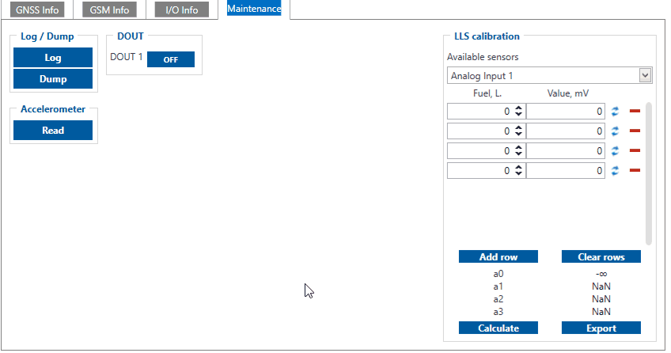
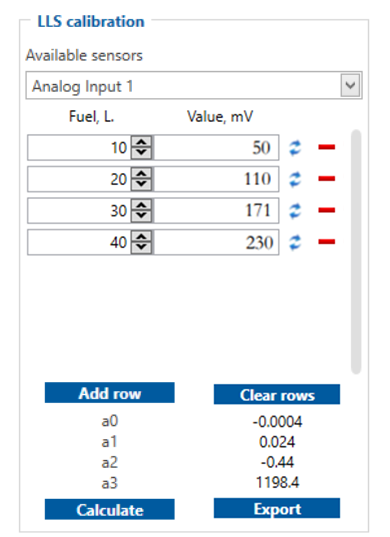

# FMC650 Status info

Status info enables the user to monitor real time information of FMC650. Following fields are displayed: **Device Info**, **GNSS Info**, **GSM Info**, **I/O Info**, **Maintenance** and etc. User is able to export all of the information to **.HTML** file using  icon which is at the top right corner of the **Device Info** area.

# Device Info

- Device Name
- Firmware version
- Last Start Time - last device start time.
- RTC Time - real-time clock or current device time.
- Power Voltage (mV)
- Device IMEI
- External Storage (used/total) - microSD card free space.
- Device Uptime - device uptime from last start time.
- Battery Voltage (mV)
- Internal Battery Status - Charging/Not Charging

# GNSS Info

- GNSS status
 - Module status - ON, [GPS Sleep](https://wiki.teltonika-gps.com/view/FMC650_Sleep_modes#GPS_Sleep_mode), [Deep Sleep](https://wiki.teltonika-gps.com/view/FMC650_Sleep_modes#Deep_Sleep_mode), [Online Deep Sleep](https://wiki.teltonika-gps.com/view/FMC650_Sleep_modes#Online_Deep_Sleep_mode), [Ultra Deep Sleep](https://wiki.teltonika-gps.com/view/FMC650_Sleep_modes#Ultra_Deep_Sleep_mode) mode.
 - GNSS packets - the number of GNSS packets the device received from startup.
 - Fix Status - Fix/No Fix. **(Note: Fix time strongly depends on indoor/outdoor location. To achieve best performance acquiring GNSS fix device should be used in outdoor locations**)
 - Fix Time - the last GNSS fix time.
- Satellites
 - Visible - the number and type of satellites that are visible.
 - In Use - the number of satellites used for location positioning.
- Location
 - Latitude/Longitude - shows current device coordinates and if you press them opens **Object location** window with a map.
 - Altitude, Angle
 - HDOP, PDOP FMC650 sends HDOP/PDOP value to the server in precision of dilution **coefficient**. HDOP/PDOP calculation depends on how many [GNSS sources](https://wiki.teltonika-gps.com/view/FMC650_System_settings#GNSS_Source) are selected. If configured GNSS Source options are "GPS" and "GLONASS" and HDOP/PDOP values are received from both systems, the parameters HDOP/PDOP will be calculated as shown below: "GPS" - 1.60; "GLONASS" - 1.60; "Galileo" - will be 0, because it is not selected and not taken into account; "BeiDou" - will be 0, because it is not selected and not taken into account; Calculation formula - **("GPS" + "GLONASS" + "Galileo" + "BeiDou") / 4 (four GNSS systems)**. Calculated HDOP/PDOP value according to above parameters - **(1.60 + 1.60 + 0 + 0) / 4 = 0.8** coefficient.
 - Speed - current device speed.

## HDOP/PDOP value calculation changes

Main calculations of separate HDOP/PDOP values of GPS, GLONASS, Galileo and BeiDou are made by GNSS modem. GNSS Modem already outputs average of HDOP/PDOP from 4 GNSS systems (Used satellites) with a formula below.

Calculation formula - ("GPS" + "GLONASS" + "Galileo (0-sat)" + "BeiDou (0-sat)") / 2 (four GNSS systems)**
Calculation formula - ("GPS" + "GLONASS") / 2 (two GNSS systems)

HDOP/PDOP will be different if it will have 19 and i.e. other packet with 6 satellites. In parsed regular AVL packet example below all of 19 satellites are shown as in use.

Parsed NMEA Record Example:

Record GPS longitude : -14116383
Record GPS latitude  : 530738950
Record GPS altitude  : 356
Record GPS angle  : 357
Record GPS satellites: 19
Record GPS Kmh  : 102

# GSM Info

- GSM status
 - Modem Status
 - SIM State - Ready/Unknown
 - GPRS Status - Activated/Deactivated
 - Actual Operator Code
 - Signal Level
- GPRS traffic
 - Sent Data - the amount of data that has been sent by the device.
 - Received Data - the amount of data that has been received by the device.
 - Total Traffic - Sent Data + Received Data
- Sockets information:
 - Type - AVL Data Sending
 - Socket - Closed or Server domain and port which is used when sending AVL Data via TCP/UDP.
- Records
 - Sent Records count - how many records were sent to the server since the last data reset.
 - Last Record Send - date and time when the last record was sent.
 - Last Server Response Time - date and time when the last server response was.
- SMS Count
 - Received SMS - the amount of SMS messages the device has received.
 - Sent SMS - the amount of SMS responses that were sent from the device.
 - SMS Count - Received SMS + Sent SMS

# I/O Info

- I/O Data - shows the current values from all configurable I/O elements.

# FMS I/O Info

- FMS I/O Data - shows the current values from FMS configurable I/O elements.

# Tachograph Data Info

- Tachograph Data - shows the current values from Tachograph Data configurable I/O elements.

# Maintenance

- Log/Dump
 - Log - after button is pressed, the device starts log capturing for 10 minutes with configuration download. After this time device .log and configuration .cfg will be in compressed archive. Archive name: `YYYY_MM_DD_HH_MM_SS_FMC650_IMEI_Log.zip`Default directory: `C:\Users\<username>\Documents`

- Dump - after button is pressed, the device starts to download .dmp logs and configuration .cfg from device in compressed archive. Archive name: `YYYY_MM_DD_HH_MM_SS_FMC650_IMEI_Dump.zip`Default directory: `C:\Users\<username>\Documents`Dump files can be read only with special software. If needed, provide these files to your Teltonika sales manager or Teltonika Support team.
- Open directory - this button appears near **Log** or **Dump** if one of these functions were used.

- Accelerometer - after the button is pressed, the device starts to capture accelerometer values for 1 second.

# LLS Calibration

- LLS calibration - in this section you can calculate calibration values of Analog LLS sensors for AVL server - create a polynomial which is needed to convert sensor values to liters:
 - Table is filled row by row. Each row represents one fuel tank fill. To calculate constants it is needed to select a sensor from *„Available sensors“*, and fill the „Fuel, L.“ column and capture the current value of a sensor by clicking the *"Refresh"* button. Then the next value in liters should be entered by the user and so on.
 - When a table is filled, calculated a0, a1, a2, and a3 values should be seen.
 - To add a new tank fill row click "Add row". To remove the row click the *"minus"* button near the row you want to clear. To Clear all the rows click *"Clear rows"*.
 - By clicking *"Export"* data will be exported to .csv file.
 - To recalculate the polynomial click on *"Calculate"* button.

Default log capture time, accelerometer capture time and files directories can be changed by pressing  icon at the bottom right corner.

# CAN Adapter Info

Shows the parameters with current values (including program number and software version) from CAN adapter when the device is connected to LV-CAN200/ALL-CAN300/CAN-CONTROL.

**Note:** not all parameters which are displayed in the *"CAN Adapter Info"* tab can be readable from the vehicle.

<!-- configurator-companions -->

## Configurator notes (EN)

English notes translated from the Configurator tab PDFs, generated **2026-11-05**:

- [`configurator/status.md`](configurator/status.md) — Status: GNSS, GSM, I/O, FMS I/O, tachograph, maintenance and FMS ECO counters.

