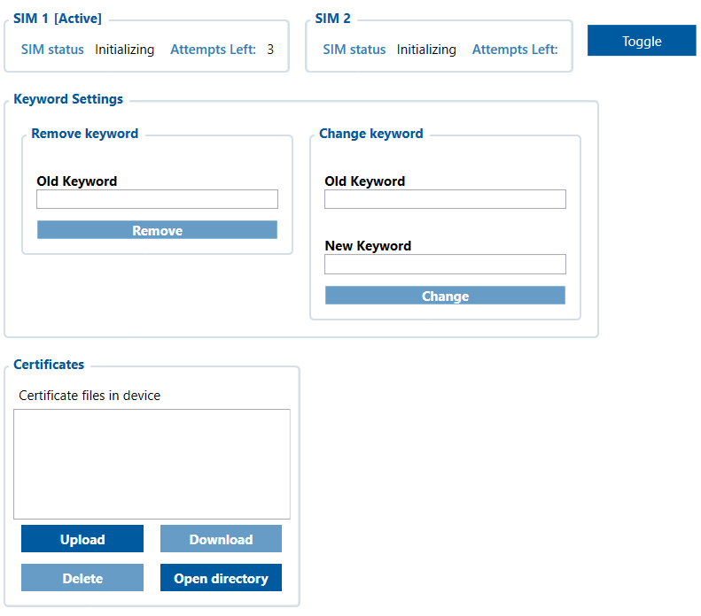

# Security — Configurator notes (EN)

> **Note:** Supplementary notes extracted from the French Configurator tab PDF
> `security-tab.pdf`, generated on **2026-11-05T08:37:58Z** — newer than the wiki
> snapshot kept in this folder. The text has been translated into English; it
> supplements the reference page [`security-info.md`](../security-info.md).
> PDF extraction quirks: section titles sometimes appear after the text they
> introduce, figures reuse page-1 filenames, and some wide tables are
> restituted row by row because the PDF text layer does not always preserve
> the columns. Unarchived `docs.tinolyx.com` image links were removed; unique
> figures are grouped under `## Figures`.

<!-- PDF p. 2 -->

The FMC650 includes management of two SIM cards to provide redundancy or failover of the mobile network.

## Security

The Security window is used to secure access to and communications of the FMC650.

### 1. SIM Management Section (SIM 1 & 2 card management)

<!-- PDF p. 3 -->

**SIM Status (SIM state)**

Meaning: Indicates the communication state between the device's GSM module and the inserted SIM card.
Value options / possible states: Initializing (starting up/initialising), Ready (ready), Not Inserted (absent), PIN Required (PIN code required), PUK Required (locked), etc.

**Attempts Left (Remaining PIN code attempts)**

Meaning: Number of attempts allowed to enter the PIN code correctly before the card is blocked.
Values: From 3 (by default) to 0 (card blocked, requiring the PUK).

**Toggle Button (SIM 1 / SIM 2 switching)**

Meaning: Forces or switches the active selection between the SIM 1 slot and the SIM 2 slot.
Secures the device against unauthorised remote commands sent by text message (SMS).

**Old Keyword & New Keyword (Old and New keyword)**

Meaning: Alphanumeric character sequence serving as a password to validate the execution of an SMS command by the tracker.
Configuration buttons [Remove] / [Change]
[Remove] : Removes the active security keyword.
[Change] : Saves a new keyword by validating the old one.
Manages the digital security certificate files (used in particular for encrypted MQTT/TLS connections with telematics servers such as Wialon).

### 2. Keyword Settings Section (SMS Command Security)

### 3. Certificates Section (Cryptographic and Network Security)

<!-- PDF p. 4 -->

**Certificate Files in Device (List of certificates)**

Meaning: Displays the SSL/TLS certificates currently stored in the device's internal memory (e.g. CA certificates, client certificates).
File management action buttons:
[Upload] : Uploads a certificate file from the computer to the FMC650.
[Download] : Retrieves a stored certificate from the device to the PC (greyed out if no file is selected).
[Delete] : Deletes a selected certificate from the device memory.
[Open directory] : Opens the local working folder containing the certificate files.

## Figures

Unique figures extracted from the PDF. The extraction reuses the same filenames for all pages; each image is therefore referenced only once here.

