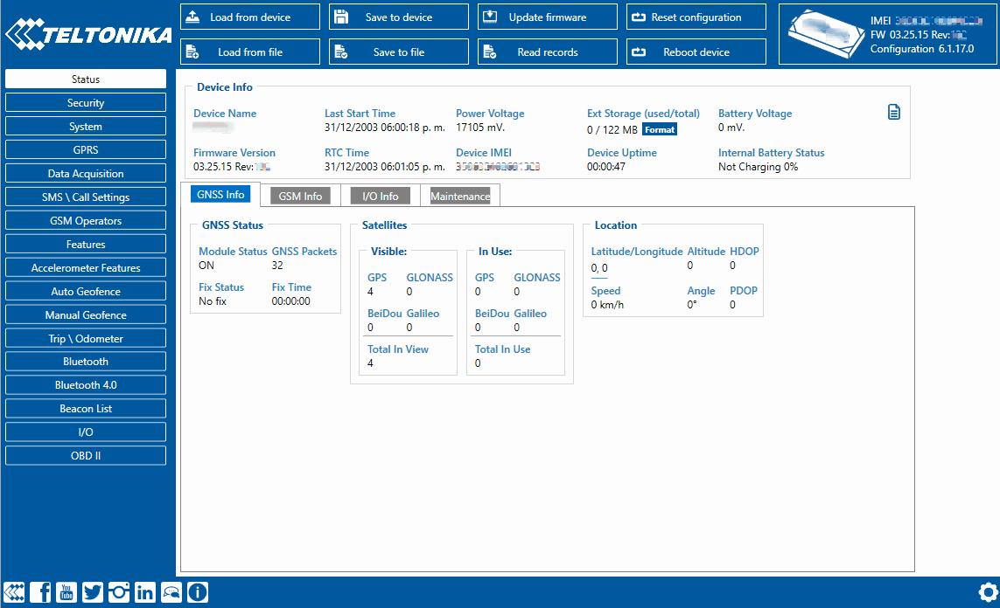

# FMC650 Security info

In security section user can see SIM card and configurator keyword security information.

- The state and status of currently connected SIM card (SIM1 or SIM2) can be observed here. If a SIM card with PIN code is used, user can enter it in this section. The remaining attempts to enter PIN code are shown as well.
- When SIM PIN code is entered correctly user can change PIN code or disable it from the SIM card. When SIM PIN is disabled and user would like to enable it again, user must enter the previously used PIN code.
- If two SIM cards are inserted into the device, user can change PIN codes for both of them.
- Configuration security keyword can be set to configurator. Keyword can be saved in configuration file (.cfg), so there is no need to connect the device to the configurator to configure the keyword. Minimum keyword length is 4 symbols and maximum length is 10 symbols. Only uppercase and lowercase letters and numbers are supported. Keyword can be configured to .cfg configuration file when the device is not connected.

*Please note that This feature will only show up in configurator when device is connected to a computer.

<!-- configurator-companions -->

## Configurator notes (EN)

English notes translated from the Configurator tab PDFs, generated **2026-11-05**:

- [`configurator/security.md`](configurator/security.md) — Security: security, passwords and access control.

