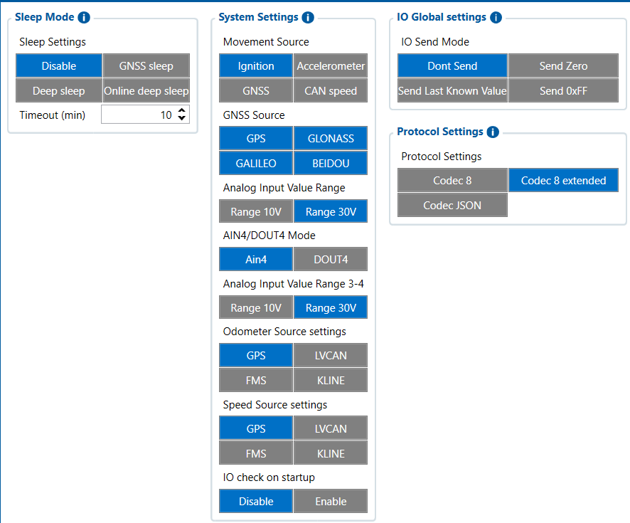

# System — Configurator notes (EN)

> **Note:** Supplementary notes extracted from the French Configurator tab PDF
> `system-tab.pdf`, generated on **2026-11-05T08:37:58Z** — newer than the wiki
> snapshot kept in this folder. The text has been translated into English; it
> supplements the reference page [`system-settings.md`](../system-settings.md).
> PDF extraction quirks: section titles sometimes appear after the text they
> introduce, figures reuse page-1 filenames, and some wide tables are
> restituted row by row because the PDF text layer does not always preserve
> the columns. Unarchived `docs.tinolyx.com` image links were removed; unique
> figures are grouped under `## Figures`.

<!-- PDF p. 2 -->

**Sleep Mode**

## System

The System window of the Teltonika Configurator is the programmable brain of the FMC650 device. Unlike Status-type sections, which are used only to read what the tracker is doing in real time, the System section is used to define the operating rules and the overall behaviour of the device.

### 1. Sleep and Power Management (Sleep & Power)

<!-- PDF p. 3 -->

Meaning: Determines the device's power-saving behaviour when the vehicle is stopped.
Available options: Disable (sleep disabled), GNSS sleep , Deep sleep , Online deep sleep .
Timeout : Inactivity delay before the sleep mode is applied (e.g. 10 min ).

**Auto Shutdown on Power Loss**

Meaning: Device action on a main power failure (use of the internal Ni-MH backup battery).
Options: Enable or Disable .

**Movement Source**

Meaning: Source used by the FMC650 to validate the vehicle's movement state.
Options: Ignition , Accelerometer , GNSS (by default), CAN speed .

**GNSS Source**

Meaning: Selection of the active satellite constellation.
Options: GPS , GLONASS , GALILEO , BEIDOU .

**Static Navigation**

Meaning: Anti-drift filter to eliminate micro-jumps in GPS position when the vehicle is stationary.
Activation : Enable / Disable .
Deactivation Source : Wake-up condition ( Movement OR Ignition , etc.).

**Odometer & Speed Source Settings**

Meaning: Origin of the source for calculating distance and speed.

### 2. Detection and Navigation Sources (Movement, GNSS & Sources)

<!-- PDF p. 4 -->

Options: GPS , LVCAN , FMS , KLINE .

**Ignition Source**

Meaning: Method for detecting the engine ignition (ON/OFF).
Options: DIN1 , DIN2 , DIN3 , DIN4 , Accelerometer , Power Voltage , Engine RPM .
Supply Voltage Thresholds (Voltage-based Ignition)
High Voltage : High threshold (e.g. 30000 mV, i.e. 30 V).
Low Voltage : Low threshold (e.g. 13200 mV, i.e. 13,2 V).

**Analog Input / AIN Mode**

Analog Input Value Range : Measurement ranges ( Range 10V or Range 30V ).
AIN4 / DOUT4 Mode : Selection of the role of the 4th multifunction channel ( AIN4 or DOUT4 ).
IO Global Settings & Startup
IO Check on Startup : Enable / Disable (I/O test at startup).
IO Send Mode : Behaviour when a value is missing ( Don't Send , Send Zero , Send Last Known Value , Send 0xFF ).

**Protocol Settings**

Meaning: Encoding format of the data packets sent to the telematics server.
Options: Codec 8 , Codec 8 Extended (recommended for support of the FMC650's extended AVL identifiers), Codec JSON .
Save Records To

### 3. Inputs, Outputs and Ignition (I/O & Ignition)

### 4. Records and Communications (Protocols & Storage)

<!-- PDF p. 5 -->

Meaning: Storage medium for data logs (AVL records).
Options: Internal memory or SD card .
Sort By & Records Saving
Sort By : Data transmission order ( Newest or Oldest ).
Records Without TS : Recording policy without time synchronisation ( Always , After Position Fix , etc.).
Network Timeouts
Open Link Timeout : Link hold time (e.g. 600 s ).
Response Timeout : Server response wait time (e.g. 30 s ).
Ping Mode & Network Ping Timeout : Connection monitoring mechanisms.
Time Synchronization
Modes: Disable (GNSS only) , NITZ , NTP , or NITZ + NTP .
NTP Parameters
NTP Server 1 & 2 : Time server addresses (e.g. avl1.teltonika.lt , pool.ntp.org ).
NTP Sync Timeout : Synchronisation timeout (e.g. 60 s ).

### 5. Time Synchronisation (Time Sync)

## Figures

Unique figures extracted from the PDF. The extraction reuses the same filenames for all pages; each image is therefore referenced only once here.

