# FMC650 System settings

System settings have the following configurable parameters:

# Sleep Mode

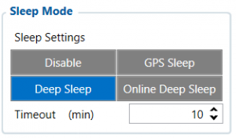This feature will be used to save power consumption of external battery (power supply). It let the user choose one of four power saving modes which he would prefer: **[GPS Sleep](https://wiki.teltonika-gps.com/view/FMC650_Sleep_modes#GPS_Sleep_mode)**, **[Deep Sleep](https://wiki.teltonika-gps.com/view/FMC650_Sleep_modes#Deep_Sleep_mode)** and **[Online Deep Sleep](https://wiki.teltonika-gps.com/view/FMC650_Sleep_modes#Online_Deep_Sleep_mode)**. Also, after the mentioned options you can find the Timeout (min) parameter which starts counting when the device is in STOP mode. After timeout is reached and all conditions for sleep mode are met, the device goes to sleep mode.
**Note:** Detail description and conditions about every mode you can find [**here**](https://wiki.teltonika-gps.com/view/FMC650_Sleep_modes).

# System Settings

## Movement Source

---

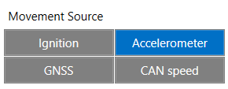Parameter, which determines if device should work in "Vehicle on Stop" or "Vehicle on Moving" mode. There are four possible movement sources

- **Ignition** - if Ignition (based on Ignition Source) is ON, Vehicle MOVING mode is used; if Ignition is OFF, Vehicle on STOP mode is used;
- **Movement** - if accelerometer detects movement, Vehicle MOVING mode is used; if no movement is detected, Vehicle on STOP mode is used;
- *GNSS'* - if GPS Fix is acquired and the vehicle speed is >=5 km/h, Vehicle MOVING mode is used; if GPS speed is <5 km/h, Vehicle on STOP mode is used (if there is no GPS Fix, accelerometer determines vehicle modes);
- **CAN Speed** - if CAN adapter or FMS speed is >0 km/h, Vehicle MOVING mode is used; if CAN adapter or FMS speed is <=0 km/h, Vehicle on STOP mode is used;

## GNSS Source

---

In *GNSS Source* settings user can configure which GNSS system(s) to use.User has a choice to use only one system GPS and it is possible to choose two or three systems together. One exception is that you cannot combine BeiDou and GLONASS systems together.

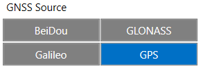**List of configurable single band GNSS sources:**

- GPS only;
- GPS + GLONASS;
- GPS + Galileo;
- GPS + Beidou;
- GPS + GLONASS + Galileo + Beidou;

**List of configurable dual band GNSS sources:**

- GPS + Galileo + Beidou;
- GPS + GLONASS + Galileo + Beidou;

## Battery Charge Mode

---

In *Battery Charge Mode* settings user can choose when the battery will be charged.

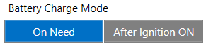Possible options:

- **On Need** - enable battery charger any time when needed;
- **After Ignition ON** - charger can be enabled after ignition is turned on, except if the battery is fully charged or 10-minute timeout has not passed since the device was turned on for faster FIX receiving;

## Analog Input value range

---

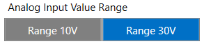In *Analog Input Value Range* settings user can choose an analog input range of 10 V or 30 V.

## AIN4/DOUT4 Mode

---

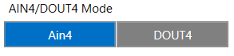Users can select one of 2 options to define which way the 18th PIN will work. Configurable options are DOUT4 and AIN4.
**Note:** *DOUT4 can be used for relay control, however it is not recommended to use it with low current peripheral devices such as LEDs as they may stay turned on in DOUT4 "OFF" state. (Due to interface properties up to 100 uA leakage current is feasible on 18th pin when DOUT4 is turned "OFF").'*

## Analog Input value range 3-4

---

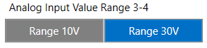In *Analog Input Value Range* settings user can choose an analog input range of 10 V or 30 V for AIN3 and AIN4.

## Odometer Source settings

---

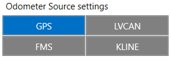In *Odometer Source settings* a user can select one of the options for odometer counting. There are 4 possible options:

- GPS
- LVCAN
- FMS
- KLINE

## Speed source settings

---

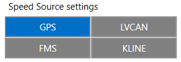In *Speed Source settings* a user can declare what technology will be used for vehicle speed measurement. There are 4 possible options:

- GPS
- LVCAN
- FMS
- KLINE

## IO Check on Startup

---

IO check on startup is a feature to modify the record generation behavior after powering up.

When this functionality is enabled, records will not be generated for the parameters after startup. Only the next value change of these parameters will generate them.

**Example:** When the functionality is enabled and the device is powered on, driver information from the tachograph card (e.g., “John”) — such as Driver 1 Name and Driver 1 SurName — will not generate records.

Records for those elements will be generated only after the card is replaced with a different one (e.g., “Bob”).

# IO Global settings

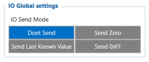In *IO Global settings* a user can set IO value if I/O is not present for 30 seconds.
A user can choose how the device will send this IO element:

- **Don't Send** - IO element is not included in the packet until new data is acquired;
- **Send Zero** - Zero value is sent until new data is acquired;
- **Send Last** Know Value - Last known value is sent until new data is acquired;
- **Send 0xFF** - 0xFF value is sent until new data is acquired;

# Protocol Settings

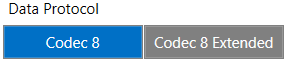In *Data Protocol* settings user can choose which protocol version (**[Codec 8](https://wiki.teltonika-gps.com/view/Codec#Codec_8)** or **[Codec 8 Extended](https://wiki.teltonika-gps.com/view/Codec#Codec_8_Extended)**) will use for data sending to the server.

# Records Settings

## Records Saving/Sending Without TS

---

This feature will be used to save and send records to the server without time synchronization.

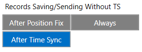Possible options:

- **After Position Fix** - records will be saved and send only after position fix;
- **After Time Sync** - records will be saved and send only after time synchronization;
- **Always** - records will be always saved and send even if will not be time synchronization.

**Note:** *If record is without valid coordinates – (there were no GPS fix in the moment of data acquisition) – Longitude, Latitude and Altitude values are last valid fix, and Angle, Satellites, and Speed are 0. After a reboot, it will send zero coordinates.*

**Note:** *Default storing/sending records data is stored in RAM's from firmware version 03.01.01.rev.15*

This feature is not configurable via the Configurator, but it can be configured via SMS/GPRS command as follows:

### Parameter 199 – Data Storage Behaviour

- **setparam 199:1**

By default, if a socket connection is active and sufficient RAM is available, records are stored in RAM and transmitted immediately, bypassing internal flash memory.

- **setparam 199:0**

When disabled, all records are first written to internal flash memory before being transmitted.

In the event that there is no space in RAM to accommodate the records, the device will revert to saving records to flash automatically if the default settings are unchanged.

## Open Link Timeout

---

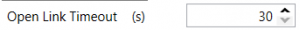This feature is used to set a timeout of the link between [FMC650](https://wiki.teltonika-gps.com/view/FMC650) and AVL application termination. If [FMC650](https://wiki.teltonika-gps.com/view/FMC650) has already sent all records it waits for new records before closing link (except **[Deep Sleep](https://wiki.teltonika-gps.com/view/FMC650_Sleep_modes#Deep_Sleep_mode)** mode, more information in **[Deep Sleep](https://wiki.teltonika-gps.com/view/FMC650_Sleep_modes#Deep_Sleep_mode)** mode chapter). If new records are generated in the period of this timeout, and the minimum count of the timer to send is reached, they are sent to AVL application. This option is useful when a GSM operators charge money for link activation.

## Response Timeout

---

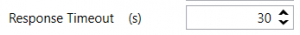This feature is used to set a time period waiting for a response from the server-side.

## Sort By

---

This feature is used to set sort records sending sequence. Possible options:

- **Newest** - sends records from newest to oldest. High priority records are sent to the server immediately;
- **Oldest** - sends records from oldest to newest. High priority records are sent to the server immediately.

## Save records to

---

This feature is used to select where to save records which are not sent yet. Possible options:

- Internal memory;
- SD card.

## Ping mode

---

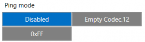The user can enable and select how frequent devices will send packets to inform the server about the active data link. It works when the device did not send any records to the server in a defined time period.

## Network Ping Timeout

---

This feature is used to set network ping after a timeout to prevent link close by the operator.

# Static navigation settings

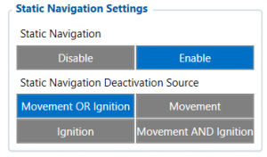*Static Navigation Mode* is a filter, which filters GPS jumps when an object is parked (is not moving) and GPS position is still traced.
If the Static navigation filter is disabled, it will apply no changes to GPS data. If the Static navigation filter is enabled:

- **Movement OR Ignition** - filter changes in GPS position if no movement (configured movement source)or ignition (configured ignition source) is detected;
- **Movement** - filter changes in GPS position if no movement (configured movement source) is detected;
- **Ignition** - filter changes in GPS position if ignition (configured ignition source) is detected;
- **Movement** AND Ignition - filter changes in GPS position if no movement (configured movement source) and ignition (configured ignition source) is detected.

If the user chooses Movement OR Ignition (default setting), static navigation will be deactivated, when movement or ignition is detected. If the user chooses Movement, static navigation will be deactivated, only when movement is detected. If the user chooses Ignition, static navigation will be deactivated, only when the ignition is detected. If the user chooses Movement AND Ignition, static navigation will be deactivated, when both movement and ignition are detected. Parameter values for each source are described in the table below.

*Static Navigation* mode is a filter, which filters out track jumps when the object is stationary. If the static navigation filter is disabled, it will apply no changes to GPS data. If static navigation filter is enabled, it will filter changes in GPS position if no movement (as defined by configured movement source) or ignition (as defined by configured ignition source) is detected. It allows filtering GPS jumps when the object is parked (not moving) and GPS position is still traced.

# Ignition Source

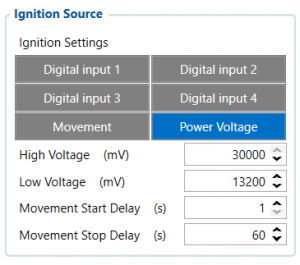Ignition source will be used to determine the ignition of the vehicle. If voltage is between High Voltage Lever and Low Voltage Level (below *Ignition Settings* options) - ignition is ON. If voltage is higher than High Voltage Lever or lower than Low Voltage Level - ignition is OFF.

- **Digital Input 1** - if *Digital Input 1* is 1 - ignition is ON; if *Digital Input 1* value is 0 - ignition is OFF;
- **Digital Input 2** - if *Digital Input 2* is 1 - ignition is ON; if *Digital Input 2* value is 0 - ignition is OFF;
- **Digital Input 3** - if *Digital Input 3* is 1 - ignition is ON; if *Digital Input 3* value is 0 - ignition is OFF;
- **Digital Input 4** - if *Digital Input 4* is 1 - ignition is ON; if *Digital Input 4* value is 0 - ignition is OFF;
- **Power Voltage** - if the voltage is between High Voltage Lever and Low Voltage Level (below *Ignition Settings* options) - ignition is ON; if the voltage is higher than High Voltage Lever or lower than Low Voltage Level - ignition is OFF.
- **Movement** - if *Movement* is still detect 1 after *Movement Start Delay (s)* - ignition is ON; if *Movement* value is 0 after *Movement Stop Delay (s)* - ignition is OFF;

**Example:** DIN1 and Movement are selected as the Ignition source. When the device detects movement, Ignition status will change to 1, regardless that the DIN1 value is 0.

# Time synchronization settings

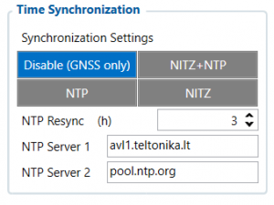*Synchronization settings* is used for choosing the device’s internal time synchronization source. Possible options are:

- **GPS Only** - time synchronization by GPS;
- **NITZ and NTP** - time synchronization from GSM operators (NITZ) and/or web server (NTP);
- **NTP** - time synchronization from NTP server only;
- **NITZ** - time synchronization from GSM operators (NITZ).

*NTP Resync* parameter determines how often a device should resynchronize its time. If the set value is not equal to zero, time resynchronization will occur periodically at time intervals to which this parameter is set.
*NTP server 1* and *NTP Server 2* let the user select which NTP server (s) will be used to re-synchronize time.

> **Note:** the configurator screenshot `IO_check_on_startup.png` (IO check on startup) is served by the archived snapshot from an unprefixed `web.archive.org/images/...` path that has no Wayback capture; it could not be preserved. All other figures are in `assets/`.

<!-- configurator-companions -->

## Configurator notes (EN)

English notes translated from the Configurator tab PDFs, generated **2026-11-05**:

- [`configurator/system.md`](configurator/system.md) — System: system settings, data protocol, FOTA and reboot.

