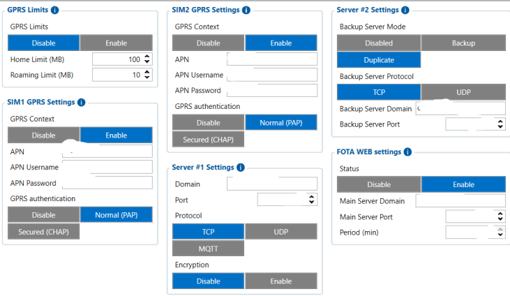

# GPRS — Configurator notes (EN)

> **Note:** Supplementary notes extracted from the French Configurator tab PDF
> `gprs-tab.pdf`, generated on **2026-11-05T08:37:58Z** — newer than the wiki
> snapshot kept in this folder. The text has been translated into English; it
> supplements the reference page [`gprs-settings.md`](../gprs-settings.md).
> PDF extraction quirks: section titles sometimes appear after the text they
> introduce, figures reuse page-1 filenames, and some wide tables are
> restituted row by row because the PDF text layer does not always preserve
> the columns. Unarchived `docs.tinolyx.com` image links were removed; unique
> figures are grouped under `## Figures`.

<!-- PDF p. 2 -->

Lets you define mobile data consumption caps to avoid unexpected extra costs.

**GPRS Limits (Activation)**

Options: Disable (default) or Enable .

**Home Limit**

Meaning: Data volume cap allowed on the main operator's network (outside roaming).

## GPRS

The GPRS tab is essentially the part that defines how the device connects to the mobile network and how it transmits its data to the servers.

### 1. GPRS Limits Section (Data Volume Control)

<!-- PDF p. 3 -->

Configuration example: 100 MB .

**Roaming Limit**

Meaning: Strict data volume cap allowed when the device connects to a partner network (roaming).
Configuration example: 10 MB .
Defines the authentication and routing information provided by the SIM card operator to establish the cellular data connection (4G/LTE).

**GPRS Context**

Meaning: Enables or disables the establishment of the mobile data session for the relevant SIM.
Option: Enable / Disable .

**APN (Access Point Name)**

Meaning: Network access point name provided by the telecom operator (e.g. the operator's specific APN name for IoT/M2M).

**APN Username & Password**

Meaning: Network authentication credentials (if required by the operator).
Example: internet / internet .

**GPRS Authentication**

Meaning: Security protocol used to validate the data connection.
Options: Disable , Normal (PAP) , Secured (CHAP) .

### 2. SIM 1 & SIM 2 GPRS Settings Section (Mobile Network Parameters)

### 3. Server #1 Settings Section (Main Data Destination)

<!-- PDF p. 4 -->

This is the key section that configures network communication between the GPS tracker and the telematics platform (e.g. Wialon).

**Domain / IP Address**

Meaning: Address of the target server (domain name or static IP) to which the FMC650 sends its AVL messages.

**Port**

Meaning: Network listening port open on the server to receive streams from the device.

**Protocol**

Meaning: Network transport protocol used for routing the data.
Options: TCP (the most common and reliable for Teltonika devices), UDP , MQTT .

**Encryption**

Meaning: Encryption of the transport link.
Options: Disable or Enable .
Lets you send data to a second endpoint in parallel or as a backup.

**Backup Server Mode**

Meaning: Role assigned to the second server.
Options: Disabled (inactive), Backup (failover if server 1 stops responding), Duplicate (simultaneous duplicate sending of all messages to two distinct servers).

**Backup Server Protocol, Domain & Port**

Meaning: Connection parameters identical to the main server (Protocol TCP , domain and port of the second server).

### 4. Server #2 Settings Section (Secondary Server or Redundancy)

<!-- PDF p. 5 -->

Manages automated communication with the Teltonika maintenance cloud platform.

**Status**

Meaning: Enables or disables the search for firmware updates ( Firmware Over The Air).
Options: Enable or Disable .

**Main Server Domain & Port**

Meaning: Connection details of the remote FOTA server managed by the manufacturer.

**Period**

Meaning: Frequency with which the device contacts the FOTA server to check whether an update is available.
Example: 720 min (i.e. a check every 12 hours).

### 5. FOTA WEB Settings Section (Remote Firmware Updates)

## Figures

Unique figures extracted from the PDF. The extraction reuses the same filenames for all pages; each image is therefore referenced only once here.

