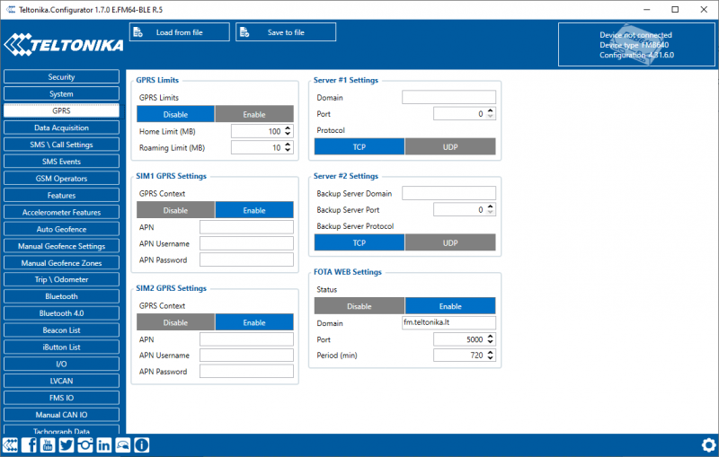

# FMC650 GPRS settings

GPRS defines main parameters for FMC650: GSM operator APN and GPRS username and password (optional – depending on the operator), destination server IP and port, and allows to set protocol used for data transfers – TCP or UDP.

SIM1 and SIM2 GPRS settings and server parameters can be configured individually. If you configure both servers, the device works in duplicate data mode: records are sent to both servers (main and backup), records are deleted from SD-card (or RAMS) only if both servers accepted the records.

FOTA WEB settings are used for FOTA WEB server connection parameters configuration. Status enables or disables FOTA WEB functionality. In domain and port fields the user can enter an address and port number of FOTA website. Period is used for the timeout of repetitive connection to FOTA WEB server.

<!-- configurator-companions -->

## Configurator notes (EN)

English notes translated from the Configurator tab PDFs, generated **2026-11-05**:

- [`configurator/gprs.md`](configurator/gprs.md) — GPRS: data limits, roaming, APN and servers.

