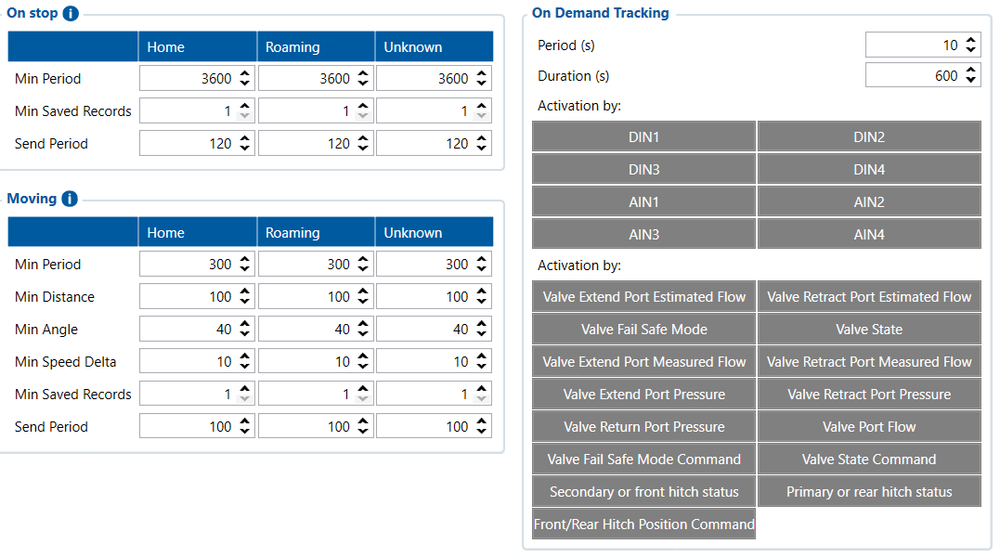

# Data Acquisition — Configurator notes (EN)

> **Note:** Supplementary notes extracted from the French Configurator tab PDF
> `data-acquisition-tab.pdf`, generated on
> **2026-11-05T08:37:58Z** — newer than the wiki snapshot kept in
> this folder. The text has been translated to English; it supplements the
> reference page [`data-acquisition-settings.md`](../data-acquisition-settings.md).
> The same PDF-extraction quirks apply: section titles sometimes appear
> after the text they introduce, figures reuse page-1
> filenames, and some wide tables are restituted
> row by row because the PDF text layer does not always preserve
> columns. Unarchived `docs.tinolyx.com` image links were
> removed; unique figures are grouped at the end of the file.

<!-- PDF p. 2 -->

1. when the FMC650 creates/records a new AVL record;

2. when it considers a change significant enough to create a new point;

3. how often it tries to send records to the server;

4. how to temporarily perform enhanced tracking with On Demand Tracking.

Defines the recording and sending frequency of data when the vehicle is stationary.
Min Period

## Data Acquisition

This tab mainly determines:

### 1. Section ON STOP (Stop Parameters)

<!-- PDF p. 3 -->

Meaning: Minimum time interval for creating an AVL point when the
vehicle is not moving.
Reference value: 3600 s (1 hour).

**Min Saved Records**

Meaning: Minimum number of points accumulated before allowing a send
attempt to the server.
Reference value: 1 .

**Send Period**

Meaning: Frequency at which the device tries to transmit the stored data
to the server.
Reference value: 120 s (2 minutes).
Combines several simultaneous criteria to decide the exact moment when a new position
point (AVL record) should be generated. As soon as any one of the thresholds is reached, a point is created.

**Min Period**

Meaning: Maximum time between two records, even if the vehicle is
driving in a straight line at constant speed.
Reference value: 300 s (5 minutes).

**Min Distance**

Meaning: Distance travelled since the last recorded point that triggers
the creation of a new record.
Reference value: 100 m .

**Min Angle**

Meaning: Change in heading angle (direction change) required to
force the recording of a point (essential for plotting bends cleanly).
Reference value: 10° (sometimes changed to 40° to reduce point density).

### 2. Section MOVING (Moving Parameters)

<!-- PDF p. 4 -->

**Min Speed Delta**

Meaning: Speed difference (acceleration or deceleration) relative to the last
point that triggers a record.
Reference value: 10 km/h .
Min Saved Records & Send Period
Min Saved Records : Minimum point threshold before sending ( 1 ).
Send Period : Frequency of network send attempts (default value: 120 s , customizable e.g. 100 s ).
Allows temporarily enabling a high-frequency positioning mode in the event of
a particular event.

**Period**

Meaning: Very short time interval between each point during the
active tracking period.
Reference value: 10 s .

**Duration**

Meaning: Total duration for which this intensive tracking mode remains active
after it is triggered.
Reference value: 600 s (10 minutes).

**Activation Sources (DIN / AIN)**

Meaning: Selection of physical inputs (digital or analog) or
I/O events that serve as triggers to automatically start this tracking
mode.

### 3. Section ON DEMAND TRACKING (Enhanced tracking on demand)

## Figures

Unique figures extracted from the PDF. The extraction reuses the same file
names for all pages; each image is therefore referenced only once here.

