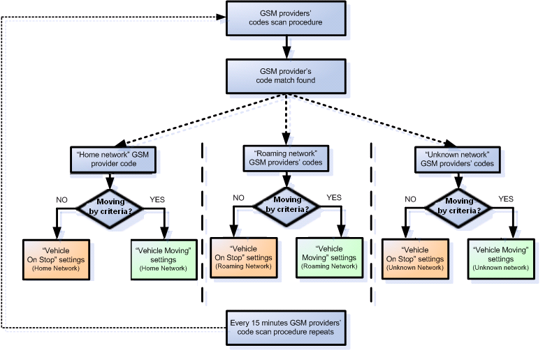
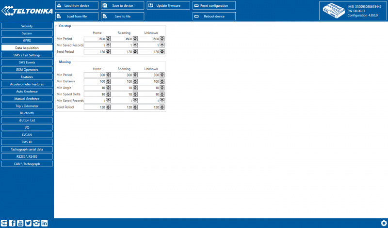
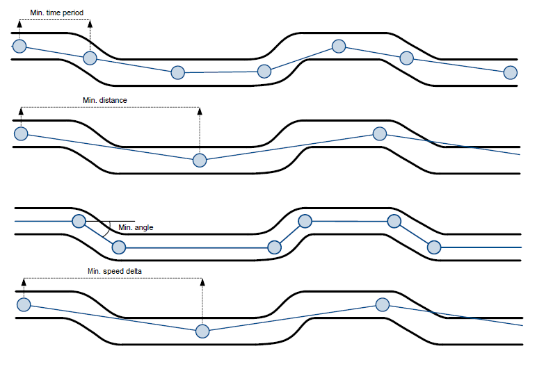
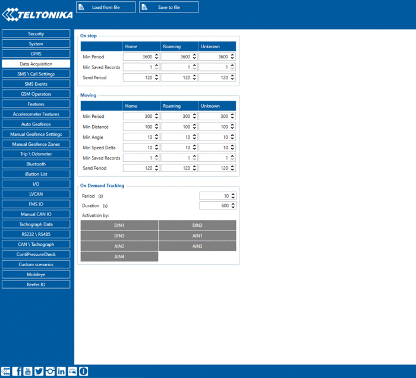

# FMC650 Data acquisition settings

Data Acquisition modes are an essential part of FMC650 device, they are also highly configurable.Through configuration user defines how records will be saved and sent. There are three different modes: Home, Roaming and Unknown. All these modes with configured data acquisition and report frequencies depend on current GSM Operator defined in the Operator list (see section [GSM Operators settings](https://wiki.teltonika-gps.com/view/FMC640_GSM_Operators_settings)) and are switched when GSM operator changes (e.g. vehicle passes through a country border).If current GSM operator is defined as Home Operator, device will work in Home Data Acquisition mode, if current operator is defined as Roaming Operator, device will work in Roaming Data Acquisition mode, and if current operator code is not written in the Roaming Operator list, device will work in Unknown mode.This functionality allows having different AVL records to acquire and send parameter values when object is moving or standing still. Vehicle moving or stop state is defined by Stop Detection Source parameter.FMC650 has 6 different modes. Operational logic is shown in the figure below.

|  | If home operator is written to roaming operator list, it will still be detected as home operator. |
| --- | --- |

Operator search is performed every 15 minutes. Depending on current GSM operator Home, Roaming or Unknown mode can be changed faster than every 15 minutes. This process is separate from operator search. Movement criteria are checked every second.

*Min Saved Records* defines minimum number of coordinates and I/O data that should be transferred within a single connection to the server. If FMC650 does not have enough coordinates to send to the server, it will check again after a time interval defined in *Send Period* field.*Send period* controls the frequency of GPRS data being sent to server. Module makes attempts to send collected data to the server every defined period of time. If it does not have enough records (depends on the parameter *Min. Saved Records* described above), it tries again after the defined time interval.

|  | Keep in mind that FMC650 operates in GMT:0 time zone, without daylight saving. |
| --- | --- |

FMC650 is able to collect records using four methods at the same time: time, distance, angle and speed based data acquisition:

- Time based data acquisition (*Min Period*) – records are acquired every time when a defined interval of time passes. Entering zero disables data acquisition based on time.
- Distance based data acquisition (*Min Distance*) – records are acquired when the distance between previous coordinate and current position is greater than a defined parameter value. Entering zero disables data acquisition based on distance.
- Angle based data acquisition (*Min Angle*) – records are acquired when the angle difference between last recorded coordinate and current position is greater than a defined value. Entering zero disables data acquisition based on angle.
- Speed based data acquisition (*Min Speed Delta*) – records are acquired when the speed difference between last recorded coordinate and current position is greater than a defined value. Entering zero disables data acquisition based on speed.

# On Demand Tracking

This functionality was added to FMX640 series devices from 01.00.05. Tracking on Demand can be activated using commands. After device receives [SMS/GPRS](https://wiki.teltonika-gps.com/view/FMB640_SMS/GPRS_command_list) command "*[on_demand_trackingX](https://wiki.teltonika-gps.com/view/FMB640_SMS/GPRS_command_list#Commands_related_to_features)*" where *X* is a number from 0 to 2.

Possible X values are:

- X = 0 – Stops Tracking on Demand functionality.
- X = 1 – Starts Tracking on Demand functionality.
- X = 2 – Generates one high priority record and initiates data sending to the server.

After that, the device starts to generate high priority records and initiate data sending to the server. This
feature is configurable via [SMS/GPRS](https://wiki.teltonika-gps.com/view/FMB640_SMS/GPRS_command_list) commands only.

Tracking on demand can be triggered by multiple IO Events. To enable functionality at least one activation source must be selected and an appropriate IO Event (in I/O tab) should be enabled (Low/High/Panic priority, the operand must NOT be “Monitoring”). When IO Event is generated and if the event is enabled in activation sources, tracking on demand will be started. THE new IO event will not interrupt or restart tracking on-demand until the Duration period has expired. If tracking on demand is already running, SMS/GPRS command will restart tracking on demand.
If tracking the on-demand period is lower than the normal record acquisition period, only high priority records will be created. If tracking the on-demand period is larger than the normal record acquisition period, low priority records will be created according to data acquisition configuration and high priority records will be created after configured tracking on-demand period. Some new [Tracking on Demand parameters](https://wiki.teltonika-gps.com/view/Template:FMB640_Device_Family_Parameter_list#Tracking_on_Demand) are introduced in devices.

.gif)

There are three available options for the activation source of tracking on demand - DIN/AIN or both (devices that support multiple DINs/AINs allow choosing which DINs/AINs to use). Note that, these inputs will work as buttons, rather than switches, and are used to trigger the functionality, the duration of tracking on demand will not be extended if the activation source status is high for a period of time.

<!-- configurator-companions -->

## Configurator notes (EN)

English notes translated from the Configurator tab PDFs, generated **2026-11-05**:

- [`configurator/data-acquisition.md`](configurator/data-acquisition.md) — Data Acquisition: data acquisition, filtering and recording.

