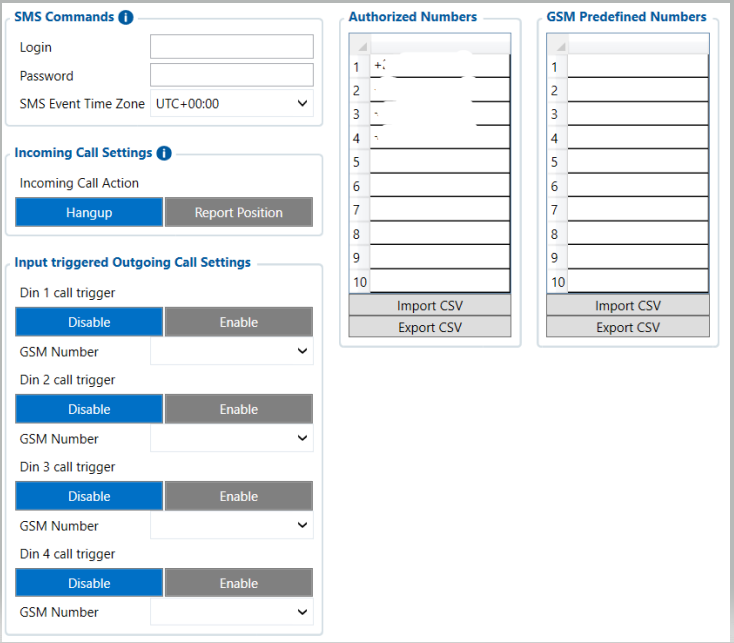

# SMS / Call Settings — Configurator notes (EN)

> **Note:** Supplementary notes extracted from the French Configurator tab PDF
> `smscall-settings-tab.pdf`, generated on
> **2026-11-05T08:37:58Z** — newer than the wiki snapshot kept in
> this folder. The text has been translated to English; it supplements the
> reference page [`sms-call-settings.md`](../sms-call-settings.md).
> The same PDF-extraction quirks apply: section titles sometimes appear
> after the text they introduce, figures reuse page-1
> filenames, and some wide tables are restituted
> row by row because the PDF text layer does not always preserve
> columns. Unarchived `docs.tinolyx.com` image links were
> removed; unique figures are grouped at the end of the file.

<!-- PDF p. 2 -->

## sms/call settings

The SMS / Call Settings tab of the FMC650 concerns communication of the device over the
GSM network, mainly SMS commands, incoming calls and automatic outgoing
calls.

### 1. Section SMS Commands (Security and SMS Commands)

<!-- PDF p. 3 -->

Defines the security and time zone applicable when controlling the device remotely by
text message.

**Login & Password**

Meaning: Textual security credentials required in the SMS body to
validate execution of remote commands.
Option: Empty by default (disabled) or customizable.

**SMS Event Time Zone**

Meaning: Reference time zone used to timestamp reports or
events related to SMS commands.
Reference value: UTC+00:00 .
Determines how the FMC650 reacts when a phone number calls the SIM card inserted
in the device.

**Incoming Call Action**

Meaning: Automatic behaviour upon receiving an external call.
Options:
Hangup (default: the device rejects/hangs up the call immediately).
Report Position (the device hangs up and sends back an SMS containing the current GPS position).
Allows associating a hardware trigger on the physical inputs with the automatic
dialling of a phone call (widely used for SOS buttons or emergency alarms).
DIN1 to DIN4 Call Triggers

### 2. Section Incoming Call Settings (Incoming Call Management)

### 3. Section Input Triggered Outgoing Call Settings (Automatic Outgoing Calls)

<!-- PDF p. 4 -->

Meaning: Enables or disables automatic outgoing calling when the
state of a digital input changes.
Options: Enable or Disable (default).

**Number Association**

Meaning: Each triggered digital input can be linked to a
predefined number in the GSM list.
Manages a secure whitelist to filter telephone and SMS interactions.

**Slots (1 to 10)**

Meaning: Stores up to 10 trusted phone numbers.
Role: Only calls or SMS from these registered numbers are accepted
and processed by the device (unknown numbers are ignored to prevent hacking or malicious commands).

**Import / Export CSV**

Meaning: Allows loading or saving the complete list of numbers
via a tabular configuration file.
Manages a second list of 10 phone number slots.
Main role:
Unlike Authorized Numbers, which are used to filter incoming security, the
Predefined Numbers serve as outgoing call targets (e.g. the fleet manager's number or the emergency service number that the FMC650 must call automatically when an alert occurs on a digital input).

### 4. Section Authorized Numbers (Security of Authorized Numbers)

### 5. Section GSM Predefined Numbers (Predefined Destination Numbers)

## Figures

Unique figures extracted from the PDF. The extraction reuses the same file
names for all pages; each image is therefore referenced only once here.

