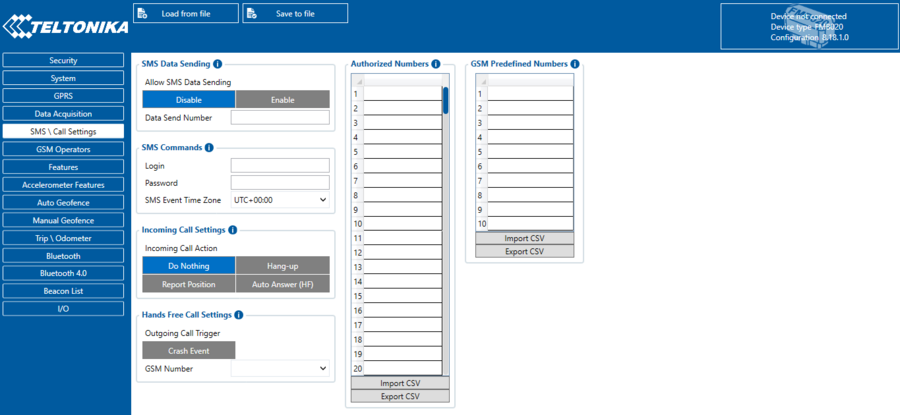
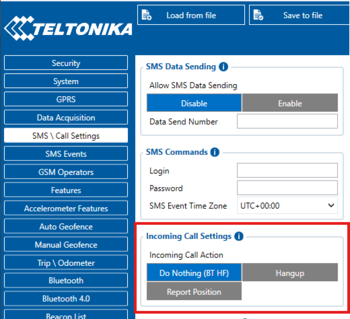

# FMC650 SMS/Call settings

# SMS Data Sending

These settings allow sending AVL data using binary SMS. AVL data will be sent by SMS only when there is no GPRS connection. This setting does not affect replies to SMS request messages – answers are always sent back to the sender's telephone number. If SMS events are activated but there are no numbers defined in GSM Predefined Numbers list then the device will not send any messages.

# SMS commands

Essential fields in *SMS/Call settings* are *Login* and *Password*. The login and password are used with every SMS sent to FMC650. If login and password are not set, in every SMS sent to FMC650 device two spaces before command have to be used (<space><space><command>).Command structure with set login and password:<login><space><password><space><command>, for example: "asd 123 getgps"Phone numbers have to be written in international standard, using "+" is optional but not necessary (in both cases number will be recognized, but when number is without "+" symbol, IDD Prefix will not be generated, which depends on location of the phone). If no numbers are entered, configuration and sending commands over SMS are allowed from all GSM numbers.

# Incoming Call settings

**Incoming Call Action** parameter defines device action during the incoming call:

- Do Nothing.
- Hang-up – Automatically hang up an incoming call.
- Report Position – Report position to calling number via SMS.
- Authorized Numbers - Configuration of Authrorized Numbers indication scenario.
- GSM Predefined Numbers.

# SMS configuration example

|  | Please do not set Data Send Number to some cell phone number, because it will not understand binary SMS. When sending a binary SMS to a phone number, which is a server phone number, the server can interpret and understand binary code, so the data can be read and you can view it on the server. |
| --- | --- |
|  | SMS login and password and authorized numbers list are used to protect FMC650 module from unauthorized access. Module accepts messages only from a list of authorized numbers and with proper module login and password. Phone numbers have to be written in international standard using "+" or without using it (in both cases the number will be recognized). If no authorized numbers are entered, module accepts messages from all numbers. |

<!-- configurator-companions -->

## Configurator notes (EN)

English notes translated from the Configurator tab PDFs, generated **2026-11-05**:

- [`configurator/sms-call.md`](configurator/sms-call.md) — SMS / Call Settings: authorized numbers, SMS commands and calls.

