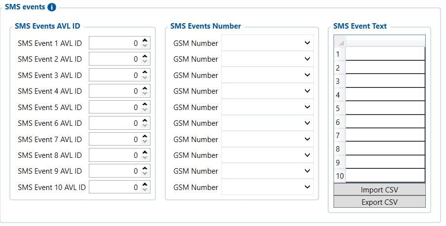

# SMS Events — Configurator notes (EN)

> **Note:** Supplementary notes extracted from the French Configurator tab PDF
> `sms-events-tab.pdf`, generated on
> **2026-11-05T08:37:58Z** — newer than the wiki snapshot kept in
> this folder. The text has been translated to English; it supplements the
> reference page [`sms-events.md`](../sms-events.md).
> The same PDF-extraction quirks apply: section titles sometimes appear
> after the text they introduce, figures reuse page-1
> filenames, and some wide tables are restituted
> row by row because the PDF text layer does not always preserve
> columns. Unarchived `docs.tinolyx.com` image links were
> removed; unique figures are grouped at the end of the file.

<!-- PDF p. 2 -->

Allows configuring automated text message sending actions based on state
changes of the device's internal parameters (identified by their AVL ID). Unlike
emergency calls, this section handles custom text alerts.
Number of available slots:
The FMC650 provides 10 independently configurable event rows
(Event 1 to Event 10).
Defines the telematics parameter or monitored physical input that will trigger the sending of
the alert.

## SMS events

The SMS Events tab is used to define which AVL events/parameters should
trigger the automatic sending of an SMS, to which number and with what text.

### 1. Overview and Principle of SMS Events

### 2. Section AVL ID (The Trigger / "What?")

<!-- PDF p. 3 -->

**AVL ID Parameter**

Meaning: Unique numeric identifier of the parameter (e.g. ID of a digital input DIN, a voltage threshold, etc.).
Current reference value: 0 (By default, all slots are at 0, meaning that no SMS event is enabled).
Associates with each SMS event the target mobile phone number that will receive the message.

**Recipient phone number**

Meaning: Phone contact of the recipient (e.g. fleet manager or technician).
Current reference value: Empty for all 10 slots (no recipient configured).
Defines the exact text content of the message that will be composed and sent by the GSM network when
the event occurs.

**Custom alert text**

Meaning: Body of the SMS message (e.g. ALERT: Contact activated or Sensor fault ).
Current reference value: Empty (no text programmed).
For an event SMS to work, these three elements must all be filled in together:
1. AVL ID ➔ Which parameter triggers the alert?
2. GSM Number ➔ Which number receives the alert?
3. SMS Event Text ➔ What text does the alert contain?

### 3. Section GSM Number (The Recipient / "To whom?")

### 4. Section SMS Event Text (The Message / "What to say?")

### 5. Overall logic of the 3 combined parameters

## Figures

Unique figures extracted from the PDF. The extraction reuses the same file
names for all pages; each image is therefore referenced only once here.

