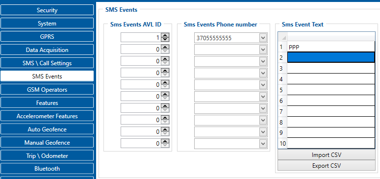

# FMC650 SMS events

SMS events functionality allows FMC650 to send a configured SMS when an event is triggered. This event can be triggered by every I/O element.When any of the I/O elements is triggered, FMC650 sends a configured SMS message to a defined phone number.

FMC650 is able to send SMS messages to Predefined phone numbers (recipients) if any of selected events are triggered. User can send SMS alert message of selected event to maximum 10 predefined phone numbers. AVL ID of parameter has to be entered in configuration to receive its SMS event. Predefined phone numbers must be entered in SMS Events Numbers list in ‘SMS \ Call Settings’ menu before it will be possible to pair them with AVL ID and SMS event text.

SMS Event Text is used to add additional text to standard SMS event message text.

|  | If FMC650 is in Deep Sleep mode and an SMS event occurs with Low priority (which does not wake up FMC650), then the device does not send the message. It is saved to device memory until it wakes up from Deep Sleep mode and GSM modem starts working normally. After it wakes up, all the messages that are saved to memory will be sent, but keep in mind that only 10 messages can be saved to memory – all other messages will not be saved, until there is free memory space. |
| --- | --- |

<!-- configurator-companions -->

## Configurator notes (EN)

English notes translated from the Configurator tab PDFs, generated **2026-11-05**:

- [`configurator/sms-events.md`](configurator/sms-events.md) — SMS Events: SMS events and recipient numbers.

