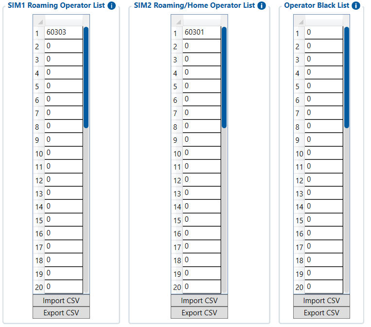

# GSM Operators — Configurator notes (EN)

> **Note:** Supplementary notes extracted from the French Configurator tab PDF
> `gsm-operators-tab.pdf`, generated on
> **2026-11-05T08:37:58Z** — newer than the wiki snapshot kept in
> this folder. The text has been translated to English; it supplements the
> reference page [`gsm-operators-settings.md`](../gsm-operators-settings.md).
> The same PDF-extraction quirks apply: section titles sometimes appear
> after the text they introduce, figures reuse page-1
> filenames, and some wide tables are restituted
> row by row because the PDF text layer does not always preserve
> columns. Unarchived `docs.tinolyx.com` image links were
> removed; unique figures are grouped at the end of the file.

<!-- PDF p. 2 -->

Defines the list of allowed or preferred mobile networks when the first SIM card
is operating in roaming.

## GSM operators

The GSM Operators tab is used to control the mobile operators to which the FMC650
can connect, depending on the SIM used, as well as to define operators to avoid.

### 1. Section SIM 1 Roaming Operator List (SIM 1 Network Preferences)

<!-- PDF p. 3 -->

**Slots (1 to 20)**

Meaning: Allows registering up to 20 operator identifiers in
MCC+MNC format (e.g. 60303 ).
Current reference value: The first slot contains an identifier ( 60303 ), the other 19 are at 0 (not filled in).
Manages operator selections and restrictions for the second SIM card, whether it is on its
home network or roaming.

**Slots (1 to 20)**

Meaning: List of target network codes for SIM 2.
Current reference value: The first slot contains an identifier ( 60301 ), the other 19 are at 0 .
Allows formally prohibiting access to certain mobile networks, regardless of the SIM card
used.

**Slots (1 to 10 or 20)**

Meaning: List of MCC+MNC codes that the FMC650 cellular modem must
reject or ignore.
Current reference value: All slots are at 0 (no specific prohibition configured).

**Import CSV / Export CSV**

Meaning: Allows loading or saving all operator preference or blacklists
as a tabular configuration file, making deployment across a fleet of several vehicles easier.

### 2. Section SIM 2 Roaming/Home Operator List (SIM 2 Network Preferences)

### 3. Section Operator Black List (Operator Blacklist)

### 4. Management Tools (Import / Export CSV)

<!-- PDF p. 4 -->

Unlike the GPRS window, which configures how to connect to the Internet (APN, data credentials), the GSM Operators window controls radio access upstream: which mast or
which specific mobile network the device's 4G/LTE modem is allowed to attach to or not,
which is particularly critical for fleets crossing border or multi-
operator areas.
Key role of this window

## Figures

Unique figures extracted from the PDF. The extraction reuses the same file
names for all pages; each image is therefore referenced only once here.

