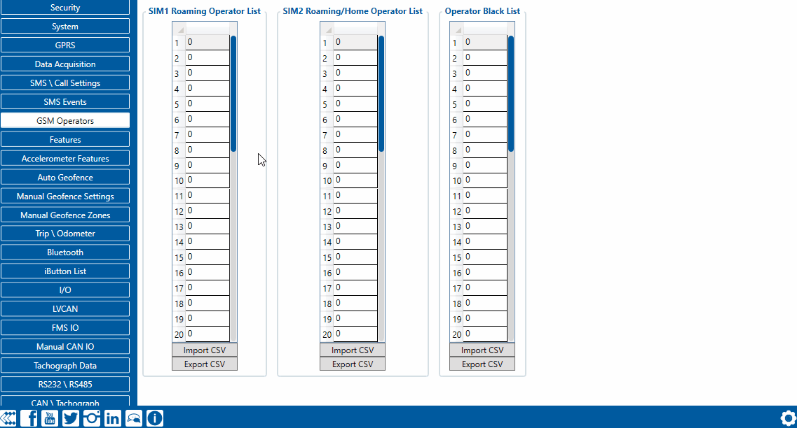

# FMC650 GSM Operators settings

FMC650 can work in different modes (use different settings) according to the operator list defined. Operator list is used for Data Acquisition Mode switching (see [Data acquisition settings](https://wiki.teltonika-gps.com/view/FMC640_Data_acquisition_settings) section for more details). Modes are changed based on GSM operator FMC650 is connected to.

If roaming operator list is left empty, FMC650 will automatically detect home operator. If home operator is written to the roaming operator list, it will still be detected as home operator. Any operator not in the roaming operator list (except the home operator) will be recognized as unknown operator and FMC650 will work in Unknown mode (make sure it is configured to allow data sending – GPRS context is enabled).If user wants FMC650 to not connect and work with a particular operator it has to be written to *Operator Blacklist*. Up to 50 operators may be entered to this list.Operator search procedure is initiated as normal every 15 minutes and tries to connect to an operator providing the strongest signal. It will prioritize operators which are specified in the operator list. If no operators from the operator list are available, the device will try to connect to an operator from the blacklist. If device connects to an operator from the blacklist, best operator search procedure is initiated instantly. During the time when device is connected to blacklisted operator no GPRS connection would be initiated and no data would be sent via GPRS. However, the ability to send SMS commands to the device would remain. If no suitable operator is found on both lists, the device will try to connect to a remaining available operator with the strongest signal.

<!-- configurator-companions -->

## Configurator notes (EN)

English notes translated from the Configurator tab PDFs, generated **2026-11-05**:

- [`configurator/gsm-operators.md`](configurator/gsm-operators.md) — GSM Operators: mobile operators, SIMs and network priorities.

