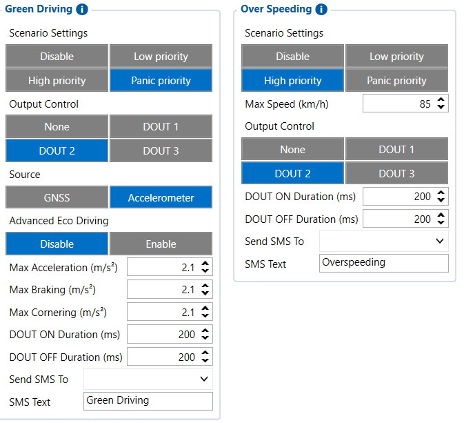

# Features — Configurator notes (EN)

> **Note:** Supplementary notes extracted from the French Configurator tab PDF
> `features-tab.pdf`, generated on
> **2026-11-05T08:37:58Z** — newer than the wiki snapshot kept in
> this folder. The text has been translated to English; it supplements the
> reference page [`features-settings.md`](../features-settings.md).
> The same PDF-extraction quirks apply: section titles sometimes appear
> after the text they introduce, figures reuse page-1
> filenames, and some wide tables are restituted
> row by row because the PDF text layer does not always preserve
> columns. Unarchived `docs.tinolyx.com` image links were
> removed; unique figures are grouped at the end of the file.

<!-- PDF p. 2 -->

Allows automatic detection of harsh driving styles (acceleration, braking, sharp cornering) using the internal accelerometer.
Scenario Priority

## Features

The Features tab configures the device's advanced functions and automatic
scenarios.

### 1. Section Green Driving (Driving behaviour analysis)

<!-- PDF p. 3 -->

Meaning: Priority level assigned to the event when it is detected.
Current value: Panic priority (maximum level in the event hierarchy).

**Output Control**

Meaning: Action on a physical output upon detection.
Current value: DOUT 2 (shared with over speeding).

**Source & Advanced Eco Driving**

Source : Accelerometer .
Advanced Eco Driving : Disable (the numeric thresholds in m/s² are not active as long as advanced mode is disabled).
Monitors the vehicle speed to identify tolerated threshold exceedances.

**Scenario Priority & Max Speed**

Priority : High priority .
Max Speed : 85 km/h (triggers an event if the speed calculated via GPS exceeds this limit).

**Output Control**

Current value: DOUT 2 (beware of a potential conflict in use of the same physical output as Green Driving).
Protects the tracker against malicious neutralisation attempts by GSM/GNSS frequency
jammers.
Sensitivity & Detection Period

### 2. Section Over Speeding (Speeding detection)

### 3. Section Network Jamming (Network jamming detection)

<!-- PDF p. 4 -->

Sensitivity : Low (cautious setting to avoid false positives).
Detection Time : 60 s (the suspicious signal must persist during this period to validate the alert).

**Eventual Records**

Option: Enable (generates a traceable data record in case of detection).
Manages blocking of vehicle starting, conditioned on prior identification (e.g. iButton or 1-Wire badge).

**Global status**

Option: Disable (disabled in the current bench configuration).

**Authorization parameters (if enabled)**

List Check : OneWire .
Timeouts : Ignition TMO ( 30 s ) and Authorization TMO ( 30 s ).
DOUT Control Via Call : Allows controlling an output via a phone call ( None by default).
Impulse Counters : Pulse counters for specific external sensors
(flow meters, etc.) configured to None .
Ignition Work Time :
Meaning: Cumulative counter of engine running time.
Current value: Enable (with an accumulated history converted into hours of use).

### 4. Section Immobilizer (Immobilizer and Authorizations)

### 5. Other Functions and Advanced Counters

## Figures

Unique figures extracted from the PDF. The extraction reuses the same file
names for all pages; each image is therefore referenced only once here.

