# FMC650 Features settings

# Green Driving

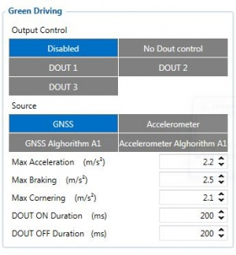When vehicle parameters exceed the values of *Max Acceleration*, *Max Braking* or *Max Cornering* parameters, the scenario is activated: a record is generated and digital output status is changed to 1 when configured. You can configure all three parameters in m/s2 units. Scenario is activated until current Acceleration, Braking or Cornering value decreases below the set parameter value.Parameters used with *Green Driving* functionality are given in a table below.

| Parameter name | Description |
| --- | --- |
| Output Control | Enable/Disable Green driving functionality and Activate/Deactivate DOUT. |
| Max Acceleration | Value which can be reached while accelerating without triggering harsh acceleration event. |
| Max Braking Acceleration | Value which can be reached while braking without triggering harsh braking event. |
| Max Cornering Acceleration | Value which can be reached while cornering without triggering harsh cornering event. |
| Source | Which source data will be collected from: GNSS - GPS Data will be used to detect harsh driving. (This algorithm was used in FM53, FM63 devices) / Accelerometer – Accelerometer data will be used to detect harsh driving. (This algorithm is from FMB device family). Accelerometer calibration needs to be performed with “auto_calibrate:set” command. / GNSS Algorithm A1 – GPS data will be used to detect harsh driving. (This algorithm is used in FMA11 devices). The main difference from FM53 is cornering detection which uses advanced math to more precisely calculate harsh cornering value across different vehicle speeds. / Accelerometer Algorithm A1 - Accelerometer data will be used to detect harsh driving. (This algorithm is used in FMA11 device family) / Note: To use “Accelerometer Algorithm A1” option user need to install device as in Figure 1. |

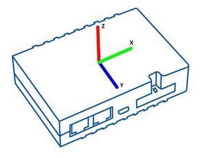[FMC650](https://wiki.teltonika-gps.com/view/FMC650) Device accelerometer position. (With positive Z axis pointing to Ground and antennas face forward in the vehicle). Before operation with the vehicle on level ground user must send “setacc” SMS.

## Auto calibration

---

The auto-calibration process is the following:

1. The vehicle is stopped.
2. There is a straight road ahead.
3. Send SMS *"auto_calibrate:set"* to the FMC650 device.
4. Accelerate to >30 km/h for 5 sec.
5. FMC650 will send a response when calibration is completed successfully.

Calibration is saved to internal flash memory, which means it will stay after a reset.
To check auto-calibration status send a following short text message to the FMC650 device: *"auto_calibrate:get"*.

# Over Speeding

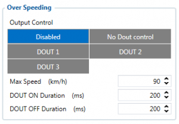When vehicle speed exceeds configured maximum speed value the scenario is activated, an event record is generated and digital output status is changed to 1 when configured.Scenario is active until detected speed decreases below the set parameter value.info
DOUT1, DOUT2 or DOUT3 can be activated for a period of time to warn the driver. Output on-time is configured separately for each feature case. For more information please refer to [DOUT controls](https://wiki.teltonika-gps.com/view/DOUT_controls).

# Jamming

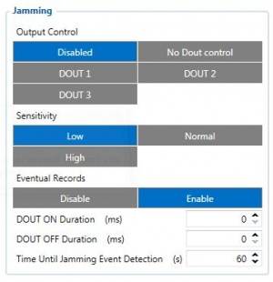When jamming is detected the scenario is activated, an event record is generated and digital output status is changed to 1 when configured once *Jamming* timeout runs out. If jamming ends during timeout countdown no event will be generated and output will not be controlled.*Eventual Records* parameter can be configured: when it is disabled scenario status value will appear in each AVL record, otherwise it will be appended only to eventual records.

# DOUT Control via Call

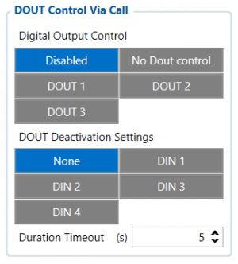Activates DOUT on incoming call.
The scenario is activated and digital output is ON when a call is received from a number which is in authorized numbers list.
Call control functionality:

- When FMC650 is configured to control DOUT1/DOUT2/DOUT3/DOUT4 device waits for an incoming call from the configured secure number. If the call is received FMC650 turns on DOUT1/DOUT2/ DOUT3/DOUT4 for user-defined Duration timeout (s). If the Duration timeout set to „0“(s), DOUT1/DOUT2/ DOUT3/DOUT4 will be OFF.
- DOUT1/ DOUT2/DOUT3/DOUT4 can be turned off by Duration timeout (s) or by digital input 1, digital input 2, digital input 3, or digital input 4 (DOUT deactivation settings).
- DOUT1/DOUT2/DOUT3/DOUT4 can be turned off before Duration timeout (s) by selected DIN (DOUT deactivation settings).
- DOUT1/DOUT2/DOUT3/DOUT4 always will be ON, if DOUT deactivation set to DIN1 for example, but DIN1 will be never turned ON or set Duration timeout to Max value (2147483647) it is about 68 years.

# Authorized driving/Immobilizer

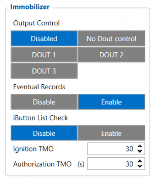- If DOUT Control is disabled, the scenario will only generate events without digital output activation. If DOUT Control is enabled DOUT1/DOUT2 turns ON if ignition turns ON (Ignition Source is configured to 1).
- After any iButton ID is attached, DOUT1/DOUT2/DOUT3 turns OFF.
- After iButton identification configured Ignition Source can be turned OFF (Ignition Source is configured to 0) for no longer than 30 seconds, otherwise immobilizer must be repeated.
- If iButton List Check parameter is enabled, the authorization will be successful only if the attached iButton is specified in the iButton list.
- Ignition off timeout parameter is used to set the duration after which authorization is activated when the ignition is turned off.
- Authorization off timeout parameter is used to set the duration of how long the user has time to authorize after switching the ignition ON.
- iButton list gives the ability to use the vehicle for 1000 specific iButton owners (specified in iButton list). Selected DOUT is controlled by scenario for user needs, to manage buzzer, LED, etc.

# iButton Read Notification

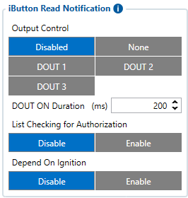Output control parameter lets the user choose which DOUT will iButton blink. After connecting iButton, DOUT will blink for a period of time, which is configured in DOUT ON Duration parameter. The iButton List checking parameter configures whether the device reads the iButton ID from iButton list or not. For example if configured as Enabled, device will not blink DOUT unless the iButton is in the iButton list.
If Depend on Ignition parameter is enabled, then Output will be triggered only if ignition is off (in addition to being in a list if iButton List Checking is also enabled).
Output control examples when iButton is detected (if None is selected in Output Control – all of the following steps will be skipped):

- If both iButton List Checking and Depend on Ignition are disabled – Output is triggered.
- If iButton List Checking is enabled and Depend on Ignition is disabled – Output is triggered only if iButton is in the list.
- If iButton List Checking is disabled but Depend on Ignition is enabled – Output is triggered only if ignition is off.
- If both iButton List Checking and Depend on Ignition are enabled – Output will trigger if iButton is in the list and ignition is off.

iButton Read Notification parameters:

- Output control – available scenario settings for module Digital output activation/deactivation
- DOUT ON duration – a value in seconds, for how long DOUT1/DOUT2/DOUT3 should be active.
- iButton List checking - parameter configures that device reads the iButton ID from list or not.
- Depend on Ignition - Output will be triggered only if ignition is off

# Short burst data settings

FMC650 supports Iridium devices which can send short burst data (SBD) to the server. This means that some data can be sent from FM device to the server through satellites.

In order to properly connect the Iridium device to , Iridium has to be connected to the device via RS-232 - COM1 or COM2 (with RJ-45 connector, where 4 pin is GND, 5 pin is RS232 Rx and 6 PIN is RS232 Tx). Additionally **Pin No. 6** - power control (reference in the image below) must be connected to one of the FMC650 DOUTs (1/2/3/4), in order to allow the device to power ON/OFF Iridium device on demand. More information about SBD can be found here **[Short Burst Data](https://wiki.teltonika-gps.com/view/FMC650_Short_Burst_Data)**.

Iridium Edge pinout and RS232 COM 1/2 connection:

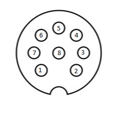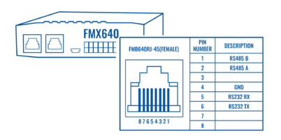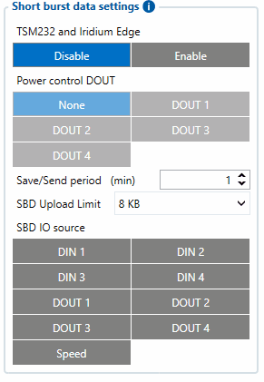When the Iridium edge device is connected ***Power control DOUT*** configures DOUT pin which can control Iridium Edge ON/OFF pin. Configure if DOUT pin is connected. Respective power control DOUT to which the Iridium device's *PIN6* is connected must be selected.

***Save/Send period*** configures how long will FMC650 device wait after losing the signal to generate SBD packet. If the signal is not recovered, it will send it indefinitely (or till the SBD Upload limit is reached, if such is set).

***SBD Upload Limit*** is configurable and resets every month. This option can ensure that no additional data is used so that no unexpected costs are experienced by the customer. The default value is 8000 (for 8KB plan). This option can be disabled by setting the Upload limit to 0. The monthly data usage counter can be reset by using the SMS/GPRS command - **sbdlimitsreset**.

***SBD IO source*** configures IO source which can trigger SBD record saving. 9 elements can generate an Alarm for SDB sending. These elements are:

- Digital input 1
- Digital input 2
- Digital input 3
- Digital input 4
- Digital output 1
- Digital output 2
- Digital output 3
- Digital output 4
- Speed

Configurator parameter IDs and their explanation:

| Parameter ID / | Parameter name | **Values** | Explanation | — | — |
| --- | --- | --- | --- | --- | --- |
| — | — | Min | Max | Default | — |
| 99420 | Iridium Edge | 0 | 1 | 0 | This parameter enables or disables Iridium Edge functionality |
| 99421 | Save/Send period | 0 | 1440 | 1440 | This parameter lets to configure Iridium Edge sending period |
| 99422 | SBD IO source* | 0 | 8 | 0 | SBD IO elements which when enabled are included into the SBD record |
| 99423 | SBD UploadLimit | 0 | 30000 | 8000 | Limit to save user from exceeding the monthly plan. Max limit of 30000 due to 30KB plan. If set to 0 – limit will be off. |
| 99424 | Power control DOUT | 1 | 5 | 0 | Device DOUT which can control ON/OFF pin of the Iridium Edge |
| 151 | RS232 Mode | 0 | 23 | 0 | RS-232 mode selection. "Satellite backup" - 15 |

***** SBD IO source parameter is configured with bitmasks:

- Disabled = 0x00,
- Din1 = 0x01,
- Din2 = 0x02,
- Din3 = 0x04,
- Din4 = 0x08,
- Dout1 = 0x10,
- Dout2 = 0x20,
- Dout3 = 0x40,
- Dout4 = 0x80,
- Speed = 0x100

For example: to enable Din1, Din3 and Dout4: 0x01 + 0x04 + 0x80 = 0x85 convert to decimal --> 133.

More information about SBD can be found here **[Short Burst Data](https://wiki.teltonika-gps.com/view/FMC650_Short_Burst_Data)**.

# Impulse Counters Settings

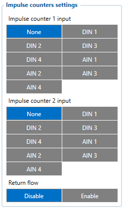Pulse counter functionality enables the FMX640 devices to count digital impulses going to Digital and Analog Inputs. This means that these inputs of the FMX640 devices can now be used for precise fuel flow meter data reading. Impulse based fuel usage monitoring is much more accurate than a different type of fuel metering sensors and it makes the FMX640 devices a perfect solution for high fuel usage machines like cranes, construction vehicles, mining machines, agriculture equipment.

**How does it work?**

When "Impulse Counter 1/2 input" is selected and "Fuel Counter/Impulse Counter 2" IO elements are enabled, device will count every input state change to HIGH and send the counted number with the next record. Pulse counter value is reset after sending the record.

**NOTE**: Impulse Counters feature is available from FW ver. 01.02.02

---

**I/O elements** - Each counter has a corresponding IO elements for "Impulse Frequency" - value in Hz and "Impulse RPM" - impulse count per minute.

[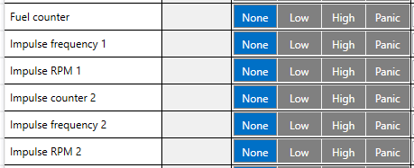](https://wiki.teltonika-gps.com/view/File:Image-2021-09-07-18-10-28-631.png)

---

**Additionally** - some fuel meters have a return flow counter as well:

[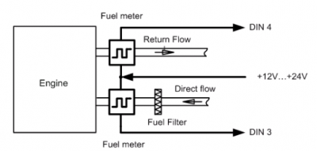](https://wiki.teltonika-gps.com/view/File:400px-FMB640_Impulse_meter.png)

In this case - you can select which inputs are used for direct (*Impulse counter 1*) and return (*Impulse counter 2*) lines and enable "Return Flow" - when this parameter is enabled - "Fuel Counter" IO element will have a value of Direct Flow impulses substracted by Return Flow impulses.

For example:

- Direct Flow=50 impulses.
- Return Flow=10 impulses
- Fuel Counter=40 - if "Return Flow" is enabled.

Note that each Input has a specific requirements for signal frequency and threshold:

| Input | Max frequency (Hz) | Min Voltage threshold (V) |
| --- | --- | --- |
| DIN1 | 50 | 7.5 |
| DIN2 | 30 000 | 2.5 |
| DIN3 | 30 000 | 2.5 |
| DIN4 | 30 000 | 2.5 |
| AIN1 | 10 000 | 2.5 |
| AIN2 | 10 000 | 2.5 |
| AIN3 | 10 000 | 2.5 |
| AIN4 | 10 000 | 2.5 |

<!-- configurator-companions -->

## Configurator notes (EN)

English notes translated from the Configurator tab PDFs, generated **2026-11-05**:

- [`configurator/features.md`](configurator/features.md) — Features: Green Driving, overspeeding, jamming detection and immobilizer.

