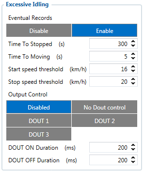
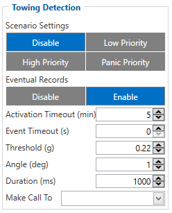
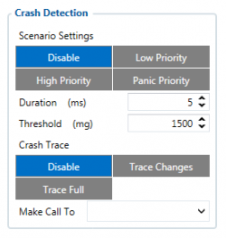

# FMC650 Accelerometer Features settings

# Accelerometer Calibration

Accelerometer auto calibration functionality has one purpose - determine how FMC650 device is mounted in a vehicle. After the calibration process *eco driving* functionality becomes active and calibration data will be used to determine harsh acceleration, braking and cornering events.

There are two conditions when auto calibration takes place:

- If on device startup no calibration was detected;
- If the device receives an SMS/GPRS message with *auto_calibrate:set* text.

After functionality has started FMC650 device periodically checks current appliance GNSS, ignition and movement source parameters and if the conditions match:

- position fix got;
- GNSS speed is zero;
- ignition is ON;
- first calibration vector was not saved yet;

Then first vector is taken. Saved vector will be considered as ground vector and it will be used at further calibration calculations.

*Note: When FMC650 device saves first ground vector vehicle must be parked on flat ground*. Crooked vector may have an impact on further calculations.

Afterwards first ground vector was taken, device analyses conditions:

- position fix got;
- GNSS speed is at least 20 km/h;
- ignition is ON;
- second vector was not saved yet;
- vehicle driving in the same direction with 5⁰ tolerance;
- vehicle speed increase by 7km/h within 1 second.

For next vector. Second vector will be taken if all conditions match. Immediately after second vector is received, it will be multiplied by first (ground) vector, the result of these vectors is vector multiplication cross product which is the right side of a car. By using same vector multiplication method, device front, left side will be calculated. At this point calibration is successfully ended as indication device sends an SMS/GPRS message with *Device is calibrated, to recalibrate send:auto_calibrate:set*.

*Note: SMS/GPRS message will be sent only if auto calibration functionality was triggered by* SMS/GPRS message*.*

For user convenience in case auto calibration functionality fails then notification message will be sent. For exact messages, check algorithm section.

*Note: SMS/GPRS message will be sent only if auto calibration functionality was triggered by* SMS/GPRS message*.*

To get current calibration status *auto_calibrate:get* SMS/GPRS command must be sent to the device. If device is calibrated it will respond with *Calibration state: calibrated* or otherwise *Calibration state: not calibrated*. Also this command returns saved Ground and Side vectors.

After every TRIP START event, device starts shadow calibration. This type of calibration is running in parallel with already saved vectors (this means that vectors does not reset until shadow calibration have both new vectors). After shadow calibration is done, device updates the vector values to the new ones. There are two conditions when shadow calibration does not run at TRIP start event:

- Normal calibration is still running.
- Shadow calibration is still running from previous TRIP event.

To take ground vector these conditions should be met:

- Ignition is ON
- Device got GPS FIX
- Vehicle speed = 0km/h

Device will check these conditions every 1sec until they will pass.

To take side vector these conditions should be met:

- Vehicle speed >= 20km/h
- Device got GPS FIX
- Ignition is ON
- Device angle does not change more than 5 degrees in past 1 sec
- Speed need to increase by 7km/h in 1s period. Device will check these conditions every 1 sec until they will pass.

# Excessive Idling

If ignition (DIN1 or Power Voltage) is ON and the vehicle is not moving, FMC650 will generate the *Excessive Idling* event when the configured time period passes. When vehicle starts moving and configured period of time passes, FMC650 will generate event that vehicle idle time ends. Auto Geofencing option can be configured by the following parameters:

- Time to stopped - scenario is activated until vehicle starts moving and keeps moving (moving is detected only from the accelerometer) for the amount of time that is configured.
- Time to moving - scenario is activated until vehicle stops and stays idle (moving is detected only from the accelerometer) for the amount of time that is configured.
- Start speed threshold - scenario is activated, when the vehicle's speed exceeds the *start speed threshold* value.
- Stop speed threshold - scenario is activated, when the vehicle's speed drops below the *stop speed threshold* value.

Digital output 1 or digital output 2 can be activated for a period of time to warn the driver. Output on-time is configured separately for each feature case. For more information please refer to [DOUT controls](https://wiki.teltonika-gps.com/view/DOUT_controls).

In order for vehicle to enter idling, state ignition has to be ON and at least one of these conditions have to be satisfied:

- detected speed is less than configured speed (Excessive Idling start speed threshold) for configured time duration (Time to stopped timeout);
- no GPS fix AND speed configured as GPS speed in Speed source settings AND no movement detected for configured time duration (Time to stopped timeout);

The vehicle is considered to be leaving the idling state if at least one of these conditions is satisfied:

- if detected speed is greater than configured speed (Excessive Idling stop speed threshold) for configured time duration (Time to moving timeout);
- if for configured time duration (Time to moving timeout) there is no GPS fix AND movement is detected AND speed is configured as GPS speed in Speed source settings;
- if the ignition is not detected for configured time duration (Time to moving timeout).

If the Excessive idling Eventual records parameter is enabled, the event is generated and saved with low priority on every idling state change.

# Towing Detection

*Towing Detection* feature helps to inform the driver about unexpected car movement when it was parked. FMC650 generates an event when car is being towed or lifted, for example, in a case of vehicle evacuation. FMC650 activates towing function when following conditions are met:

1. Ignition (configured Ignition Source) is OFF.
2. *Activation Timeout* is reached.

When towing function is engaged FMC650 monitors accelerometer data. If acceleration *Threshold* or *Angle* reach configured values for a configured *Duration*, and Ignition is still OFF for a period of time that is longer than *Event Timeout*, then an event is generated. When configured, *Make Call To* and *Send SMS To* functions make a call or send an SMS to a predefined phone number. Towing function will be reactivated after FMC650 detects a change of Ignition state from ON to OFF.

# Crash Detection

Scenario is activated when Crash is detected by device using acceleration values.
Crash Detection functionality can be set according to these settings:
1. Threshold (mg)
2. Duration (ms)
If accident happens and FMC650 detects acceleration value higher than set threshold value during set time period, then device will generate an event. Threshold and duration values are set depending of accident power which you want to detect. FMC650 can detect a slight tapping on the device (Threshold=100mg, Duration=1ms) or can detect severe accident (Threshold=4000mg, Duration=5ms).

*Crash trace functionality*
Crash trace functionality collects accelerometer, GNSS data if configured. Collected data holds 10 seconds of information. Output data rate for crash trace is 50 Hz and it is not configurable
0. Disabled,
1. Trace Changes(Enable).

- FMC650 will collect acceleration data for configured trace duration. Every second Acceleration changed more then > 50mG Data will be collected and records generated. If Acceleration does not change, trace will save records with 1second period.

2. Trace Full.

- It doesnt matter if axis changed more then >50mG or not all values will be added in buffer.

*Crash trace data structure*
Data is packed different in Codec 8 and Codec 8E protocols.
Then CODEC8 is being used device will save IO records with 4 elements. Each sample will contain sample data. This means that 500 records will be created to reflect 10 s of data then ODR is 50 Hz.

<!-- configurator-companions -->

## Configurator notes (EN)

English notes translated from the Configurator tab PDFs, generated **2026-11-05**:

- [`configurator/accelerometer-features.md`](configurator/accelerometer-features.md) — Accelerometer Features: harsh-driving thresholds and stationary detection.

