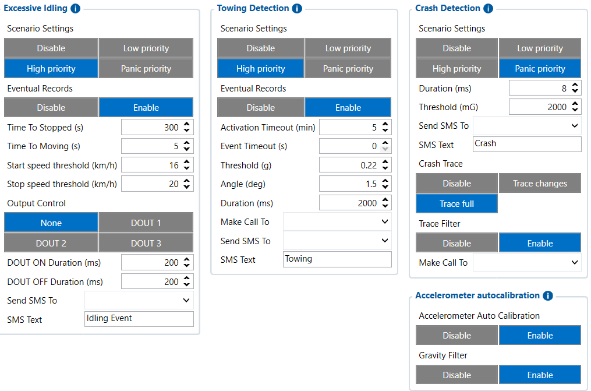

# Accelerometer Features — Configurator notes (EN)

> **Note:** Supplementary notes extracted from the French Configurator tab PDF
> `accelerometres-features-tab.pdf`, generated on
> **2026-11-05T08:37:58Z** — newer than the wiki snapshot kept in
> this folder. The text has been translated to English; it supplements the
> reference page [`accelerometer-features-settings.md`](../accelerometer-features-settings.md).
> The same PDF-extraction quirks apply: section titles sometimes appear
> after the text they introduce, figures reuse page-1
> filenames, and some wide tables are restituted
> row by row because the PDF text layer does not always preserve
> columns. Unarchived `docs.tinolyx.com` image links were
> removed; unique figures are grouped at the end of the file.

<!-- PDF p. 2 -->

Detects situations where the engine runs unnecessarily while the vehicle is stationary.

**Priority and Recording**

Priority : High priority (important event in the AVL history).
Eventual Records : Enable (generates a data record when triggered).
Time and Speed Thresholds

## Accelerometer Features

The FMC650 accelerometer is a built-in physical sensor that continuously measures
acceleration and inclination forces on three axes (X, Y, Z). It allows the device to
detect physical movements without relying solely on the GPS signal (useful in case of signal loss or parking).

### 1. Section Excessive Idling (Excessive Idling)

<!-- PDF p. 3 -->

Time To Stopped / Moving : 300 s (prolonged stop of 5 minutes required) / 5 s
(resumption of movement).
Start / Stop Speed Thresholds : 16 km/h / 20 km/h (logical thresholds to validate the stopped or moving states).

**Output and Alerts**

Output Control : None (no physical DOUT output control configured for this test).
Identifies whether the vehicle is moved or towed while it is parked or switched off.
Trigger Parameters
Activation Timeout : 5 min (arming delay after the vehicle stops).
Threshold : 0.22 g (minimum lateral or longitudinal acceleration threshold required).
Angle : 1.5° (detected angular orientation change).
Duration : 2000 ms (the suspicious movement must persist for 2 seconds).

**Priority and Actions**

Priority : High priority with recording enabled ( Enable ).
SMS / Call : Empty (no immediate alert recipient by call or SMS programmed).
Critical function analysing ultra-fast variations to spot collisions.

**Shock Parameters**

Priority : Panic priority (maximum emergency level).

### 2. Section Towing Detection (Towing / Theft Detection)

### 3. Section Crash Detection (Shock / Accident Detection)

<!-- PDF p. 4 -->

Duration : 8 ms (impact analysis over a micro time window).
Threshold : 2000 mG (i.e. 2 g or about 19.62 m/s² of sudden deceleration/acceleration).
Traces and Analysis
Crash Trace : Trace full (keeps a complete history of the accelerometer data around the impact, ideal for post-accident analysis).
Trace Filter : Enable (cleans spurious data to keep a usable trace).
Accelerometer Auto Calibration : Enable (allows the device to self-calibrate and automatically correct its mounting position or orientation).
Gravity Filter : Enable (separates Earth's gravity from actual vehicle movements to avoid calculation errors).

### 4. General Accelerometer Parameters

## Figures

Unique figures extracted from the PDF. The extraction reuses the same file
names for all pages; each image is therefore referenced only once here.

