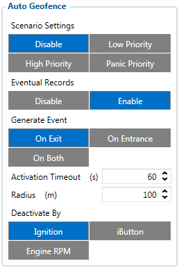

# FMC650 Auto Geofence settings

AutoGeofence – the last known position after movement = off. If your car is being taken away – you can be notified. The shape and size of the geofence zones are configurable. There is a possibility to state whether entering in or out of the geofence triggers an asynchronous message.
Auto Geofencing option can be configured by following parameters:

- Priority – Priority of generated event, which will be applied to saved record.
- Eventual Records - Scenario status will be (or not, if disabled) sent with each AVL

record.
Generate Event:

- On Entrace – Event generation on Geofence entrance.
- On Exit – Event generation on Geofence exit.
- On Both - Event generation on Geofence entrance or exit.
- Activation Timeout – Time period before Geofence is activated after vehicle stops.
- Radius - Radius of circle where in center of it is last coordinates of device when vehicle

engine was running.
Deactivate By:

- Ignition – if ignition becomes high it will drop AutoGeofenze Zone
- iButton – if iButton is attached it will drop AutoGeofence Zone
- Engine RPM - if engine RPM becomes more than zero it will drop AutoGeofence zone

<!-- configurator-companions -->

## Configurator notes (EN)

English notes translated from the Configurator tab PDFs, generated **2026-11-05**:

- [`configurator/auto-geofence.md`](configurator/auto-geofence.md) — Auto Geofence: dynamic geozone creation around the stop position.

