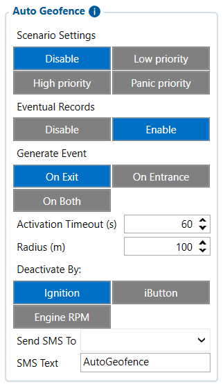

# Auto Geofence — Configurator notes (EN)

> **Note:** Supplementary notes extracted from the French Configurator tab PDF
> `auto-geofence-tab.pdf` (pages 1–2), generated on
> **2026-11-05T08:37:58Z** — newer than the wiki snapshot kept in
> this folder. The text was translated to English; it supplements the
> reference page [`auto-geofence-settings.md`](../auto-geofence-settings.md).
> PDF-extraction quirks: section titles sometimes appear
> after the text they introduce, figures reuse page-1
> filenames, and some wide tables are restituted row by row because
> the PDF text layer does not always preserve the
> columns. Unarchived `docs.tinolyx.com` image links were
> removed; unique figures are grouped at the end of the file. 1 table duplicating the text was omitted.

<!-- PDF p. 2 -->

1. The FMC650 is at a position.

2. It detects a stop situation.

3. After the configured delay, it automatically creates a zone around this position.

4. The device then monitors whether the vehicle leaves or enters this zone.

5. An event may be generated.

6. A deactivation condition then makes it possible to remove/disable this Auto Geofence logic. A geofence (geozone) is a virtual geographic zone defined around a position.

Auto Geofence works dynamically:

## Figures

Unique figures extracted from the PDF. The extraction reuses the same file
names for all pages; each image is therefore referenced only once here.

