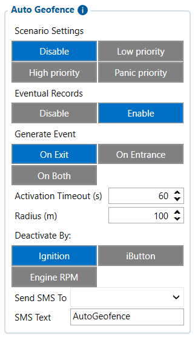

# Manual Geofence — overview — Configurator notes (EN)

> **Note:** Supplementary notes extracted from the French Configurator tab PDF
> `auto-geofence-tab.pdf` (pages 3–5), generated on
> **2026-11-05T08:37:58Z** — newer than the wiki snapshot kept in
> this folder. The text was translated to English; it supplements the
> reference page [`manual-geofence-settings.md`](../manual-geofence-settings.md).
> PDF-extraction quirks: section titles sometimes appear
> after the text they introduce, figures reuse page-1
> filenames, and some wide tables are restituted row by row because
> the PDF text layer does not always preserve the
> columns. Unarchived `docs.tinolyx.com` image links were
> removed; unique figures are grouped at the end of the file.

<!-- PDF p. 3 -->

Unlike Auto Geofence (which is created dynamically around the last stop position), Manual Geofence allows fixed geographic zones to be saved in advance directly in the internal memory of the FMC650 device.
Operation: The device continuously analyzes its GNSS position and checks whether its coordinates are inside or outside the predefined geozones, without depending exclusively on calculations from the remote server (such as Wialon).
Capacity: The FMC650 allows configuring several fixed geographic zones (multiple geofences depending on firmware versions).

### 1. Overview and Principle of Manual Geofences

### 2. Scenario Settings Section (Activation and Priority)

<!-- PDF p. 4 -->

Defines whether monitoring of manual zones is active and what level of importance is assigned to crossing events.
Possible values:
Disable (Function disabled)

**Low priority / High priority / Panic priority**

Meaning: Allows classifying the alert sent to the server when the vehicle enters or leaves the programmed zone.
Geometrically delimits the monitoring zone on the map.
Supported geometric shapes: Generally Circle type (defined by a center point and a radius in meters) or Rectangle (defined by coordinates of opposite corners).
GPS coordinates (Latitude / Longitude): Exact anchor point of the zone in space. Unlike Auto Geofence, these values must be entered manually by the administrator.
Determines the exact behavior that generates a record or an alert:
On Exit: Triggers the event when the vehicle leaves the predefined geozone.
On Entrance: Triggers the event when the vehicle enters the zone.
On Both: Generates an event in both situations (on entry and on exit).

### 3. Shape and Coordinates Section (Shape and Coordinates)

### 4. Generate Event Section (Trigger Rule)

### 5. Notifications and Outputs Section (SMS / DOUT)

<!-- PDF p. 5 -->

Output Control: Allows linking the crossing of the manual zone to the activation of a physical output (DOUT 1, DOUT 2, etc.) to trigger, for example, a horn or an on-board device.
SMS / Call Settings: Allows associating a custom alert text (e.g. Restricted Zone) and a recipient number to receive a direct SMS in the event of a zone violation.
Note for your project with Wialon: In a modern telematics architecture, the creation and management of geofences are almost always delegated directly to Wialon Local, which offers a cartographic interface infinitely more flexible and powerful than the limited memory of an on-board device. The use of geofences integrated in the FMC650 remains relevant mainly for "standalone mode" type scenarios where the device must trigger a local physical action (cut-off, relay, alarm) even in the event of a total loss of connection with the server.

## Figures

Unique figures extracted from the PDF. The extraction reuses the same file
names for all pages; each image is therefore referenced only once here.

