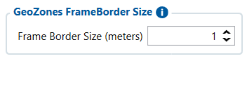

# Manual Geofence Settings — Configurator notes (EN)

> **Note:** Supplementary notes extracted from the French Configurator tab PDF
> `manual-geofence-settings-tab.pdf`, generated on
> **2026-11-05T08:37:58Z** — newer than the wiki snapshot kept in
> this folder. The text was translated to English; it supplements the
> reference page [`manual-geofence-settings.md`](../manual-geofence-settings.md).
> PDF-extraction quirks: section titles sometimes appear
> after the text they introduce, figures reuse page-1
> filenames, and some wide tables are restituted row by row because
> the PDF text layer does not always preserve the
> columns. Unarchived `docs.tinolyx.com` image links were
> removed; unique figures are grouped at the end of the file.

<!-- PDF p. 2 -->

of a depot;
of a construction site;
of a factory;
of a parking lot;
of a restricted zone;
of a customer;
Parameter: GeoZones Frame Border Size
Current value: 1 m
Meaning: Safety margin (hysteresis zone) applied
directly to the boundary line of a manual geofence.
of a port.

### 1. Single Parameter Extracted

Manual Geofence
A geofence is a geographically defined virtual zone.
For example, you can create a zone around:

<!-- PDF p. 3 -->

Role: Prevents unwanted state flips (Inside/Outside) caused
by slight inaccuracies and fluctuations of the GPS signal when a vehicle
is parked or driving on the boundary line.
What it does (Advantage): Guarantees crossing detection as close as possible to the actual line of the zone.
Its limits (Disadvantage): With a very low value of 1 m, the system
remains sensitive to GPS noise, poor GNSS reception or vehicles
parked on the edge.
What it IS NOT: It is not the radius (Radius) of the zone. It does not change
the actual size of the geofence (a radius of 500 m with a Border Size of 1 m does not make 501 m).

### 2. Details and Nuances on this Parameter

## Figures

Unique figures extracted from the PDF. The extraction reuses the same file
names for all pages; each image is therefore referenced only once here.

