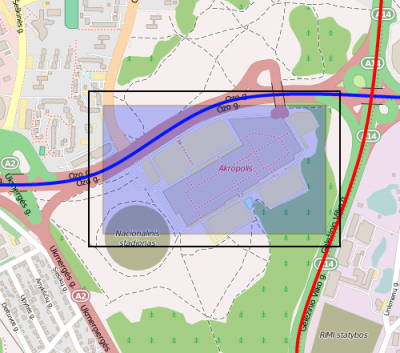
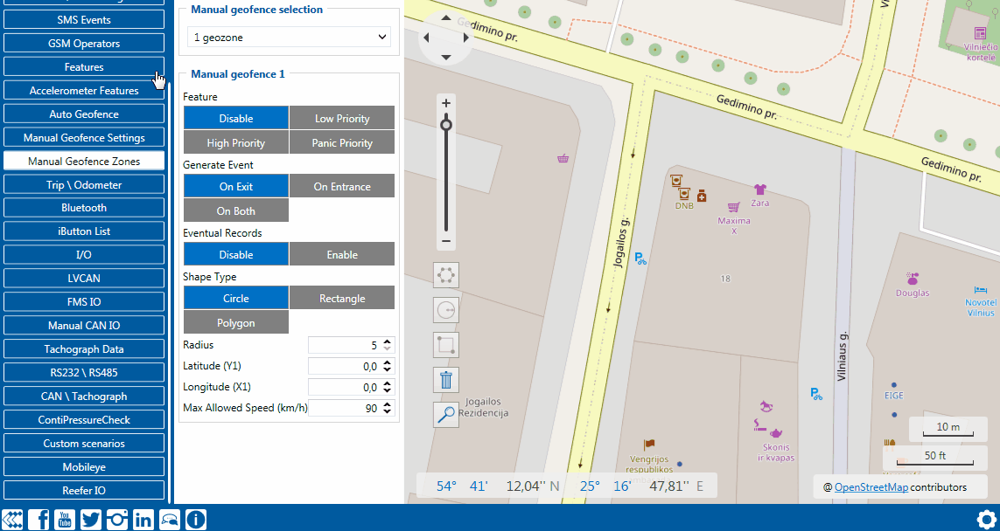

# FMC650 Manual Geofence settings

FMC650 has 100 configurable Geofence zones and it can generate an event when a defined Geofence zone border is crossed.
*Frame border* is an additional border around Geofence zone used to prevent false events when object stops on the border of the area and as a result records are made inside and outside the defined area because of GNSS errors. The event is generated only when both (Geofence and frame) borders are crossed. See figure to the right for details: blue track is considered to have entered the area while red track is not.*Shape* can be a rectangle or a circle as defined by the user.Priority of Geofence event is categorized into Low, High or Panic levels. These levels define the priority of event information that is sent to the server. For more details about priorities look in [I/O settings section](https://wiki.teltonika-gps.com/view/FMC640_I/O_settings).*Generate event* allows to choose when record will be generated.*Eventual records* controls where scenario status value appears: when disabled it will exist in each AVL record and when enabled the value will be appended only to eventual records.*OverSpeeding* helps to configure OverSpeeding scenarios separately for each different *Geozone*. Regular OverSpeeding and geozones' OverSpeeding function independently. If digital output control is enabled in a regular OverSpeeding scenario, geozones OverSpeeding scenario will control it too i.e when the device is in more than one geozone and OverSpeeding is detected in any zone then the digital output turns on. Digital output turns off only when OverSpeeding is not detected anywhere.*X1* is used to set geofence zone left bottom corner X coordinate (longitude) while *Y1* is used to set Y coordinate (latitude).*X2* or *R* are used to set accordingly geofence zone upper right corner X coordinate (longitude) when Rectangular zone is used or circle radius when Circular zone is used. *Y2* sets geofence zone upper right corner Y coordinate (latitude) for a Rectangular zone.

Rectangle Geofence

<!-- configurator-companions -->

## Configurator notes (EN)

English notes translated from the Configurator tab PDFs, generated **2026-11-05**:

- [`configurator/manual-geofence-overview.md`](configurator/manual-geofence-overview.md) — Manual Geofence — overview: fixed geozone principles, priorities, shapes, events and outputs.
- [`configurator/manual-geofence-settings.md`](configurator/manual-geofence-settings.md) — Manual Geofence Settings: GeoZones Frame Border Size parameter and GPS hysteresis.

