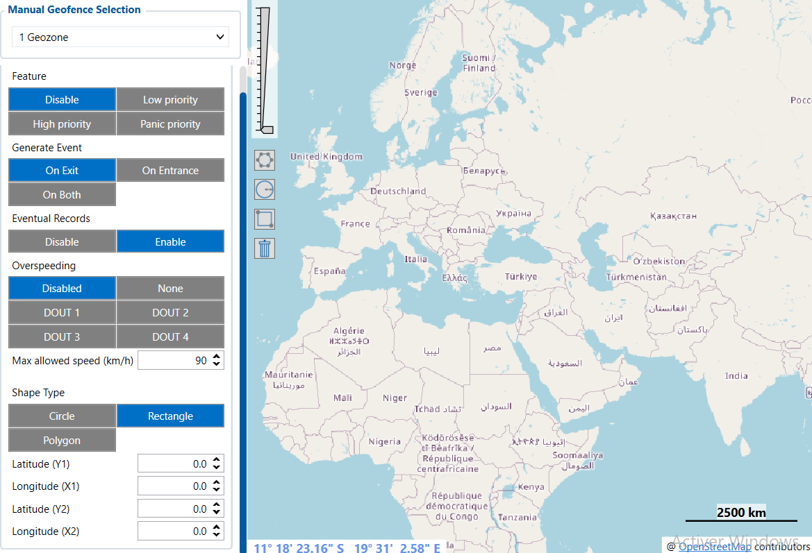

# Manual Geofence Zones — Configurator notes (EN)

> **Note:** Supplementary notes extracted from the French Configurator tab PDF
> `manual-geofence-zones-tab.pdf`, generated on
> **2026-11-05T08:37:58Z** — newer than the wiki snapshot kept in
> this folder. The text was translated to English; it supplements the
> reference page [`manual-geofence-zones.md`](../manual-geofence-zones.md).
> PDF-extraction quirks: section titles sometimes appear
> after the text they introduce, figures reuse page-1
> filenames, and some wide tables are restituted row by row because
> the PDF text layer does not always preserve the
> columns. Unarchived `docs.tinolyx.com` image links were
> removed; unique figures are grouped at the end of the file.

<!-- PDF p. 2 -->

Parameter: Manual Geofence Selection
Current value: 1 Geozone
Meaning: Number of the zone currently being viewed or configured.

## Manual Geofence Zones

A Manual Geofence Zone is a geographic zone that you define yourself
in the FMC650 from GPS coordinates and a geometric shape.
It can then be used to trigger events when the device detects that the
vehicle enters or leaves the zone.

### 1. Details of the Parameters and their Role

<!-- PDF p. 3 -->

Role: Allows navigating between the different fixed zones saved in the
device (e.g.: Zone 1 = Depot, Zone 2 = Construction site).
Parameter: Feature
Current value: Disable (Options: Disable, Low priority, High priority, Panic priority)
Meaning: Activation state and priority level of the geofence.
Role: Activates monitoring of the zone and defines the importance of the alert sent
to the server when an event occurs (Disable = function completely turned off).
Parameter: Generate Event
Current value: On Exit (Options: On Entrance, On Exit, On Both)
Meaning: Event trigger condition.
Role: Determines when the alert should be sent (here, only when the vehicle leaves the perimeter).
Parameter: Eventual Records
Current value: Enable (Options: Disable, Enable)
Meaning: Recording of geolocation data.
Role: Forces the device to create and save a point/history (AVL Record) in
its memory when crossing, in order to use it on a platform such as
Wialon.
Parameter: Overspeeding
Current value: Disabled (Options: Disabled, None, DOUT 1 to 4)
Meaning: Control of speeding internal to the zone and assignment
of a physical output.
Role: Activates speed monitoring specifically in this zone and allows
triggering a digital output (e.g.: alarm or horn via DOUT) in case
of excess.
Parameter: Max allowed speed
Current value: 90 km/h

<!-- PDF p. 4 -->

Meaning: Maximum authorized speed threshold in the zone.
Role: Sets the limit not to be exceeded. (Note: Inactive as long as Overspeeding is set to Disabled).
Parameter: Shape Type
Current value: Rectangle (Options: Circle, Rectangle, Polygon)
Meaning: Geometric shape of the zone.
Role: Defines the drawing mode of the zone on the map.
Parameter: Coordinates (Latitude Y1/Y2, Longitude X1/X2)
Current value: 0.0 / 0.0
Meaning: GPS anchor points of the opposite corners of the rectangle.
Role: Delimits the exact geographic location of the zone. (Note: 0.0 indicates that no real zone has been drawn yet).

## Figures

Unique figures extracted from the PDF. The extraction reuses the same file
names for all pages; each image is therefore referenced only once here.

