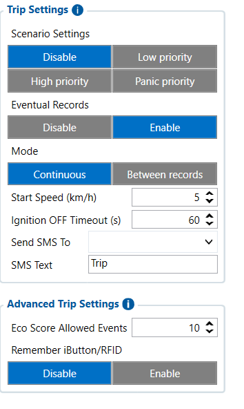

# Trip / Odometer — Configurator notes (EN)

> **Note:** Supplementary notes extracted from the French Configurator tab PDF
> `tripodometer-tab.pdf`, generated on
> **2026-11-05T08:37:58Z** — newer than the wiki snapshot kept in
> this folder. The text was translated to English; it supplements the
> reference page [`trip-odometer-settings.md`](../trip-odometer-settings.md).
> PDF-extraction quirks: section titles sometimes appear
> after the text they introduce, figures reuse page-1
> filenames, and some wide tables are restituted row by row because
> the PDF text layer does not always preserve the
> columns. Unarchived `docs.tinolyx.com` image links were
> removed; unique figures are grouped at the end of the file.

<!-- PDF p. 2 -->

General parameters governing automatic detection and trip priority.

## Trip/Odometer

The Trip Settings section concerns the detection and tracking of trips made by the
vehicle.
A Trip corresponds to a period during which the vehicle is considered to be
making a movement, from the start of the trip to its end.

### 1. Trip Scenario Configuration (Trip Settings)

<!-- PDF p. 3 -->

**Scenario Settings**

Meaning: Activation state and urgency level assigned to trip
events.
Options: Disable (standby), Low priority, High priority, Panic priority.
Role: Enables or disables global trip tracking on the FMC650 and sets the priority
for transmitting packets to the server (Disable = function off).

**Mode**

Meaning: Method for calculating and evaluating movement.
Options: Continuous, Between records.
Role: Defines whether the trip is evaluated continuously as long as the vehicle is
moving (Continuous) or whether it is split according to recording intervals.

**Eventual Records**

Meaning: Generation of specific AVL data during trip
events.
Options: Disable, Enable.
Role: Forces the creation and saving of a GPS point in memory at the exact
moment of the start (Trip Start) and end (Trip End) of the trip.
Parameters defining the physical criteria that start or end a trip.

**Start Speed**

Meaning: Minimum speed threshold to validate the start of a trip.
Current value: 5 km/h.
Role: Determines from what speed the device switches the vehicle status to
"Trip in progress".
**Ignition OFF Timeout**

### 2. Trigger Conditions and Stop Threshold (Trip Triggers & Timeouts)

<!-- PDF p. 4 -->

Meaning: Stop confirmation delay after the engine ignition is turned off (Ignition OFF).
Current value: 60 s.
Role: Prevents prematurely closing a trip during a temporary stop (e.g.
traffic lights or short stop) by waiting for the defined duration before validating the end of the
trip.
Parameters dedicated to sending direct text messages in the event of a trip-related event.

**Send SMS To**

Meaning: Recipient phone number for alerts.
Current value: [Empty].
Role: Receives the SMS notification when the scenario is triggered (inactive if the field is empty).

**SMS Text**

Meaning: Text content of the message sent.
Current value: Trip.
Role: Defines the raw message transmitted by SMS.
Advanced parameters associated with driver assignment and driving behavior tracking.

**Eco Score Allowed Events**

Meaning: Number of eco-driving events taken into account in the calculation
of the score.
Current value: 10.

### 3. SMS Notifications and Alerts (SMS Settings)

### 4. Driving Analysis and Identification (Advanced Trip Settings)

<!-- PDF p. 5 -->

Role: Serves as a variable in the driving evaluation algorithm (acceleration, braking and sharp turns) during the trip.

**Remember iButton/RFID**

Meaning: Memorization of the driver identifier.
Options: Disable, Enable.
Role: Associates or not the scanned identification badge (iButton/RFID) with the
current trip to link the driver to the journey (Disable = no association).

## Figures

Unique figures extracted from the PDF. The extraction reuses the same file
names for all pages; each image is therefore referenced only once here.

