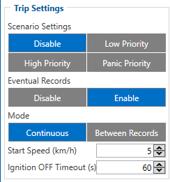
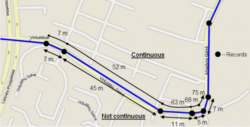
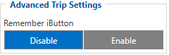

# FMC650 Trip/Odometer settings

# Trip Settings

Trip window offers user to configure Trip feature. Trip customizable feature enables user extended monitoring of performed trips (from engine start at present location to engine stop at arrived location), log their start and stop points, view driven total distance. Event will be generated (included into send records) only when trip starts and finishes.
Start Speed (km/h) – GPS speed has to be greater than the specified Start Speed in order to detect Trip Start.
Ignition OFF Timeout (s) – timeout to wait if ignition (configured ignition source) was off, to detect Trip stop.
Distance counting mode – Between Records or Continuous can be chosen. For this feature I/O Trip Odometer must be enabled.
If I/O Trip Odometer is enabled and Continuous distance counting variable (Mode) is set to Continuous, Trip distance is going to be counted continuously (from Trip start to Trip stop). This value is written to I/O Trip Odometer value field. When Trip is over and next Trip begins, Trip Odometer value is reset to zero. When the next trip starts counting continuously starts from the beginning again.
If I/O Trip Odometer is enabled and Continuous Distance Counting variable (Mode) is set “Between Records”, then the distance is going to be counted only between every record made. This value is written to I/O Trip Odometer value field and reset to zero every new record until Trip stops. If later all Odometer values are summed up manually, the user gets the distance driven during the whole period of the Trip.

# Advanced Trip Settings

**Remember iButton functionality.** If *Remember iButton* and *Trip* parameters are enabled, ignition is on and iButton is attached then FMC650 remembers iButton ID. iButton ID is saved and sent to the server with every record. If new iButton is attached during the *Trip*, FMC650 remembers new iButton ID. FMC650 forgets iButton ID after ignition is off and ignition timeout is reached.

<!-- configurator-companions -->

## Configurator notes (EN)

English notes translated from the Configurator tab PDFs, generated **2026-11-05**:

- [`configurator/trip-odometer.md`](configurator/trip-odometer.md) — Trip / Odometer: trip counters, odometer and reset.

