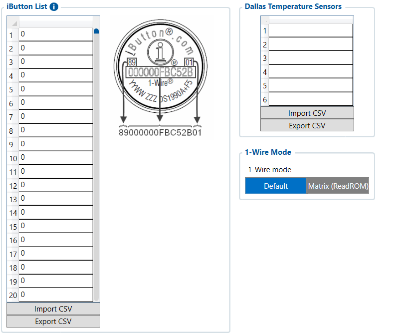

# Authorization ID List (iButton) — Configurator notes (EN)

> **Note:** Supplementary notes extracted from the French Configurator tab PDF
> `authorization-id-list-tab.pdf`, generated on
> **2026-11-05T08:37:58Z** — newer than the wiki snapshot kept in
> this folder. The text was translated to English; it supplements the
> reference page [`ibutton-list-settings.md`](../ibutton-list-settings.md).
> PDF-extraction quirks: section titles sometimes appear
> after the text they introduce, figures reuse page-1
> filenames, and some wide tables are restituted row by row because
> the PDF text layer does not always preserve the
> columns. Unarchived `docs.tinolyx.com` image links were
> removed; unique figures are grouped at the end of the file.

<!-- PDF p. 2 -->

1. Reliably identify which driver takes the wheel.

Link the driver identifier to the recorded trips.
Feed the anti-start logic (Immobilizer) by refusing to start
if the presented iButton is not in the authorized list.
Driver Security and Access Control (iButton):

2. Declare the wired temperature probes installed in the trailer or refrigerated body.

Ensure the exact assignment of temperature readings (°C) to the correct
storage locations in the truck.
Cold Chain Traceability (Dallas Sensors):

3. Transmit the identification codes (drivers or probes) to the management platform to generate the eco-driving, working hours or legal temperature compliance reports.

Report the identifiers back to Wialon:

## Authorization ID List

The Authorization ID List tab is used to record and filter all devices physically connected
by cable via the FMC650 1-Wire bus. It fulfills two distinct strategic functions:

<!-- PDF p. 3 -->

Storage locations and management tools for identifying people.
iButton List (Slots 1 to 20)
Meaning: Memory locations for recording the unique identifiers
(hex codes) of driver identification keys.
Current value: [All at 0 / Empty].
Role: Serves as a whitelist of authorized keys to identify who is driving
or to authorize vehicle starting.
**Import CSV / Export CSV (iButton)**

### 1. Driver Key Management (iButton List)

<!-- PDF p. 4 -->

Meaning: Transfer of the iButton identifier list by file.
Role: Allows quickly injecting or extracting the list of authorized drivers in
the fleet without manual entry.
Identification locations for physical 1-Wire sensors.

**Dallas Temperature Sensors (Slots 1 to 6)**

Meaning: Locations reserved for recording the unique hardware identifiers
of 1-Wire temperature probes (DS18B20 / Dallas).
Current value: [All empty].
Role: Associates the physical identifier of a probe with a specific logical location
(e.g. Probe #1 = Front compartment / Probe #2 = Rear compartment).
Configuration of the communication protocol of the 1-Wire hardware bus.

**1-Wire Mode**

Meaning: Query mode of the 1-Wire data bus.
Options: Default, Matrix (ReadROM).
Role: Default activates the standard auto-detected read protocol of
1-Wire devices. Matrix (ReadROM) is a specific mode for addressing and
raw reading of the components' ROM.

### 2. Wired Temperature Probes (Dallas Temperature Sensors)

### 3. Bus Operating Mode (1-Wire Mode)

## Figures

Unique figures extracted from the PDF. The extraction reuses the same file
names for all pages; each image is therefore referenced only once here.

