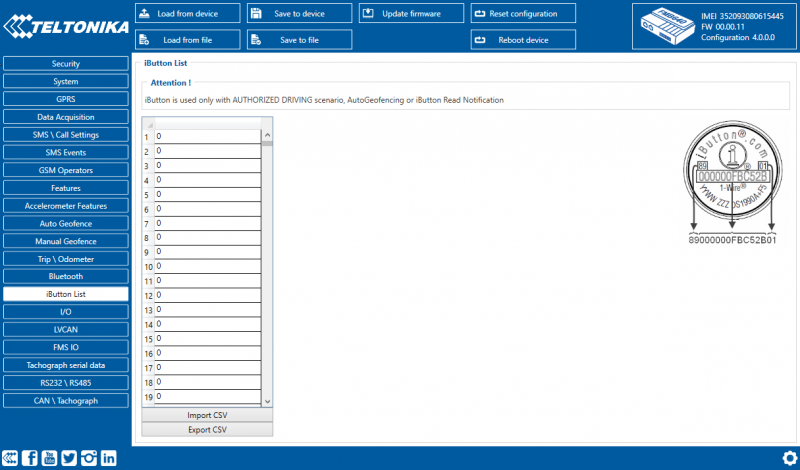

# FMC650 iButton List settings

IButton list is used to enter authorized iButton ID codes, which are used to authenticate driver in Immobilizer/Autohorized driving, iButton Read Notification scenarios as well as in Auto Geofencing.

IButton value must be entered as it is written on it. User can save 1000 iButtons to .csv file and read them from same file using Import CSV and Export CSV buttons. User can also enter iButton key ID in iButton ID list by attaching iButton key to reader then connecting reader to device after that click ‘copy ID’ and paste iButton key in iButton ID list.

<!-- configurator-companions -->

## Configurator notes (EN)

English notes translated from the Configurator tab PDFs, generated **2026-11-05**:

- [`configurator/authorization-id-list.md`](configurator/authorization-id-list.md) — Authorization ID List (iButton): authorized iButton identifiers and immobilizer.

