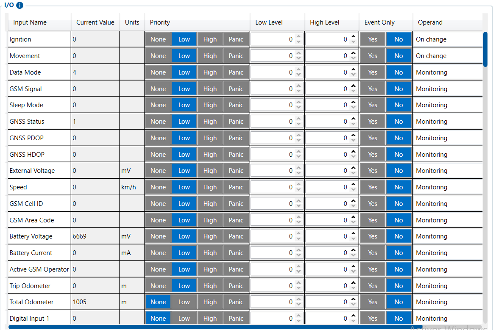

# I/O — Configurator notes (EN)

> **Note:** Supplementary notes extracted from the French Configurator tab PDF
> `io-tab.pdf`, generated on
> **2026-11-05T08:37:58Z** — newer than the wiki snapshot kept in
> this folder. The text was translated to English; it supplements the
> reference page [`io-settings.md`](../io-settings.md).
> PDF-extraction quirks: section titles sometimes appear
> after the text they introduce, figures reuse page-1
> filenames, and some wide tables are restituted row by row because
> the PDF text layer does not always preserve the
> columns. Unarchived `docs.tinolyx.com` image links were
> removed; unique figures are grouped at the end of the file.

<!-- PDF p. 2 -->

1. Declare and structure data: Define which signals (physical, virtual, CAN-bus, 1-Wire) the device must listen to, smooth and record.

2. Trigger the alert logic: Configure the precise conditions (On Change, threshold crossing) that must trigger the generation of an event.

3. Manage the data footprint and priority: Adjust the sending frequency and priority of AVL packets in order to optimize SIM data consumption while ensuring that critical alerts are immediate.

4. Feed the Wialon platform: Prepare and format each parameter so that it is correctly transmitted via the Teltonika AVL protocol and decoded by Wialon as sensors usable in your reports (fuel level, temperature, door status, eco-driving, etc.).

## I/O

The I/O (Inputs/Outputs) tab is the processing and mapping heart of the FMC650. It is mainly used to:

<!-- PDF p. 3 -->

Definition of the configuration columns that govern the recording and sending of each
input/output.

**Priority**

Meaning: Priority level assigned to data transmitted in AVL packets.
Options: Disable, Low, High, Panic.
Role: Sets the urgency of sending the data to the server (Low = transmitted during standard periodic sends; High / Panic = triggers an immediate send).

**Operand & Levels (Low / High Level)**

Meaning: Logical conditions and trigger thresholds of an event.

### 1. Input/Output Processing Control (I/O General Mechanics)

<!-- PDF p. 4 -->

Options: On Change, Hysteresis, On Entrance, On Exit, Monitoring.
Role: Defines when to trigger an alert: on a state change (On Change), when a value crosses a threshold (Low/High Level), or in simple continuous monitoring (Monitoring).

**Event Only**

Meaning: Restriction of data sending to only the moments when
the event occurs.
Options: No, Yes.
Role: If set to Yes, the data is included in AVL packets only when a
specific event is triggered (to reduce data volume). If No, it
is sent at every periodic point.

**Averaging Const**

Meaning: Smoothing/filtering constant of the measurement.
Current values: 1 (instantaneous), 3, 10 (filtered).
Role: Applies a moving average to eliminate electrical noise or
sudden variations (e.g. wave in the tank for fuel, voltage variations).
Internal sensors, physical inputs/outputs and vehicle electrical status.

**Ignition & Movement**

Meaning: Engine ignition and vehicle movement states.
Role: Fundamental logical indicators (0/1) for detecting trip start/end,
engine hours and "Stopped/Moving" status.

**External Voltage & Battery Voltage / Current**

Meaning: Truck battery voltage and internal backup battery status.

### 2. Hardware and System Inputs & Outputs (Hardware & System I/O)

<!-- PDF p. 5 -->

Role: Monitoring the health of the main battery, detection of power cut
or startup, and management of internal charging.
Digital Inputs (DIN 1 to 4) & Digital Outputs (DOUT 1 to 4)
Meaning: 4 logic inputs (all-or-nothing) and 4 control outputs.
Role: The DINs read states (SOS button, door contact, ignition). The
DOUTs allow the device to actuate external equipment (ignition cut-off relay, siren, indicator light).

**Analog Inputs (AIN 1 to 4)**

Meaning: 4 analog inputs (voltage measurement 0-10V or 0-30V).
Role: Convert continuous electrical signals into usable values (e.g.
pressure probes, custom analog gauges).
Additional wired peripherals and advanced telematics.

**LLS Fuel Level & Temperature (LLS 1 to 5)**

Meaning: Level and temperature measured by capacitive fuel probes
(Liquid Level Sensors).
Role: Report the exact fuel volume and its temperature to detect
refueling and fuel thefts.

**Ultrasonic Sensors (UL202 / UL212)**

Meaning: Measurements from ultrasonic fuel level sensors.
Role: Allow measuring the height or volume of fuel from the bottom
of the tank without drilling.

**1-Wire Temperature / Humidity & iButton / RFID**

Meaning: Temperature/humidity sensors and identification badges
connected to the 1-Wire bus.

### 3. Fuel, Probes and Identification (Sensors & Peripherals)

<!-- PDF p. 6 -->

Role: Cold chain traceability and unique identification of the driver at the
wheel.

**Impulse Frequency / RPM (1 to 4)**

Meaning: Fast pulse counters and rotation speed converters.
Role: Evaluate engine speeds or flow rates from sensors generating
pulse frequencies.
Hardware health data and three-dimensional measurements.

**GSM Signal, Connectivity Quality & GNSS HDOP/PDOP**

Meaning: Indicators of mobile network power and satellite
positioning accuracy.
Role: Diagnostic tools to explain communication losses or evaluate
the geographic accuracy of positions.

**Axis X, Y, Z & PCB Temperature**

Meaning: 3-axis accelerometer and FMC650 motherboard temperature.
Role: Analysis of driving behavior (braking, acceleration, sharp turns), shock/accident detection, and internal thermal monitoring of the
device.

### 4. Diagnostics, Quality and Telemetry (Diagnostics & Accelerometer)

## Figures

Unique figures extracted from the PDF. The extraction reuses the same file
names for all pages; each image is therefore referenced only once here.

