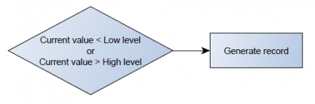
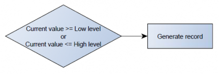
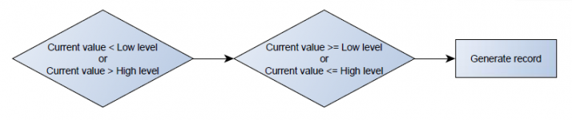
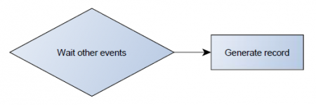
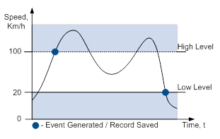
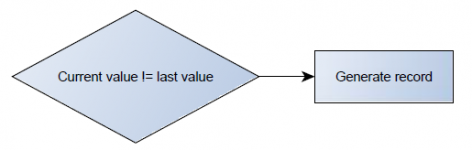
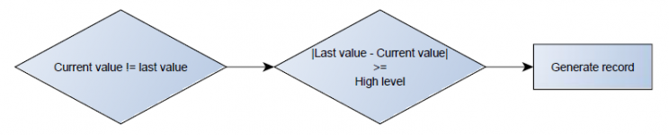
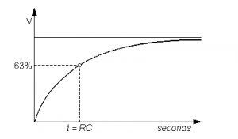

# FMC650 I/O settings

When no I/O element is enabled, AVL packet comes with GNSS information only. After enabling I/O element(s) AVL packet contains current value(s) of enabled I/O element(s) along with GNSS information.If the device is connected to configurator all current I/O values are displayed in *Current Value* column.*Priority* field allows enabling I/O elements and setting them a priority so they are added to the data packet, which is sent to the server. By default 10 I/O elements with low priority are enabled: *Ignition*, *Movement*, *Data Mode*, *GSM Signal*, *Sleep Mode*, *GNSS Status*, *GNSS PDOP*, *GNSS HDOP*, *External Voltage* and *Speed*. *Priority* level (AVL packet priority) can be Low, High or Panic. All records made by FMC640 are regular, and regular packets are sent as low priority records. When *Low priority* event is triggered, FMC640 makes an additional record with an indication that the event was caused by an I/O element change (depending on *Operand* configuration). When *High priority* is selected, module makes an additional record with high priority flag and sends event packet immediately to the server using GPRS. *Panic priority* triggers same actions as *High priority*, but if GPRS fails, it sends an AVL packet using SMS data if SMS data sending is enabled and the number is provided in *SMS/Call Settings*.*High* and *Low* levels define I/O value range. If I/O value enters or exits this range, FMC640 generates an event. *Operand* parameter defines when to generate event: *On Exit*, *On Entrance*, *On Both*, *On Hysteresis* or *On Delta Change*.When *Event Only* is selected, I/O element status value will be appended only to eventual records, otherwise I/O element status value will appear in each AVL record.

# Operands

## Operand On Exit

Record is generated when input value leaves a range between low and high level limits.

## Operand On Entrance

---

Record is generated when input value enters a range between low and high level limits.

## Operand On Both

---

Record is generated by both On Exit and On Entrance operands' logic at same time.

## Operand Monitoring

---

No event at all. Values are recorded only when other triggers worked.

## Operand On Hysteresis

---

Record is generated when input value crosses the high limit value from below the low limit value or vice versa.

## Operand On Change

---

Record is generated when input value changes.

## Operand On Delta Change

---

Record is generated when input value changes and the absolute change becomes equal to or higher than the limit value.

# Avg Const

If *Avg Const* value is 10, new value must be present for 1 second to register the change to a new value. Internal sampling is done every 40 ms, so 25 samples are taken per second. To configure 5 seconds of averaging multiply 10 by 5 yielding 50 as *Avg Const* value. The same logic works if the device is in Deep Sleep mode.Averaging follows RC exponential curves, see image below:

For Boolean values of 5, values is used, that means value change is taken when new values is averaged to more than 99.3%.

***NOTE: Average Constant is not used as an activation timer or delay timer. But it is used as a filter.***

Event is generated at different times due to variations in voltage. Average constant is designed to filter jumps instead of event generation time.

For example: generation is set to happen at 14500mV, and actual voltage is set to 15000mV, that record will be generated earlier than 10s with avg const set to 100. This is because avg const is calculating time it takes for device to get to actual voltage (in this case 15000 mV), while device will be generating records when it hits 14500mV.

<!-- configurator-companions -->

## Configurator notes (EN)

English notes translated from the Configurator tab PDFs, generated **2026-11-05**:

- [`configurator/io.md`](configurator/io.md) — I/O: inputs/outputs, pulses, DOUT outputs and calibration.

