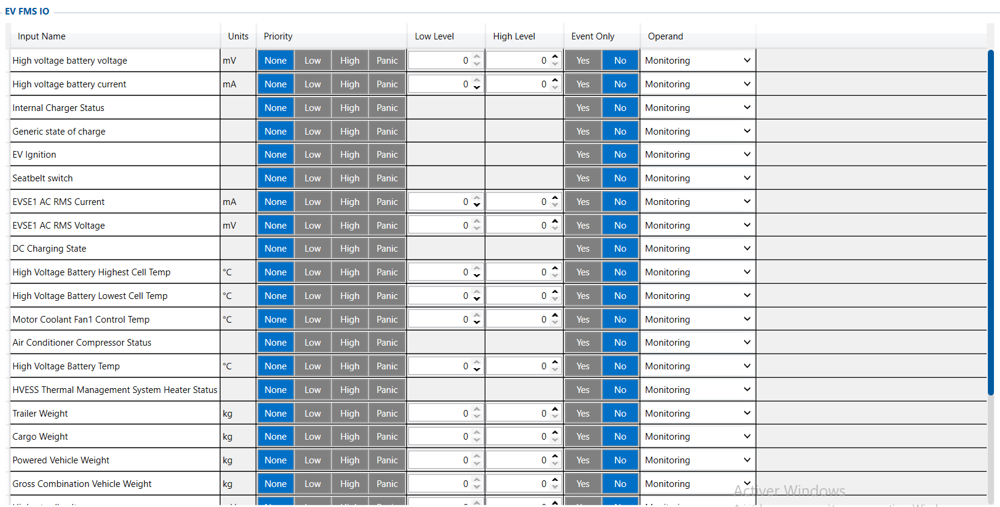

# EV FMS I/O — Configurator notes (EN)

> **Note:** Supplementary notes extracted from the French Configurator tab PDF
> `ev-fms-io-tab.pdf`, generated on
> **2026-11-05T08:37:58Z** — newer than the wiki snapshot kept in
> this folder. The text was translated into English; it supplements the
> reference page [`lvcan-fms-tachograph-data-elements.md`](../lvcan-fms-tachograph-data-elements.md).
> PDF-extraction quirks: section titles sometimes appear
> after the text they introduce, figures reuse page-1
> filenames, and some wide tables are restituted row by row because the PDF
> text layer does not always preserve columns. Unarchived `docs.tinolyx.com`
> image links were removed; unique figures are grouped under `## Figures` at
> the end of the file.

<!-- PDF p. 2 -->

1. Replace thermal telemetry: Substitute fuel/oil level/exhaust pressure notions with the equivalent variables of the electrical world (SOC, SOH, HV voltage/current, cell temperatures).

2. Measure the impact of auxiliaries on range: Analyse the share of energy consumed by air conditioning, battery preheating and engine cooling compared with pure traction.

3. Optimize fleet charging: Report to Wialon the exact state of charge, the remaining charging time and the quality of the power delivered by the charging station (AC/DC).

4. Calculate load and actual range: Cross-check the gross combined weight ( GCVW) and the payload (Cargo Weight) with the SOC to plan trips compatible with the battery pack capacity.

## EV FMS IO

The EV FMS IO tab is the extension of the FMS standard (J1939) specifically dedicated to
electric vehicles (trucks, buses, utility vehicles). It is mainly used to:

<!-- PDF p. 3 -->

Essential electrical indicators for monitoring electric traction and charging sessions.

**Generic State of Charge (SOC) & HVESS State of Health (SOH)**

Meaning: Current state of charge (%) and overall state of health of the traction
battery (%).
Role: Equivalent of the fuel gauge (SOC) and of the structural
wear/degradation of the battery (SOH).

**High Voltage Battery Voltage & Current**

Meaning: Overall voltage (mV) and current intensity (mA) of the high-voltage
battery pack.
Role: Measures the instantaneous power absorbed (acceleration) or fed back
(regenerative braking), as well as the stability of the electrical network.

**Highest / Lowest Cell Temp & Highest / Lowest Cell Voltage**

Meaning: Extreme temperatures (°C) and extreme voltages (V) of the individual
battery cells.
Role: Detection of cell imbalances and prevention of thermal runaway
risks (Thermal Runaway).
EVSE1 AC RMS Current / Voltage & DC Charging State / Internal Charger Status
Meaning: Voltage/current measured on the charging station side, DC fast
charging status and AC on-board charger status.
Role: Real-time monitoring of charging cycles, detection of charging station
failures and monitoring of absorbed energy.
Useful charging data adapted to electric road trains and industrial vehicles.
Gross Combination Vehicle Weight (GCVW) & Powered Vehicle Weight

### 1. High-Voltage Battery Telemetry & Charging (HV Battery & Charging)

### 2. EV Mass & Tractive Forces (EV Mass & Heavy Duty Metrics)

<!-- PDF p. 4 -->

Meaning: Gross combined vehicle weight (truck + trailer combination, in kg)
and weight of the towing vehicle (kg).
Role: Calculation of the total laden mass to adjust the forecast
energy consumption and avoid overloads.

**Cargo Weight & Trailer Weight**

Meaning: Weight of the goods transported (kg) and specific weight of the
trailer (kg).
Role: Enables traceability of the net payload transported relative to the
battery's remaining capacity.
Management of secondary systems with a high impact on range.

**HVESS Estimated Remaining Distance**

Meaning: Estimated remaining range (km) calculated by the vehicle.
Role: Anticipate charging needs en route and avoid running out of energy ( Range Anxiety).

**HVESS Thermal Management System Heater Status & Motor Coolant Fan1 Temp**

Meaning: Status of the battery preheating system and control of the
engine cooling fan.
Role: Monitoring of the pack's thermal regulation (essential in very cold or very hot weather to maintain charging efficiency).

**Air Conditioner Compressor Status & Propulsion System Active**

Meaning: State of the air-conditioning/heating compressor and status of the
electric traction system.
Role: Isolate the consumption related to cab comfort from the energy
dedicated to movement.
EV Ignition, Seatbelt Switch & HVESS Total Energy Throughput

### 3. Auxiliary Components, Thermal & Safety (Auxiliaries & Thermal)

<!-- PDF p. 5 -->

Meaning: Electrical contact, seatbelt switch and total cumulative energy
that has passed through the battery.
Role: Driver safety and accounting of energy wear over the vehicle's
life cycle.
Settings applied by default to the electrical section.

**Priority, Operand, Event Only & Levels**

Meaning: Processing in passive monitoring mode ( Priority = None , Operand = Monitoring , Event Only = No ).
Role: These parameters are ready to receive CAN bus telemetry without generating
specific interrupts or emergency alerts in the current configuration.

### 4. Processing & Signal Parameters (Processing)

## Figures

Unique figures extracted from the PDF. The extraction reuses the same
filenames for all pages; each image is therefore referenced only once here.

