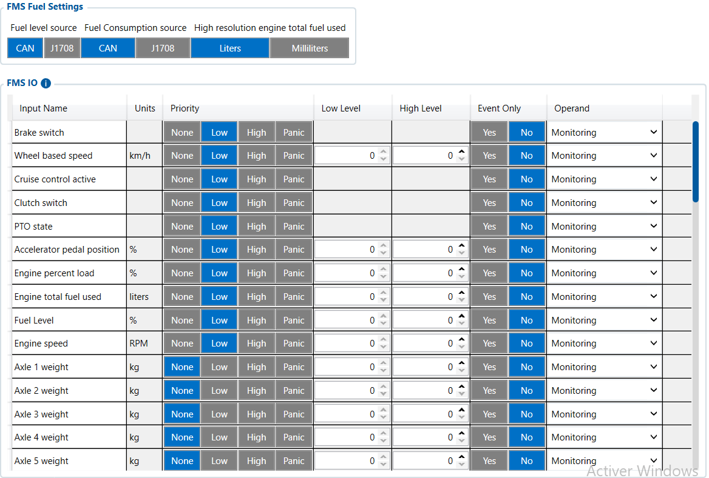

# FMS I/O — Configurator notes (EN)

> **Note:** Supplementary notes extracted from the French Configurator tab PDF
> `fms-io-tab.pdf`, generated on
> **2026-11-05T08:37:58Z** — newer than the wiki snapshot kept in
> this folder. The text was translated into English; it supplements the
> reference page [`lvcan-fms-tachograph-data-elements.md`](../lvcan-fms-tachograph-data-elements.md).
> PDF-extraction quirks: section titles sometimes appear
> after the text they introduce, figures reuse page-1
> filenames, and some wide tables are restituted row by row because the PDF
> text layer does not always preserve columns. Unarchived `docs.tinolyx.com`
> image links were removed; unique figures are grouped under `## Figures` at
> the end of the file.

<!-- PDF p. 2 -->

1. Leverage the universal heavy-truck standard: Unlike LVCAN, which uses an intermediate adapter, FMS applies the official standard adopted by the major manufacturers (Volvo, Scania, MAN, DAF, Mercedes-Benz, Iveco, Renault) to deliver harmonized data without risk to the vehicle warranty.

2. Centralize weight and high-precision fuel data: This is the preferred channel for obtaining exact consumption in litres and per-axle loads ( Axle Weight ) without adding external sensors.

3. Optimize driver behaviour: Transmit direct variables to Wialon (braking, accelerator, over-revving, cruise control) to calculate a reliable eco-driving score.

4. Report vehicle health to Wialon: Provide dashboard warning lights ( Tell Tale ), tyre pressure, oil temperatures and AdBlue level for preventive maintenance.

## FMS IO

The FMS I/O tab (Fleet Management System Input/Output) is the core of decoding
standardized FMS manufacturer data (SAE J1939) for heavy trucks and buses. It is
mainly used to:

<!-- PDF p. 3 -->

General parameters setting the data sources and the unit of measurement for
energy management.

**Fuel Level Source & Fuel Consumption Source**

Meaning: Choice of the acquisition channel for fuel level and
consumption.
Current value: CAN .
Role: Tells the FMC650 to read the data directly on the standardized FMS
CAN bus (rather than via a J1708 interface or an analog probe).

**High Resolution Engine Total Fuel Used**

Meaning: Unit of measurement for the high-precision consumed fuel
counter.
Current value: Liters .

### 1. Fuel Source and Units (FMS Fuel Settings)

<!-- PDF p. 4 -->

Role: Defines the precision (e.g. in litres or millilitres) of the fuel volume accumulated
since the engine was first started.
Core data for fleet management, mechanical diagnostics and environmental monitoring.

**Combined Vehicle Weight & Axle 1–15 Weight**

Meaning: Total combined vehicle weight and load applied to each
axle (from 1 to 15).
Role: Recording of the actual weight transmitted by the manufacturer's on-board weighing system to
avoid overloads and control freight volume. (Currently at - / inactive).
Engine Total Fuel Used, Fuel Level (1 & 2), Fuel Rate & Instantaneous Fuel

**Economy**

Meaning: Cumulative consumption, main and
secondary tank levels, instantaneous flow rate and energy efficiency.
Role: Enables detailed modelling of fuel expenditure, detection of theft
while stopped and analysis of trip efficiency.

**Engine Speed (RPM), Engine Percent Load & Accelerator / Brake Pedal Position**

Meaning: Engine speed, engine load percentage and
accelerator/brake pedal positions.
Role: Dynamic assessment of driving style (eco-driving, detection of sudden braking, over-revving and excessive loads).

**Engine Total Hours of Operation & Service Distance**

Meaning: Engine operating hours counter and distance
remaining before the next service.
Role: Automated preventive maintenance planning based on actual
engine wear rather than on the calendar alone.
Engine Coolant / Oil Temperature, Engine Oil Pressure & Transmission Oil Temp

### 2. Heavy Truck Telemetry & Engine Diagnostics (Vehicle & Engine Metrics)

<!-- PDF p. 5 -->

Meaning: Coolant and oil (engine/gearbox) temperatures
and oil pressure.
Role: Monitoring of the vehicle's vital signs to anticipate major
failures and the risk of engine damage.

**AdBlue Status & AdBlue Level**

Meaning: Operating state of the SCR system and AdBlue tank
level.
Role: Prevention of vehicle immobilization in the event of a shortage of the emissions-limiting
reagent (Euro 5/6 standards).
Information on auxiliary equipment and vehicle dynamics.

**PTO State & PTO Drive Engagement**

Meaning: Activation and mechanical engagement state of the power take-off
(Power Take-Off).
Role: Measurement of the usage duration of auxiliary equipment (hydraulic units, outriggers, mixer drums, pumps).

**Tire Location & Tire Pressure**

Meaning: Exact location and pressure level of each tyre (TPMS).
Role: Early detection of slow punctures and prevention of
overconsumption due to under-inflation (Configured in On change mode to alert as soon as a change occurs).

**Brake Switch, Clutch Switch, Cruise Control Active & Wheel Based Speed**

Meaning: Status of the brake switch, clutch, cruise
control and wheel-measured speed.
Role: Fine analysis of manoeuvres and cross-checking of the actual wheel speed
with the GNSS satellite speed.
Engine MIL Indicator, DTC / Diagnostics & Tell Tale ID0–ID4

### 3. Safety, Auxiliary Components & Tyres (Safety, PTO & TPMS)

<!-- PDF p. 6 -->

Meaning: Engine malfunction indicator lamp (MIL), fault codes and dashboard
warning lights.
Role: Immediate reporting of dashboard alerts to the tracking
platform.
Rules configured for the acquisition and filtering of FMS inputs/outputs.

**Priority**

Meaning: Priority levels for sending the data ( Low for most FMS parameters).
Role: Classifies data when generating frames to the server (a Low priority does not affect data accuracy).

**Operand & Event Only**

Meaning: Tracking mode (mainly Monitoring , except for oil pressure and tyre pressure switched to On change ).
Role: Determines whether the parameter is read continuously ( Monitoring ) or whether it triggers the
sending frame as soon as its value changes ( On change ).

**Low Level / High Level & Averaging Const**

Meaning: Alert thresholds ( 0 ) and averaging filtering ( empty ).
Role: No numeric threshold or time smoothing is configured at this level; the
raw data from the FMS CAN bus is kept as is.

### 4. Data Management and Processing Rules (Processing & Thresholds)

## Figures

Unique figures extracted from the PDF. The extraction reuses the same
filenames for all pages; each image is therefore referenced only once here.

