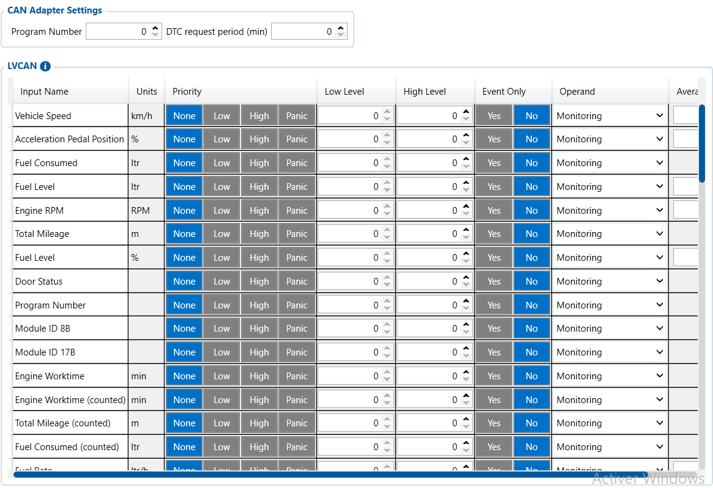

# LVCAN — Configurator notes (EN)

> **Note:** Supplementary notes extracted from the French Configurator tab PDF
> `lvcan-tab.pdf`, generated on
> **2026-11-05T08:37:58Z** — newer than the wiki snapshot kept in
> this folder. The text was translated into English; it supplements the
> reference page [`lvcan-fms-tachograph-data-elements.md`](../lvcan-fms-tachograph-data-elements.md).
> PDF-extraction quirks: section titles sometimes appear
> after the text they introduce, figures reuse page-1
> filenames, and some wide tables are restituted row by row because the PDF
> text layer does not always preserve columns. Unarchived `docs.tinolyx.com`
> image links were removed; unique figures are grouped under `## Figures` at
> the end of the file.

<!-- PDF p. 2 -->

1. Replace external physical sensors: Retrieve the manufacturer's original data directly (dashboard odometer, fuel level, engine temperature, weight on axles) without adding third-party probes.

2. Standardize multi-brand telematics: Translate proprietary CAN frames from various truck or machine manufacturers into a unified data format.

3. Provide complex business data: Handle advanced use cases such as winter road maintenance (salt spreaders), agricultural tracking or payload weight.

4. Report real data back to Wialon: Transmit official vehicle variables (not extrapolated by the GPS) to your Wialon server to generate accurate reports on consumption, eco-driving and equipment care.

## LVCAN

The LVCAN tab is the interface dedicated to decoding data from the vehicle's CAN-Bus /
FMS network via a dedicated Teltonika adapter. It is mainly used to:

<!-- PDF p. 3 -->

General parameters governing the software and hardware connection between the CAN adapter and the
FMC650.

**Program Number**

Meaning: Identification code of the CAN decoding profile/program.
Current value: 0 .
Role: Specifies the vehicle's make, model and year so that the LVCAN
adapter knows which decoding grid to use ( 0 = no profile selected / inactive).

**DTC Request Period**

Meaning: Polling interval for engine diagnostic trouble codes (Diagnostic Trouble Codes).

### 1. CAN Adapter Configuration (CAN Adapter Settings)

<!-- PDF p. 4 -->

Current value: 0 min .
Role: Sets the frequency at which the unit asks the vehicle's ECU to
report diagnostic errors ( 0 = no automatic polling).
Essential data for operational tracking, eco-driving and fleet maintenance.

**Total Mileage (Standard & Counted)**

Meaning: Odometer / Total mileage of the vehicle.
Role: Reports the exact distance displayed on the dashboard to synchronize
maintenance intervals and trip data (the Counted version being recalculated by the unit).

**Fuel Level (L & %) & Fuel Consumed / Rate**

Meaning: Tank level (litres/percentage), total consumption and
instantaneous flow rate.
Role: Allows analysis of energy efficiency, cost per kilometre and identification of
abnormal drops (fuel theft).

**Engine RPM, Engine Load & Pedale Position**

Meaning: Engine speed (rpm), engine load (%) and accelerator pedal
position (%).
Role: Key indicators for analysing driving behaviour (detection of over-revving, heavy loads and idling time).

**Axle 1 to 5 Load & Load Weight**

Meaning: Load applied to each axle (kg) and total payload weight.
Role: Monitors the truck's payload, avoids regulatory overloads and
optimizes freight distribution.
**Engine Worktime, Engine Temperature & Oil Level**

### 2. Heavy Truck Telemetry & Speed (Vehicle & Fleet Metrics)

<!-- PDF p. 5 -->

Meaning: Engine operating hours, coolant temperature and
oil level.
Role: Essential for preventive vehicle maintenance and detection of
overheating risks.
Business telemetry parameters dedicated to agricultural, road-maintenance or handling machinery.

**Agricultural Machinery Flags & Harvesting Parameters**

Meaning: Harvesting time, worked area, grain volume/moisture,
drum speed.
Role: Activity logging for combine harvesters and agricultural machinery in order
to measure yield per hectare.

**Salt Spreader Parameters (Amount of Spread Salt/Calcium/Gravel...)**

Meaning: Spreading quantities and widths of salt, calcium, gravel or sand,
and salting distance.
Role: Legal traceability of snow-clearing and winter road maintenance
operations.

**Arm Movement (Slope / Rotation / Height)**

Meaning: Tilt, rotation, ejection and height of the mechanical arm.
Role: Activity tracking for tipper trucks, auxiliary cranes or construction machinery
with an articulated arm.
Smoothing settings and vehicle diagnostic elements.
DTC Faults & Fault Codes

### 3. Specialized Equipment (Agri, Winter Maintenance & Arm)

### 4. Processing & Diagnostics Parameters (Processing & Diagnostics)

<!-- PDF p. 6 -->

Meaning: ECU error codes transmitted over the CAN network.
Role: Reporting of engine warning lights and error codes for technical intervention
before a breakdown that immobilizes the vehicle.

**Door Status, VIN & Battery Level/Voltage**

Meaning: Door open state, manufacturer serial number (VIN) and
vehicle battery health.
Role: Unique vehicle identification and cab/trailer securing.

**Priority, Operand, Averaging Const & Levels**

Meaning: Data management rules (Priority None , Monitoring mode , Filtering 10 ).
Role: Defines how the FMC650 filters CAN network noise before generating
the sending frame.

## Figures

Unique figures extracted from the PDF. The extraction reuses the same
filenames for all pages; each image is therefore referenced only once here.

